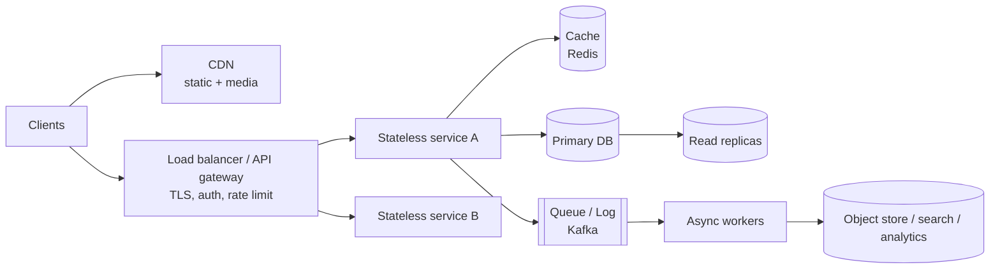

# 00 · The HLD Playbook: how to answer any system design question

Every case study in this folder uses the same 6-step structure. Practise the structure until it's automatic; then each problem is just filling in the blanks.

---

## 1. The 45-minute timeline

```
 0-5   1. REQUIREMENTS        functional (3-5 core features) + non-functional (scale, latency, availability, consistency)
 5-10  2. ESTIMATION          QPS (avg + peak), storage/year, bandwidth, cache size  ->  what is the bottleneck?
10-15  3. API + DATA MODEL    the 3-5 endpoints; the main tables/keys and access patterns
15-25  4. HIGH-LEVEL DESIGN   boxes and arrows: clients -> LB -> services -> caches/queues -> stores
25-40  5. DEEP DIVES          the 2-3 hardest parts (the interviewer usually picks), e.g. fan-out, hot keys, ordering
40-45  6. TRADE-OFFS          what you chose and why; bottlenecks; failure modes; what you'd do at 10x
```

**Senior signals:** you drive the conversation; you state assumptions with numbers; you name trade-offs before being asked; you know *why* a component is there, not just its name; you design for failure (what happens when X dies?).

---

## 2. Step 1: requirements

**Functional:** list the verbs. *"Users post, follow, and see a feed of followees' posts ordered by recency."* Explicitly cut the rest: *"Out of scope: ads, search, DMs."*

**Non-functional (always ask/state):**

| Property | Question | Typical answer |
|---|---|---|
| Scale | DAU? read:write ratio? | 100M DAU, 100:1 reads |
| Latency | p99 target? | feed < 200 ms, redirect < 50 ms |
| Availability | how many nines? | 99.99% (52 min downtime/year) |
| Consistency | stale reads OK? for how long? | feed: eventual (seconds); payments: strong |
| Durability | can we lose data? | messages/payments: never; analytics: some |

---

## 3. Step 2: back-of-the-envelope estimation (see `Estimation.java`)

**Numbers to know by heart**

| Thing | Value |
|---|---|
| seconds/day | ~86,400 ≈ **10⁵** |
| 1M requests/day | ≈ **12 QPS** |
| 1B requests/day | ≈ **12K QPS** |
| peak | ≈ **2–3× average** |
| 1 char / 1 int / 1 long | 1–2 B / 4 B / 8 B |
| a tweet-sized row | ~300 B – 1 KB |
| a photo | ~200 KB–2 MB |

**Latency numbers (orders of magnitude)**

| Operation | Time |
|---|---|
| L1 cache / main memory reference | 1 ns / 100 ns |
| read 1 MB sequentially from memory | ~10 µs |
| SSD random read | ~100 µs |
| round trip within a datacenter | ~0.5 ms |
| read 1 MB sequentially from SSD | ~1 ms |
| disk seek (HDD) | ~10 ms |
| round trip across continents | ~150 ms |

**What one box can do (rough, to sanity-check)**

| Component | Order of magnitude |
|---|---|
| stateless web/app server | 1K–10K req/s |
| Redis (single node) | ~100K ops/s |
| MySQL/Postgres (single primary, simple queries) | ~1K–10K writes/s, more reads |
| Kafka broker | ~100K–1M msgs/s |
| Cassandra node | ~10K writes/s |

**The point of estimating:** decide *what matters*. 12 QPS needs one box; 1M QPS of reads needs caching and replicas; 100 TB needs sharding.

---

## 4. Step 3: API and data model

- **API**: REST resources (or RPC) with the important parameters: pagination cursors, idempotency keys, auth. 3–5 endpoints, not 20.
- **Data model**: the main entities, their keys, and **access patterns** (queries). Choose storage from the access patterns:

| Access pattern | Fits |
|---|---|
| relations, transactions, ad-hoc queries | SQL (Postgres/MySQL) |
| huge write volume, key or partition+range lookups | wide-column (Cassandra/ScyllaDB/Bigtable) |
| simple key → value, very fast | KV (DynamoDB, Redis) |
| flexible documents | document store (MongoDB) |
| full-text / relevance search | Elasticsearch |
| big immutable blobs | object storage (S3) + CDN |
| time-series metrics | TSDB (Prometheus/InfluxDB) |
| graph traversals | graph DB (or adjacency tables + caching) |

---

## 5. Step 4: the standard building blocks



Each box has a reason to exist; say it:
- **Load balancer**: spreads load, removes dead instances (health checks), terminates TLS.
- **Stateless services**: any instance can serve any request, so you scale by adding instances.
- **Cache**: absorbs the read-heavy part; cuts latency from ms to sub-ms.
- **Replicas**: read scaling and failover. **Sharding**: write and storage scaling.
- **Queue**: decouples, absorbs spikes, enables async and retries.
- **CDN**: serves static/media content from the edge.

---

## 6. Step 5: deep-dive checklist (pick what the problem stresses)

| Topic | Questions to answer | Fundamentals folder |
|---|---|---|
| Scaling the hot path | stateless? cache? replicas? | 01, 03 |
| Data growth | partition key? hot partitions? resharding? | 02 |
| Consistency | where do we need strong vs eventual? | 05 |
| Async work | queue? ordering? delivery semantics? | 04 |
| APIs | pagination, idempotency, rate limits | 06 |
| Failure | node death, network partition, retries, thundering herd | all |

---

## 7. Step 6: trade-offs and failure modes (always end here)

- "I chose **fan-out on write** for normal users because reads dominate 100:1, but **fan-out on read** for celebrities to avoid 50M writes per post."
- "**Eventual consistency** on the feed is acceptable; a post appearing 2 seconds late is fine. For the payment ledger I'd need strong consistency."
- Failure walk-through: *cache dies* → DB load spike → protect it with request coalescing + rate limits; *a region goes down* → failover with DNS; replication lag means some data loss bounded by the RPO.
- **10× question:** where does it break first? (usually the DB write path or a hot key) and how do you fix it?

---

## 8. Interview Q&A: general HLD

**Q1. Vertical vs horizontal scaling?**
Vertical = a bigger machine: simple, but capped and a single point of failure. Horizontal = more machines: unbounded and fault-tolerant, but it needs statelessness, load balancing, and data partitioning.

**Q2. How do you decide SQL vs NoSQL?**
From access patterns and scale: relations, transactions and flexible queries → SQL (it scales further than people think, with replicas, partitioning, Vitess/Citus). Massive write throughput with simple key/range access → wide-column/KV. Many systems use both.

**Q3. How do you estimate QPS quickly?**
Daily actions ÷ 10⁵ seconds = average QPS; × 2–3 for peak. Example: 100M users × 10 reads/day = 10⁹/day ≈ 12K QPS average, ~30K peak.

**Q4. Where do caches go?**
Client → CDN → API gateway (response cache) → application (Redis/memcached) → DB buffer pool. Cache the hottest read path closest to the user that still meets the freshness requirements.

**Q5. When do you introduce a message queue?**
When work doesn't need to finish within the request (emails, fan-out, analytics), to absorb spikes, to decouple producers from consumers, or to retry failures without blocking users.

**Q6. Strong vs eventual consistency: how do you choose?**
Per data type: money, inventory and uniqueness constraints need strong consistency; feeds, likes counts and analytics tolerate eventual. Mention read-your-writes as a cheap middle ground users notice.

**Q7. What's the first thing that breaks at 10× load?**
Usually the single write primary, a hot partition/key, or an uncached fan-out. Answer with the specific mitigation: shard, add a cache, go async, rate-limit, or change the data model.

**Q8. How do you design for failure?**
Redundancy (N+1 instances, replicas, multi-AZ), timeouts + retries with backoff + jitter, circuit breakers, idempotent operations, bulkheads, graceful degradation (serve stale data), and monitoring + alerts.

**Q9. How do you handle a hot key?**
Replicate it in local caches with a short TTL, split it (key#1..key#N), use request coalescing, or precompute. For write hot keys, shard the counter and aggregate.

**Q10. How deep should the estimation go?**
Deep enough to drive decisions (do we need sharding? how much cache? how many servers?), with round numbers. State assumptions and move on: 2–3 minutes.

---

Run the calculator: `java Estimation.java`. It works through the estimates used by the case studies (URL shortener, chat, feed) with every assumption commented.
