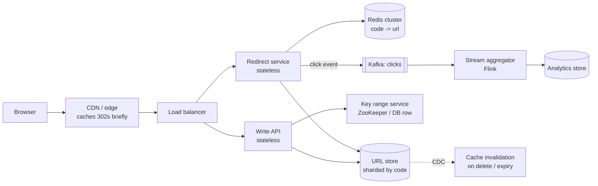

# HLD 07 · URL Shortener (bit.ly) at Scale

> Case study. The full interview answer in the 6-step format. The class-level design (base62, collisions, aliases, expiry) is [LLD 05](../../LLD/05-URL-Shortener/); this is the **system**: estimates, id generation across servers, storage and sharding, the read path through CDN/Redis/DB, analytics, and failure handling.
> Simulation: [`UrlShortenerHld.java`](UrlShortenerHld.java). Run with `java UrlShortenerHld.java` (11 checks).

---

## 1. Requirements
**Functional:** shorten a long URL (optional custom alias, optional expiry); redirect short → long; basic click analytics; delete own links.
**Non-functional:** redirect p99 < 50 ms globally; 99.99% available for redirects (writes can be slightly less); codes unique and hard to enumerate; durable (links live for years).
**Out of scope:** user management details, link preview, spam ML (mention a hook).

## 2. Estimation

| Assumption | Number |
|---|---|
| new URLs/day | 100M → **~1.2K writes/s** |
| read:write | 100:1 → **~116K redirects/s avg, ~350K peak** |
| record size | ~500 B (code, long URL, owner, created, expiry) |
| retention | 10 years → 365B URLs → **~180 TB** → sharding |
| code space | 62⁷ = 3.5T > 365B ✓ (7 chars) |
| hot cache | 20% of a day's reads ≈ **~1 TB** → a Redis cluster |
| redirect fleet | ~500 instances at 1K QPS each, 70% utilisation |

## 3. API
```
POST   /api/v1/urls        {longUrl, alias?, expiresAt?}   Idempotency-Key header -> 201 {code, shortUrl}
GET    /{code}                                              -> 302 Location: longUrl   (404 / 410 expired)
GET    /api/v1/urls/{code}/stats?from&to                    -> click counts
DELETE /api/v1/urls/{code}                                  -> 204 (owner only)
```

## 4. Data model
- `urls`: **code (PK)**, long_url, owner_id, created_at, expires_at. A KV / wide-column store (DynamoDB, Cassandra) **sharded by hash(code)**: every redirect is one key lookup on one shard (the simulation: an even spread over 16 shards).
- `urls_by_owner`: (owner_id, created_at) → code, for "my links" (a secondary table / GSI).
- `clicks_agg`: (code, minute) → count, in an analytics store (ClickHouse / Druid / Bigtable).

## 5. Architecture



## 6. Deep dives

### 6.1 Unique short codes without a bottleneck
- **Range leases (Key Generation Service):** each write server leases a block of 10,000 ids from a coordinator, then counts locally → base62.
- Simulation: 20 servers, ~100 random crashes, 1M ids → **0 duplicates**, only **172 coordinator calls**. Crashed servers waste the rest of their block (41% of the id space skipped here), which is harmless with 3.5T codes; make blocks smaller if you care.
- **Make codes non-enumerable:** pass the counter through a Feistel / format-preserving permutation before base62.
- **Alternatives:** hash(longUrl) + collision retries (natural dedupe); random codes + conditional insert. The DB's conditional insert is the final uniqueness guarantee either way.

### 6.2 The read path (350K QPS)
- **CDN → Redis → DB.** URL popularity is a power law; the simulation of 2M Zipf redirects over 1M URLs gives CDN 52%, Redis 24%, DB 23% with small caches, and the DB share drops as Redis grows (300K entries → 17%). Over a longer horizon, hit ratios are higher because the hot set stays hot. The cold long tail still reaches the DB, but each is a **single-key read on one shard**, which is cheap and horizontally scalable with replicas.
- Cache entries get a TTL plus explicit invalidation on delete/expiry (CDC → delete key). Negative-cache unknown codes (with a Bloom filter) to stop scanners.

### 6.3 301 vs 302
A 301 is cached by browsers forever, so later clicks never reach you (the simulation: 1 of 10 clicks seen). Use **302/307** to keep analytics, expiry and abuse takedowns working. Cache at the CDN with a short TTL to get most of the load benefit.

### 6.4 Analytics without slowing redirects
The redirect service emits a click event to Kafka **asynchronously** (fire-and-forget with a local buffer). A stream job aggregates per (code, minute) (the simulation: 10,000 out-of-order events → 9 buckets, none lost) and writes to an OLAP store. Use event time with windows and watermarks for late events.

### 6.5 Expiry and deletion
Store `expires_at`; the redirect checks it (410 Gone); a TTL index or background job purges. Deletion invalidates caches (CDC) and the CDN (purge API).

## 7. Trade-offs and failure modes
- **KGS down:** servers still have leased blocks (minutes of runway); run the coordinator HA (a ZooKeeper/etcd quorum or a DB with failover).
- **Redis down:** the DB sees full read traffic, so protect it with rate limiting + request coalescing, keep Redis replicated across AZs, and let the CDN absorb the hottest links.
- **A shard down:** replicas take over; the codes on it are briefly unavailable; that's acceptable at 99.99% with fast failover.
- **A hot viral link:** the CDN plus near caches; it's a read-only hot key, which is the easy case.
- **Abuse:** rate-limit creation per user/IP ([LLD 04](../../LLD/04-Rate-Limiter/)), malware URL scanning asynchronously, takedown via delete + purge.
- **Multi-region:** redirect reads served regionally from replicated stores (eventual consistency is fine: a new link visible after ~1 s elsewhere), writes to a home region, or ids partitioned by region bits.

## 8. Interview Q&A

**Q1. Why not hash the long URL and take 7 characters?**
Collisions are guaranteed at scale (birthday bound), so you need check-and-retry with salts. A counter with range leases gives uniqueness without retries. Hashing is fine if you want natural dedupe.

**Q2. How do you scale reads to 350K QPS?**
Stateless redirect servers, CDN caching of 302s with short TTLs, a Redis cluster for hot codes, and a sharded KV store with replicas for the long tail.

**Q3. SQL or NoSQL for the URL table?**
The access pattern is a single-key lookup and an insert, with no joins and huge volume: a KV/wide-column store fits naturally. SQL works too if sharded by code (Vitess), especially when owner queries matter more.

**Q4. How do you prevent two servers generating the same code?**
Disjoint id ranges from a coordinator (each id used once), or conditional inserts (fail on an existing key) with retry for random/hash codes.

**Q5. How would you support custom aliases?**
Insert with the alias as the key using put-if-absent; reserve system words; validate the charset; rate-limit. Conflicts return 409.

**Q6. How do you handle analytics at 350K clicks/s?**
Async events to Kafka, partitioned by code; streaming aggregation into time buckets; OLAP storage. The redirect never waits on analytics.

**Q7. How do you clean up expired links?**
Check on read (410), plus TTL indexes (DynamoDB TTL / Cassandra TTL) or a periodic job; purge caches and the CDN on expiry or delete.

**Q8. How do you make codes not guessable?**
Permute counter ids with a keyed bijection (Feistel), or use random codes with conditional inserts. Never expose raw sequential ids for private links.

**Q9. What breaks first at 10×?**
Redirect QPS on the cache tier (add Redis shards, more CDN caching) and analytics ingestion (more partitions). Writes (12K/s) and storage (sharded) scale linearly.

**Q10. Multi-region design?**
Regional read replicas/caches serve redirects locally; writes go to a primary region or use region-partitioned id ranges so every region can generate codes independently without conflicts.

## 9. Common mistakes
- Synchronous analytics in the redirect path.
- 301 when analytics or expiry matter.
- A single global counter row hammered per request.
- Hash prefixes treated as unique.
- No plan for the cache going down.
