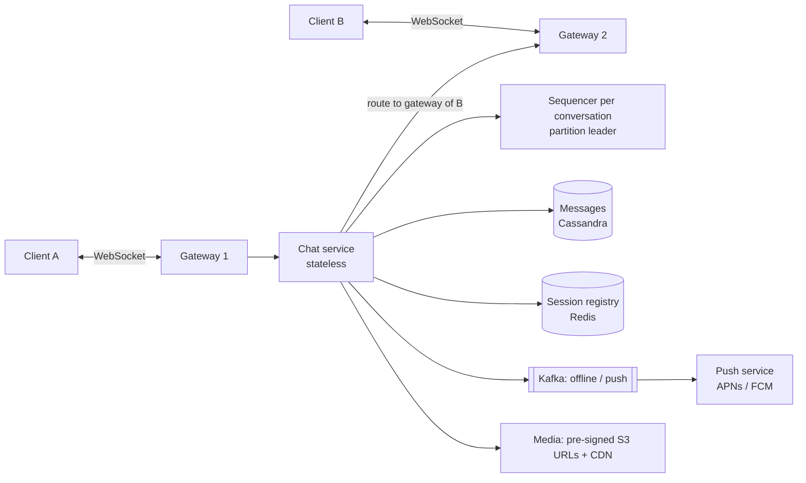

# HLD 08 · Chat System (WhatsApp / Messenger)

> Case study. Real-time delivery over persistent connections at hundreds of millions of users: WebSocket gateways and a session registry, per-conversation ordering, store-then-deliver, offline sync and push notifications, gateway failure, group fan-out limits, storage partitioning, and presence.
> Simulation: [`ChatHld.java`](ChatHld.java). Run with `java ChatHld.java` (8 checks). The object-level design (seq, cursors, receipts, client hold-back buffer) is [LLD 14](../../LLD/14-Chat-Application/).

---

## 1. Requirements
**Functional:** 1:1 and group chats (≤ 1,000 members), send/receive in real time, offline delivery, delivery/read receipts, last seen/online, history sync across devices. Media via upload links.
**Non-functional:** delivery latency < 200 ms when both are online; **no message loss**; per-conversation order; 99.99% available; messages durable for years.
**Out of scope:** E2E key exchange details (mention Signal protocol), voice/video calls, search.

## 2. Estimation

| Assumption | Number |
|---|---|
| DAU | 500M; 40 messages/user/day → **20B messages/day ≈ 230K/s avg, ~700K peak** |
| message size | ~100 B text + metadata → **~2 TB/day**, **3.7 PB / 5 years** (that's why it's a wide-column store, and why WhatsApp historically deleted messages after delivery) |
| concurrent connections | 40% online → **200M WebSockets** → ~2,500 gateway boxes at ~100K connections each |
| fan-out | avg group ~5 → ~1M deliveries/s at peak |

## 3. API
- **WebSocket** (persistent, bidirectional) between client and gateway, with frames: `send{conv, clientMsgId, body}`, `ack{conv, seq}` (delivered), `read{conv, seq}`, server pushes `msg{conv, seq, from, body}`.
- **REST** for everything else: `GET /conversations/{id}/messages?before=seq&limit=50` (cursor pagination), `POST /media/upload-url`, group management.

## 4. Data model
- `messages`: partition key **(conversation_id, month_bucket)**, clustering key **seq**. One conversation-month is one bounded partition; history pages walk buckets backwards (the simulation: a 5-year chat → 60 partitions of ~6K rows instead of one 365K-row partition).
- `conversation_members` (conv → users, roles); `user_conversations` (user → convs, last activity) for the inbox list.
- `cursors`: (user, conv) → delivered_seq, read_seq. Receipts and unread counts derive from them.
- **Session registry** (Redis): user → gateway id, with a TTL refreshed by heartbeats.

## 5. Architecture

**Send flow:** A → gateway 1 → chat service → assign `seq` for the conversation → **persist** → ack A (✓) → look up the members' gateways in the registry → push to online members (they ack → ✓✓) → offline members: push notification; they sync on reconnect.

## 6. Deep dives

### 6.1 Ordering
A single sequencer per conversation (e.g. Kafka partition by conversation_id, or a DB counter per conversation) assigns `seq`. Clients render by seq and buffer out-of-order arrivals. Never use phone timestamps.

### 6.2 Reliable delivery
**Store first, then deliver.** Delivery to sockets is best-effort; correctness comes from **sync**: on (re)connect, the client sends its last seq per conversation and the server returns everything newer. Dedupe by seq on the client. Simulation: bob goes offline, 2 messages trigger 2 push notifications, and on reconnect both are synced in order.

### 6.3 Gateway failure
Users' sockets drop; heartbeats stop, so registry entries expire; clients reconnect (with jittered backoff, to avoid a reconnect storm) to any healthy gateway and sync. Simulation: 10 gateways, one crashes, 17 users reconnect elsewhere; every user catches up to the latest seq with no duplicates.

### 6.4 Group fan-out
Each group message costs `members − 1` deliveries (the simulation: 1,000 members → ~300 socket pushes + ~700 notifications per message). Cap push fan-out to moderately sized groups. For channels/broadcast lists with 100K+ members, send a lightweight "new activity" signal and let clients **pull** (fan-out on read), and aggregate notifications.

### 6.5 Presence
Broadcasting every online/offline change to every friend: 100M users × 20 changes × 300 friends ≈ **7M events/s**. Instead keep presence as a heartbeat-refreshed TTL key, and fetch it lazily for the open chat / visible contacts (subscribe only while viewing).

### 6.6 Multi-device and E2E
A cursor per device. With E2E, the server stores ciphertext per recipient device (group sender keys), and ordering/sync are unchanged.

## 7. Trade-offs and failure modes
- **Cassandra vs SQL:** a write-heavy (700K/s), key + range access pattern with huge volume points to wide-column storage. Conversations/membership may live in SQL.
- **The registry is critical:** a Redis cluster with replicas; if it's lost, gateways re-register from their live sockets.
- **Reconnect storms** after a gateway or region outage: jittered backoff, connection rate limits, gradual drain on deploys.
- **Hot conversations** (huge groups): a separate tier/policy (pull-based).
- **Region failure:** users reconnect to another region; message stores replicated cross-region (async, so a small window of messages may arrive late, never re-ordered within a conversation because the sequencer moves with the partition leader).

## 8. Interview Q&A

**Q1. Why WebSockets and not polling?**
Real-time push with one long-lived connection; polling wastes requests and adds latency. Long polling/SSE are fallbacks.

**Q2. How does the server know which gateway a user is connected to?**
A session registry (user → gateway) in Redis, written on connect and refreshed by heartbeats, with a TTL so dead gateways' entries expire.

**Q3. How do you guarantee no message is lost?**
Persist before acknowledging the sender; deliver best-effort; the receiver syncs from its last seq on connect; acks move cursors; retries are deduped by `clientMsgId` and seq.

**Q4. How do you order messages in a group with many senders?**
One sequencer per conversation assigns monotonically increasing seqs; everyone renders in seq order.

**Q5. How do you deliver to offline users?**
Store, send a push notification via APNs/FCM, and sync when the app connects.

**Q6. How do you scale to 200M concurrent connections?**
Horizontally scaled gateways (~100K connections each, so thousands of boxes), L4 load balancing, the registry for routing, and stateless chat services behind them.

**Q7. How do you store petabytes of messages?**
A wide-column store partitioned by (conversation, time bucket), clustering by seq; TTL/archival tiers; media in object storage with a CDN.

**Q8. Group chats with 100K members?**
Don't push to everyone: fan-out on read (members fetch when they open the chat), batched notifications, maybe no per-member receipts (only counts).

**Q9. How are read receipts stored efficiently?**
A per-member cursor (read up to seq N), not per-message flags; the sender's tick state is derived by comparing cursors.

**Q10. What happens during a gateway deploy?**
Drain gradually: stop accepting new connections, ask clients to reconnect elsewhere over a few minutes with jitter, and sync on reconnect.

## 9. Common mistakes
- Delivering before persisting.
- Ordering by client clocks.
- Assuming sockets are reliable (no sync path).
- One unbounded partition per conversation.
- Broadcasting presence to all friends.
- Pushing every message to every member of huge groups.
