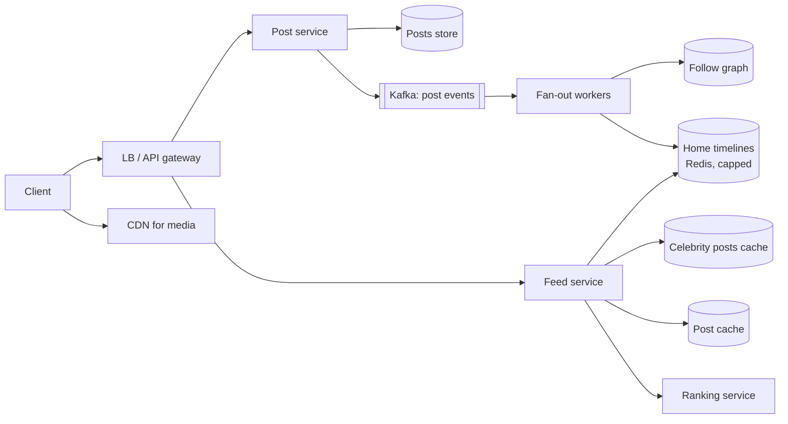

# HLD 09 · News Feed (Twitter / Instagram / Facebook)

> Case study. The heart of the problem is **fan-out**: precompute timelines on write (push), assemble them on read (pull), or a **hybrid** that treats celebrities differently. It also covers timeline storage, ranking, pagination, media, and counters.
> Simulation: [`NewsFeedHld.java`](NewsFeedHld.java). Run with `java NewsFeedHld.java` (8 checks; all three strategies verified to produce identical feeds, with costs measured).

---

## 1. Requirements
**Functional:** post (text + media); follow/unfollow; home feed of followees' posts, newest or ranked first, infinitely scrollable; like/comment counts.
**Non-functional:** feed load p99 < 200 ms; very read-heavy; eventual consistency OK (a post may appear a few seconds late); highly available.
**Out of scope:** ads, search, DMs, recommendations of unfollowed content (mention as candidates for ranking).

## 2. Estimation

| Assumption | Number |
|---|---|
| DAU | 300M; 10 feed loads/day → **~35K feed reads/s avg, ~100K peak** |
| posts | 0.2/user/day → 60M/day ≈ **700 posts/s** |
| followers | avg 200 → fan-out-on-write ≈ **140K timeline inserts/s** |
| timeline cache | 300M × 500 ids × 8 B ≈ **1.2 TB** (ids only; hydrate posts from a post cache) |
| celebrity | 1 post by a 100M-follower account = **100M inserts** → the reason for the hybrid |

## 3. API
```
POST /v1/posts                 {text, mediaIds[]}           Idempotency-Key  -> 201
GET  /v1/feed?cursor=&limit=20                              -> {items: [post...], nextCursor}
POST /v1/users/{id}/follow  /  DELETE /v1/users/{id}/follow
POST /v1/posts/{id}/likes
```
Cursor pagination is essential: the feed changes constantly ([06 · API Design](../06-API-Design/)).

## 4. Data model
- `posts`: post_id (Snowflake, time-sortable) → author, text, media refs, created_at. A KV/wide-column store plus a **post cache**.
- `user_posts`: (author_id) → post ids by time (the "user timeline").
- `follows`: (follower → followee) and the reverse (followee → followers), sharded by user id. A graph store is optional.
- `home_timeline`: (user_id) → capped list of post ids (Redis list/sorted set, ~500 entries).
- `counters`: likes/comments, sharded counters aggregated asynchronously.

## 5. Architecture



**Write path:** post → store → event → fan-out workers look up the followers (skipping celebrity authors, and optionally inactive followers) → push the post id onto each follower's capped timeline.
**Read path:** the feed service reads the precomputed timeline → merges in recent posts from the celebrities the user follows → hydrates the ids from the post cache → ranks → returns a page and cursor.

## 6. Deep dives

### 6.1 Fan-out strategies (measured)
Simulation: 20,000 users (30 celebrity accounts followed by 2–8 each), 20,000 posts, 2,000 feed loads:

| Strategy | Timeline writes | Lists fetched per feed load (fan-in) | Notes |
|---|---|---|---|
| **Push** (fan-out on write) | 7.3M | **1.0** | fastest reads; write explosion for celebrities; wasted on inactive users |
| **Pull** (fan-out on read) | **0** | 64.4 | no write amplification; every load fetches and merges ~64 lists, so latency is high |
| **Hybrid** | 1.1M (~7× fewer) | 5.6 | push for normal authors, pull for celebrities; the industry answer |

All three return **identical** feeds (verified). Hybrid tuning: only celebrity posts newer than the oldest precomputed entry can enter the top N; the celebrity lists are the hottest objects in the cache.

**Also:** skip fan-out to inactive users (rebuild their timeline on next login via pull); prioritise fan-out for active users.

### 6.2 Timeline storage
Redis lists/sorted sets of post ids, capped (~500–800); older pages fall back to pull/merge from `user_posts`. Store **ids, not posts** (posts are hydrated from the post cache, so edits/deletes apply everywhere).

### 6.3 Ranking
Candidates (timeline + celebrities + optionally recommendations) → features (author affinity, recency, engagement, media type) → a model score → top N. The demo: an older post from a close friend outranks newer posts from acquaintances (`affinity × 0.5^(age/halfLife)`). Production uses a two-stage approach: cheap candidate generation, then expensive ML ranking on a few hundred items.

### 6.4 Deletes, edits, privacy
Timelines hold ids; hydration checks that the post still exists and is visible to the viewer (blocked/private). Lazy filtering on read is cheaper than scrubbing millions of timelines.

### 6.5 Counters (likes)
Hot posts get millions of likes: use sharded counters (N sub-keys, summed on read) or stream aggregation to the count, and a per-user "liked" set for idempotency. Approximate is fine for display.

## 7. Trade-offs and failure modes
- **Consistency:** eventual. A follower may see a post seconds after it was posted (queue lag); the author sees their own post immediately (read-your-writes by merging their own recent posts).
- **Fan-out backlog** (a viral spike): the queue absorbs it; prioritise active users; the feed still works through the pull path.
- **Timeline cache loss:** rebuild lazily on read via pull + merge (slower, but correct).
- **Unfollow:** filter on read, with background cleanup of the timeline.
- **New user / cold start:** the timeline is empty, so pull from followees and add recommendations.

## 8. Interview Q&A

**Q1. Push or pull?**
Push for reads (most users, read-heavy), pull for celebrities (to avoid massive fan-out). A hybrid gets O(1)-ish reads with bounded writes.

**Q2. How do you define a "celebrity"?**
By follower count (a threshold like 10K–1M) or by measured fan-out cost; it can be dynamic. Their posts are fetched on read and cached aggressively.

**Q3. Why store post ids in timelines instead of posts?**
Smaller memory footprint (8 B vs ~1 KB); edits, deletes and privacy changes apply at hydration time; the post cache serves many timelines.

**Q4. How do you paginate a feed?**
Cursor-based (last seen post id/score). Offset pagination duplicates or skips items as new posts arrive.

**Q5. How do you handle inactive users in fan-out?**
Skip them; rebuild their timeline on login. It saves most of the fan-out work, since many accounts are dormant.

**Q6. How do you add ranking?**
A candidate generation stage (timeline + celebrities + recommendations), feature hydration, a scoring model and diversity rules; cache ranked pages briefly per user.

**Q7. What consistency does the feed need?**
Eventual is fine, with read-your-writes for the author. Strict ordering isn't required, especially with ranking.

**Q8. How do you scale the follow graph?**
Shard by user id; store both directions (followers for fan-out, following for pull); paginate huge follower lists in fan-out workers; cache celebrity follower counts.

**Q9. What happens when a celebrity with 100M followers posts?**
Nothing is fanned out. The post goes to their user timeline and a hot cache; followers merge it in at read time.

**Q10. How do you keep feed latency low?**
Precomputed timelines in memory, parallel hydration from caches, a bounded candidate set, cached ranking features, a CDN for media, and early pagination (the first page is small).

## 9. Common mistakes
- Pure push with celebrities.
- Pure pull at scale.
- Storing full posts in every timeline.
- Offset pagination.
- Synchronous fan-out inside the post request.
- Forgetting the author's read-your-writes.
