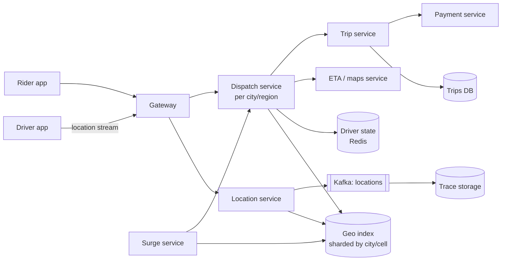

# HLD 10 · Ride-Sharing (Uber / Ola / Lyft)

> Case study. A real-time geospatial marketplace: a firehose of driver locations, **"drivers near me"** queries (geohash/H3), dispatch without double-assigning drivers, **batched matching**, surge pricing per cell, a trip lifecycle that must never lose state, and payments at the end.
> Simulation: [`RideSharingHld.java`](RideSharingHld.java). Run with `java RideSharingHld.java` (7 checks). Object-level design (trip state machine, CAS driver claim, fare decorators): [LLD 08](../../LLD/08-Ride-Sharing/).

---

## 1. Requirements
**Functional:** riders request rides (pickup, drop, product); see nearby cars and an ETA/price; get matched to a driver; track the driver live; trip lifecycle; fare and payment; ratings. Drivers go online and stream their location.
**Non-functional:** match within seconds; location freshness ~4 s; **never double-assign a driver**; trips never lost; high availability per city; graceful degradation.
**Out of scope:** routing engine internals (a maps service), pool rides (mention as an extension), fraud.

## 2. Estimation

| Assumption | Number |
|---|---|
| online drivers (peak) | 1M, updating every 4 s → **250K location writes/s** |
| ride requests | 20M rides/day → ~230/s avg, **~2K/s peak** (bursty around events) |
| "nearby" queries | rider app polling while open: ~**100K/s** |
| location data | only the latest position matters for dispatch → in memory; traces (for fares) ≈ 1M × 3,600/4 × 50 B/h ≈ 45 GB/hour to cold storage |

The insight: **the write volume is location updates, not rides**, and the location data is ephemeral.

## 3. API
```
Driver app:  WS/gRPC stream  location{lat, lon, heading, ts}      (every 4 s)
             POST /trips/{id}/accept | /arrive | /start | /complete
Rider app:   GET  /nearby?lat&lon&product            -> cars + ETA
             POST /rides {pickup, drop, product, fareQuoteId}   Idempotency-Key -> 201 {tripId}
             WS   trip updates (driver location, status)
```

## 4. Data model
- **Location index (in memory):** geohash cell → driver ids + latest position (Redis GEO / an in-memory index in the dispatch service), sharded by city/region.
- **Driver state:** driver_id → status (offline/available/on_trip), current trip, in Redis with atomic transitions.
- **Trips:** trip_id → rider, driver, status, timestamps, fare, in a durable SQL/NewSQL store (strong consistency for the lifecycle and payments).
- **Location traces:** append to Kafka → object storage / time-series DB (fare disputes, analytics, ETA models).

## 5. Architecture



## 6. Deep dives

### 6.1 "Drivers near me": geohash
Geohash interleaves longitude and latitude bits into base32, so nearby points share a **prefix** (verified against the reference value `u4pruydqqvj`). At precision 6 a cell is ~0.6 × 1.2 km. Query = the rider's cell **plus its 8 neighbours** (to handle edges), then filter by real distance. Simulation: with 50,000 drivers, every driver within 500 m was found (checked against brute force) while examining ~300 candidates per query.
Alternatives: **H3** hexagons (uniform neighbour distances: Uber), **S2** cells (Google), quadtrees (adaptive to density).

### 6.2 Location ingest at 250K/s
The location service only keeps the **latest** position (overwrite in memory) and publishes to Kafka for traces. Sharding by geohash prefix alone creates hot shards: one metro took **60%** of updates in the simulation. Shard by **city/region** and split dense regions into finer cells; scale each city's shard independently.

### 6.3 Dispatch without double assignment
- Each city/region is owned by a dispatch shard (consistent hashing on the region, with leader election), so matching decisions for an area are made in one place.
- Claiming a driver is an atomic transition (`SET driver:{id}:trip NX` / a CAS on status). Losers retry the next candidate.
- Offers go to one driver at a time with a timeout (or a few in parallel with the CAS deciding).

### 6.4 Batched matching
Greedy "nearest driver to each request in arrival order" is locally optimal but globally wasteful. Collect requests for ~1–2 s and solve the assignment problem for the batch (the Hungarian algorithm / min-cost flow). Simulation: **12% less total pickup distance** across 300 batches (and never worse).

### 6.5 Surge pricing
Per cell, demand (open requests) / supply (available drivers), smoothed and clamped (1.0–3.0×), recomputed every minute and shown to the rider. It's locked into the fare quote (with an expiry) so the price doesn't change after acceptance.

### 6.6 Trip lifecycle and payments
The trip state machine is persisted durably (SQL with optimistic versioning); every transition emits an event (notifications, ETA updates, billing). On completion: the fare from the trace, then a charge via the payment service with idempotency key = trip id (see [LLD 18](../../LLD/18-Payment-Wallet/)).

## 7. Trade-offs and failure modes
- **Location index node dies:** it's rebuilt within seconds from the next updates (ephemeral data), so no replication is needed for correctness.
- **Dispatch shard leader dies:** a new leader is elected; in-flight offers time out and retry; driver-claim atomicity in Redis prevents duplicates.
- **Region outage:** riders and drivers fail over to another region's stack; trips in progress continue from the durable trip store (replicated cross-region).
- **Stale locations:** use a TTL; drivers not updated for N seconds are excluded from dispatch.
- **Consistency choices:** location = eventual/ephemeral; driver assignment = atomic; trip and payment = strongly consistent.

## 8. Interview Q&A

**Q1. How do you find nearby drivers quickly?**
A geospatial index: geohash/H3/S2 cells in memory, keyed by cell. Look up the rider's cell and its neighbours, then filter by distance and sort by ETA.

**Q2. Why geohash neighbours and not just the prefix?**
Points near a cell boundary have different prefixes from their close neighbours across the boundary; checking the 8 surrounding cells guarantees coverage of the radius.

**Q3. How do you handle 250K location updates per second?**
In-memory latest-position storage sharded by region, no synchronous DB writes, async trace persistence via Kafka, and horizontal scaling per city.

**Q4. How do you prevent a driver being matched to two riders?**
A single owner per region for matching decisions, plus an atomic claim on the driver's state (CAS / `SET NX`). Losing requests try the next driver.

**Q5. Greedy vs batched matching?**
Greedy is simple and low-latency but globally suboptimal. Batching over 1–2 s solves an assignment problem for lower total ETA and better utilisation (12% less pickup distance in the simulation).

**Q6. How is surge computed and applied?**
Per-cell demand/supply ratios over a short window, smoothed and capped, exposed in the fare quote with an expiry; the accepted quote locks the multiplier.

**Q7. What data must be strongly consistent?**
Driver assignment and trip state transitions, and payments. Locations and surge can be eventually consistent.

**Q8. How do you compute the final fare?**
From the recorded GPS trace (distance, time) with the product's pricing plus the locked surge, tolls and promos; charged idempotently by trip id.

**Q9. How do you shard the system?**
By geography (city/region). Most interactions are local, so cross-shard traffic is rare; dense cities get finer partitions.

**Q10. How would you add pool (shared) rides?**
Matching considers riders with compatible routes and detour limits; a trip has several riders and ordered stops; batching becomes more valuable; pricing is split per rider.

## 9. Common mistakes
- Writing every location update to a relational DB.
- Querying only one geohash cell.
- Global (not per-region) dispatch locks.
- No atomic driver claim.
- Surge changing after the rider accepted.
- Losing trip state when a dispatch node dies.
