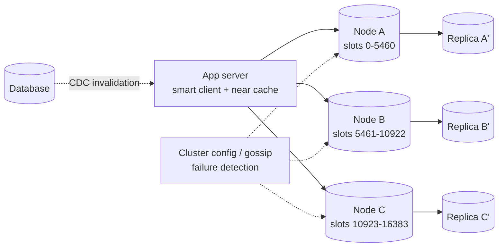

# HLD 11 · Distributed Cache (Memcached / Redis Cluster)

> Case study. Turning a single-node cache into a cluster serving millions of ops/s: **partitioning** (consistent hashing vs hash slots), **replication and failover**, **resharding without losing keys**, client routing, **hot keys** (detected with a Count-Min Sketch), consistency with the DB, and failure modes.
> Simulation: [`DistributedCacheHld.java`](DistributedCacheHld.java). Run with `java DistributedCacheHld.java` (11 checks). Single-node internals (LRU/LFU, TTL, single-flight, transactions): [LLD 06](../../LLD/06-Cache-LRU-LFU/), [LLD 17](../../LLD/17-KeyValue-Store/). Caching patterns: [HLD 03](../03-Caching/).

---

## 1. Requirements
**Functional:** `get/set/delete` with TTL; optional atomic ops (incr, CAS); a cluster that grows and shrinks.
**Non-functional:** sub-millisecond p99 within a DC; millions of ops/s; survives node failures without a DB stampede; adding nodes moves little data; memory efficient.
**Out of scope:** durability guarantees (a cache, not a database), cross-region strong consistency.

## 2. Estimation

| Assumption | Number |
|---|---|
| traffic | 5M ops/s peak, 90% reads |
| per node | ~100K–200K ops/s (Redis single thread / Memcached multi-thread), 64–128 GB usable |
| working set | 10 TB hot data → ~100+ nodes at 100 GB, ×2 with replicas |
| node count for throughput | 5M / 150K ≈ 35 nodes, so memory, not ops, decides the cluster size here |

## 3. API
`GET k`, `SET k v EX ttl [NX]`, `DEL k`, `INCRBY k n`, `MGET k1 k2…` (multi-key only if the keys share a slot/hash tag `{user:42}:cart`).

## 4. Partitioning options

| | Consistent hashing (client-side, Memcached / Twemproxy) | Hash slots (Redis Cluster) |
|---|---|---|
| Mapping | hash(key) → point on a ring → next node (virtual nodes for balance) | CRC16(key) mod 16,384 → slot → node (an explicit slot table) |
| Adding a node | ~1/N of the keys remap **to the new node** (simulation: 17.4% for 5 → 6; every moved key went to the new node) | move chosen slots explicitly, online |
| Routing | the client computes it | the client caches the slot map; servers answer **MOVED** when wrong (simulation: 1 redirect, then the client's map is fixed) |
| Control | implicit | precise (rebalance hot slots) |

## 5. Architecture

Variants: a proxy tier (Twemproxy, Envoy, mcrouter) instead of smart clients, which gives simpler clients but an extra hop.

## 6. Deep dives

### 6.1 Replication and failover
Store each key on R distinct nodes (the ring's next distinct nodes, or a primary + replica per slot range). The simulation kills one of 5 nodes:
- R=1: **79%** of the keys are still readable; the other 21% fall through to the DB at once (a stampede risk)
- R=2: **100%** readable

Redis Cluster promotes a replica when a majority of primaries agree the node is down (gossip + failure reports). Replication is asynchronous, so a few recent writes can be lost; fine for a cache.

### 6.2 Resharding without losing keys
Migrate slot by slot: the destination imports, the source exports keys (`MIGRATE`), and clients hitting the old owner get **MOVED** (or **ASK** during a migration) and refresh their map. The simulation migrates a slot under traffic: 0 keys lost, 1 redirect, then direct hits.

### 6.3 Hot keys
A single key can exceed one node's capacity (a celebrity profile, a flash-sale item). Detect it with a **Count-Min Sketch** (fixed memory, never under-counts): with 8,192 counters over 196K distinct keys, the hot keys were estimated within 1%. Cold keys are over-estimated (326 vs a handful of real hits) but stay far below the hot ones. Then mitigate: a near cache in each app server (short TTL), replicate the key under N suffixes (`key#0..#7`, picked at random on read), or serve it from the CDN.

### 6.4 Consistency with the database
Cache-aside with delete-on-write plus TTLs; CDC-driven invalidation for correctness; versioned sets to avoid the stale-set race ([HLD 03](../03-Caching/)). Across regions: a local cache per region, invalidated via a replicated invalidation stream.

### 6.5 Memory efficiency
Small-object encodings (Redis ziplist/listpack), compression for large values, eviction policy (`allkeys-lru`/`lfu`), avoid big keys (split them), and slab allocation tuning (Memcached) to reduce fragmentation.

## 7. Trade-offs and failure modes
- **Node failure without replicas** → a miss storm on the DB, so use replicas, request coalescing and DB rate limits.
- **Network partition:** Redis Cluster stops accepting writes on the minority side after a timeout (it leans CP for slot ownership); Memcached clients just route around the node.
- **Thundering reconnects / cold cache after a deploy:** warm up (replay recent keys) before taking traffic; stagger restarts.
- **Multi-key operations:** only within a slot (hash tags); cross-slot transactions aren't supported.
- **Consistent hashing without vnodes:** an uneven load ([HLD 02](../02-Databases-Sharding-Replication/): 2.52× vs 1.07× max/avg).

## 8. Interview Q&A

**Q1. Consistent hashing vs hash slots?**
Both partition keys so that adding nodes moves little data. Hash slots add an explicit, migratable mapping (fine-grained rebalancing and a slot table clients can cache). Consistent hashing is implicit and client-side.

**Q2. What happens when a cache node dies?**
Without replication, its keys miss and hit the DB, so protect the DB. With replicas, a replica is promoted (Redis Cluster) or clients read the next owner on the ring.

**Q3. How do clients find the right node?**
Smart clients compute it (ring) or cache the slot table and follow MOVED/ASK redirects; alternatively a proxy routes for them.

**Q4. How do you add capacity without downtime?**
Add nodes and migrate slots/vnodes incrementally while serving traffic; redirects handle in-flight keys; monitor hit ratio during the move.

**Q5. How do you handle a hot key?**
Detect it (sampling, a Count-Min Sketch, proxy metrics), then replicate it across nodes with key suffixes or cache it locally in app servers with short TTLs.

**Q6. Why is Redis single-threaded and still fast? How do you scale it?**
In-memory operations are tiny; a single thread avoids locking; I/O threads help with networking. Scale out by sharding (Cluster) and read replicas.

**Q7. How do you keep the cache consistent with the database?**
TTLs everywhere, invalidate on write (delete), close races with versioning or delayed double delete, and drive invalidations from CDC for reliability.

**Q8. Memcached vs Redis?**
Memcached: simple, multi-threaded, pure LRU cache, client-side sharding. Redis: rich data types, persistence options, replication, Cluster, scripting, pub/sub.

**Q9. How do you size the cluster?**
Take the max of memory need (hot set × overhead × replication) / memory per node and throughput need / ops per node, plus headroom for failover (N+1) and growth.

**Q10. Is a distributed cache CP or AP?**
Usually it favours availability and tolerates staleness (it's a cache). Redis Cluster refuses writes on the minority side for slot safety, but replication is async, so acknowledged writes can be lost on failover.

## 9. Common mistakes
- `hash % N` client sharding.
- No replicas and no DB protection.
- Multi-key operations across nodes.
- Ignoring hot keys and big keys.
- Treating the cache as durable.
- Resharding by flushing everything.
