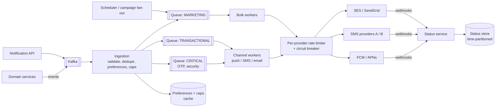

# HLD 12 · Notification System at Scale

> Case study. Billions of notifications per day across push, SMS and email: an event-driven ingestion pipeline, **priority isolation** (OTPs must never wait behind marketing; measured), campaign fan-out to millions, **provider rate limits and failover**, user preferences and frequency caps, dedupe, and delivery tracking.
> Simulation: [`NotificationHld.java`](NotificationHld.java). Run with `java NotificationHld.java` (10 checks). Service internals (preferences, templates, retry/circuit-breaker decorators, dedupe): [LLD 15](../../LLD/15-Notification-System/).

---

## 1. Requirements
**Functional:** send transactional (OTP, order updates), and marketing (campaigns to segments) notifications via push, SMS, email; user preferences and opt-outs; scheduling (send at 9 am local time); delivery status and analytics.
**Non-functional:**
- OTP/transactional delivered in seconds even during campaigns
- campaigns to 10M+ users within minutes
- at-least-once delivery with **no user-visible duplicates**
- respect provider rate limits
- highly available

**Out of scope:** template editor UI, segmentation engine internals.

## 2. Estimation

| Assumption | Number |
|---|---|
| volume | 1B notifications/day ≈ **12K/s avg**, peaks of **100K+/s** during campaigns |
| split | push 70%, email 25%, SMS 5% (SMS is expensive and rate-limited) |
| provider limits | e.g. SMS 2,000/s per account, push 50K/s per app (FCM/APNs quotas) |
| records | 1B × ~300 B status records/day ≈ **300 GB/day** → time-partitioned store with TTL |

## 3. API
```
POST /v1/notifications   {userId | userIds | segmentId, templateId, params, channels?, priority, sendAt?}
                         Idempotency-Key -> 202 {notificationId}
GET  /v1/notifications/{id}         -> status per channel
PUT  /v1/users/{id}/preferences     -> channels, categories, quiet hours
POST /v1/webhooks/{provider}        <- delivery receipts (delivered, bounced, clicked)
```
Most traffic arrives as **events** on Kafka (`OrderShipped` → notification rules), not as API calls.

## 4. Architecture



## 5. Deep dives

### 5.1 Priority isolation (the measured headline)
Simulation: a 1M-message marketing blast at t=0 plus 50 OTPs/s, through a provider limited to 2,000 msg/s:

| Design | OTP p99 latency | Blast completes |
|---|---|---|
| one FIFO queue | **493 s** (max 501 s) | t ≈ 500 s |
| priority queues (OTP first) | **1 s** | t = 512 s |

Separate topics/queues per priority, with dedicated or reserved capacity for CRITICAL (its own worker pool, its own provider account if possible). Marketing gets what's left.

### 5.2 Campaign fan-out to 10M users
Segment → user id list → **chunks** (e.g. 1,000 users) → jobs on the marketing queue → workers apply preferences/caps, render, and send in provider batch APIs. Time is bounded by `min(worker throughput, provider limit)`: 5 workers → 34 minutes; 60 workers → ~4 minutes, where the 50K/s provider limit binds. **Schedule by user timezone** ("9 am local") with the job scheduler ([LLD 13](../../LLD/13-Job-Scheduler/)) and spread sends to avoid self-made spikes.

### 5.3 Rate limits, retries, provider failover
- A token bucket per provider account ([LLD 04](../../LLD/04-Rate-Limiter/)) shared across workers (Redis-backed), so you never exceed quotas and avoid getting throttled or banned.
- Retries with exponential backoff + jitter for transient errors; DLQ for permanent ones (invalid number, unregistered token → mark the address bad).
- **Circuit breaker + secondary provider:** in the simulation the primary dies at 40%; after 5 failures the breaker opens, the remaining 60K go to the secondary, and all 100K are delivered.

### 5.4 Dedupe and idempotency
At-least-once pipelines retry, and users must not get two OTPs. Use an idempotency key per (event id, user, channel) in a TTL'd store (Redis `SET NX`) checked before sending; providers' own idempotency where available.

### 5.5 Preferences, quiet hours, frequency caps
Read from a cache of preferences (high read rate). Caps: `INCR user:{id}:mkt:{day}` with expiry. The simulation shows 7 campaigns → 3 delivered to the user, with the cap resetting the next day. SECURITY/OTP bypasses mutes and caps.

### 5.6 Delivery tracking
Provider webhooks → status events → a status store partitioned by day (TTL ~30–90 days) → analytics (open/click rates per campaign). Bounces and complaints automatically suppress addresses (email reputation depends on it).

## 6. Trade-offs and failure modes
- **Kafka/queue lag during a campaign:** isolation by priority keeps OTPs flowing; autoscale workers on lag.
- **Provider outage:** failover to a secondary; if all are down, queue (with TTL: an OTP older than 5 minutes is useless, so drop it and let the user retry).
- **Duplicate sends after a worker crash:** idempotency keys before sending; providers that accept client message ids.
- **Ordering:** usually not needed across notifications; per-user ordering for transactional flows can use per-user partition keys.
- **Cost:** SMS is expensive, so prefer push then email, and use SMS only when needed (channel fallback policy per template).

## 7. Interview Q&A

**Q1. How do you keep OTPs fast during a 10M-user marketing campaign?**
Separate priority queues and worker pools (or reserved provider capacity) for critical traffic; the simulation shows FIFO 493 s vs priority 1 s.

**Q2. How do you send a campaign to 10M users?**
Resolve the segment, chunk it into jobs, process in parallel with preferences and caps applied, send via batch provider APIs under per-provider rate limits; schedule by timezone.

**Q3. How do you avoid sending duplicates?**
An idempotency key per (source event, user, channel) recorded atomically before sending; consumers are idempotent; dedupe at ingestion for duplicate events.

**Q4. How do you respect provider rate limits across many workers?**
A shared distributed token bucket per provider account (Redis + Lua), with workers acquiring tokens before sending; backoff on 429s from the provider.

**Q5. What if a provider goes down?**
A circuit breaker opens after consecutive failures and traffic shifts to a secondary provider; half-open probes restore the primary.

**Q6. How do you handle user preferences at high QPS?**
Cache preferences (read-heavy), invalidate on change, and apply them at ingestion so disallowed sends never consume queue/provider capacity.

**Q7. How do you track delivery?**
Provider webhooks/receipts → status updates keyed by provider message id → a status store and analytics; suppress invalid addresses.

**Q8. How do you schedule "9 am local time"?**
Store the user's timezone; the campaign creates jobs per timezone bucket at the right UTC times; the job scheduler triggers fan-out.

**Q9. Push vs SMS vs email: which first?**
By template policy: OTP → SMS (or push with SMS fallback); order updates → push, then email; marketing → push/email, rarely SMS. Cost and urgency decide.

**Q10. What would you monitor?**
Queue lag per priority, send rate vs provider limits, error/bounce rates per provider, end-to-end OTP latency, the dedupe hit rate, and breaker states.

## 8. Common mistakes
- One queue for everything.
- Ignoring provider quotas until you get throttled.
- Retrying invalid addresses forever.
- No dedupe.
- Sending campaigns all at once at midnight UTC.
- OTPs that outlive their usefulness in a backlog.
