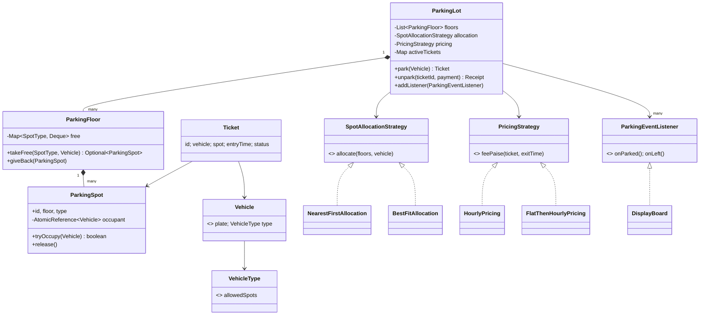

# LLD 01 · Parking Lot System

> Tier 1, the classic opener. It tests class modelling, Strategy for pricing/allocation, a Factory/Builder for setup, and the concurrency question "two gates, one spot".
> Code: [`ParkingLotSystem.java`](ParkingLotSystem.java). Run with `java ParkingLotSystem.java` (22 self-checks, including two concurrency races).

---

## 1. Clarifying questions (ask these first)

| Question | Assumption used here |
|---|---|
| Single building or many lots? | One lot, many floors |
| Which vehicle types? | Motorcycle, Car, EV car, Truck. **Must be easy to add more** |
| Spot types? | Motorcycle, Compact, Large, EV (charging) |
| Can a small vehicle use a bigger spot? | Yes, in preference order (bike → M, C, L) |
| Multiple entry/exit gates working concurrently? | **Yes**, so spot allocation must be thread-safe |
| How is the fee computed? | Per started hour, by spot type. **Pricing rules change** (mall, airport, flat rate) |
| Payment methods? | Abstracted (cash/card/UPI are out of scope, behind one interface) |
| Reservations, monthly passes, valet? | Out of scope; discussed as extensions |
| Display boards showing free spots? | Yes, updated on every entry and exit |

Saying **"out of scope"** out loud is a senior signal: you control the problem size.

## 2. Requirements

**Functional**
1. Park a vehicle → allocate a suitable free spot → issue a ticket.
2. Exit with a ticket → compute the fee → take payment → free the spot.
3. Show free-spot counts per type (display boards).
4. Reject: the lot is full for that type, the same plate is parked twice, the ticket is used twice.

**Non-functional**
- Thread-safe across many gates; no spot is ever assigned twice, and no customer is charged twice.
- Extensible: new vehicle types, spot types, pricing and allocation rules without editing core code.
- Testable: time is injected.

## 3. Thinking process: from nouns to classes

Requirement sentences → **nouns**: lot, floor, spot, vehicle, ticket, gate, fee, payment, display board.
**Verbs**: park, allocate, issue, exit, compute fee, pay, free, display.

Decisions:
- **Vehicle hierarchy? No.** `Car extends Vehicle` only makes sense if cars *behave* differently. They don't: they differ only in *which spots fit*. So: `record Vehicle(plate, VehicleType)`, where the enum carries its allowed spot types. Adding a `VAN` is one enum line. (Interviewers like hearing why you *didn't* subclass.)
- **What changes independently?** (a) where to park, (b) how much to pay → two **Strategy** interfaces.
- **Who owns the invariant "one vehicle per spot"?** The `ParkingSpot` (a CAS on its occupant).
- **Aggregates:** `ParkingFloor` owns its spots and the free lists; `ParkingLot` is the facade the gates talk to.
- **Ticket** is an entity with a lifecycle: `ACTIVE → PAYING → PAID` (and `PAYING → ACTIVE` on a failed payment).

## 4. Class diagram



## 5. Key flows

**Park**
```
Gate -> ParkingLot.park(v)
   platesInside.add(plate)            // atomic: rejects a duplicate plate
   allocation.allocate(floors, v)     // strategy picks the floor / spot type order
       floor.takeFree(type)           // lock-free poll: one spot to exactly one thread
           spot.tryOccupy(v)          // CAS null -> v (defence in depth)
   create Ticket(entryTime = clock)
   notify listeners (display board)
```
**Unpark**
```
Gate -> ParkingLot.unpark(ticketId, pay)
   ticket.startPayment()              // CAS ACTIVE -> PAYING: claim BEFORE charging
   fee = pricing.feePaise(ticket, now)
   pay(fee) ? PAID : roll back to ACTIVE
   floor.giveBack(spot); remove plate; notify listeners
```

## 6. Patterns used, and why

| Pattern | Where | Why here (and what I rejected) |
|---|---|---|
| **Strategy** | `PricingStrategy`, `SpotAllocationStrategy` | Pricing changes per customer (mall/airport); allocation may optimise for distance, EV usage, or keeping big spots for trucks. Rejected: `switch(lotType)` inside `unpark`. |
| **Builder** | `ParkingLot.Builder` | Layout plus optional strategies with defaults; validation (≥ 1 floor) in one place. |
| **Observer** | `ParkingEventListener` → `DisplayBoard` | The lot doesn't know about boards, SMS or analytics; new consumers just subscribe. |
| **Facade** | `ParkingLot` | Gates call two methods; floors/spots stay hidden. |
| *Factory (discussed)* | spot creation inside `ParkingFloor` from a `Map<SpotType,Integer>` | A full `VehicleFactory` isn't needed because vehicles are data. Mentioning this shows judgement. |

## 7. SOLID check
- **S**: `ParkingSpot` guards occupancy, `PricingStrategy` computes money, `ParkingLot` orchestrates.
- **O**: new pricing or allocation = a new class. A new vehicle type = an enum constant.
- **L**: any `PricingStrategy` can be substituted; none throws "unsupported".
- **I**: listeners get two small callbacks, not a giant interface.
- **D**: `ParkingLot` depends on the strategy *interfaces* and on an injected clock and payment function.

## 8. Concurrency: the part that separates levels

**Contended resources:** (1) a free spot (two entry gates), (2) a ticket (two exit gates, or a double scan), (3) a plate (the same car "entering" twice due to a sensor glitch).

| Resource | Technique | Why |
|---|---|---|
| Free spot | `ConcurrentLinkedDeque.pollFirst()` per (floor, type) + `AtomicReference` CAS on the spot | `poll` removes and returns atomically, so no global lock is needed. Gates on different spot types never contend. |
| Ticket | CAS `ACTIVE → PAYING` **before** charging | Charge-then-claim lets both gates charge. The test "2 exit gates scan the SAME ticket" proves one charge. |
| Plate | `ConcurrentHashMap.newKeySet().add()` | `add` returns false atomically if present. |

Alternatives to mention: a single `synchronized park()` is correct but serialises every gate. Per-floor locks are a middle ground. In a **distributed** deployment the spot table lives in a DB: `UPDATE spot SET vehicle=? WHERE id=? AND vehicle IS NULL` (check rows = 1), or a Redis `SET NX` lock per spot.

## 9. Edge cases covered
Lot full for a type, but a bigger type is free (fallback) · lot completely full · the same plate twice · the same ticket twice · payment failure (the car stays and can retry) · minutes/hours rounding · daily cap · freed spots are reused (a nearer spot comes back first).

## 10. Extensions the interviewer will ask for
- **Reservations / pre-booking**: add `Reservation(spot, window)`; allocation skips reserved spots. A spot gets a `HELD` state with an expiry.
- **Monthly pass / free parking for staff**: a `PricingStrategy` decorator: `PassAwarePricing(inner)` returns 0 for pass holders.
- **EV charging billed separately**: a `ChargingSession` attached to the ticket; total = parking + energy (composite pricing).
- **Multiple lots / city-wide**: `ParkingLotRegistry`; a search API by distance and free count.
- **Lost ticket**: lookup by plate (`platesInside` → ticket) plus a penalty fee rule.
- **Sensors / cameras**: an entry event from the ANPR camera is an input adapter that calls `park(plate)`.

## 11. Scaling to HLD (one paragraph)
Gates are clients of a stateless Parking Service. Spot state lives in a DB with a row per spot, and allocation is done with a conditional update or `SELECT … FOR UPDATE SKIP LOCKED` (which grabs any free spot without waiting on locked rows). Display boards subscribe to a pub/sub topic. Payments go through a payment service with idempotency keys = ticket id.

---

## 12. Interview Q&A

**Q1. Why not make `Car`, `Bike`, `Truck` subclasses of `Vehicle`?**
Subclasses are for different *behaviour*. Here the only difference is data (which spot types fit), so an enum with an allowed-spots list is simpler and open to extension without new classes. If behaviour diverged later (e.g. trucks needing weigh-in), I'd introduce polymorphism *then*.

**Q2. How do you guarantee two gates never get the same spot?**
Free spots sit in a concurrent deque per floor and type. `pollFirst()` atomically removes one element, so only one thread can receive a given spot. As defence in depth, the spot itself does `compareAndSet(null, vehicle)`. In a DB: a conditional update and checking that exactly one row was affected.

**Q3. Why claim the ticket before charging at exit?**
If you charge first, two concurrent exits both charge and only then discover the conflict, so a refund is needed. Claim (CAS to `PAYING`), then charge, then commit or roll back to `ACTIVE`. It's the same idea as "reserve, then pay" in booking systems.

**Q4. How would you change pricing for weekends or surge?**
A new `PricingStrategy` (e.g. `TimeOfDayPricing`), or wrap the existing one in a decorator `SurgePricing(inner, multiplier)`. The lot receives it via the builder, so nothing else changes.

**Q5. Where does the "every started hour is charged" rule live, and why there?**
Inside the pricing strategy. It's a pricing rule, so `Ticket` only records times. That keeps a single reason to change.

**Q6. Why `long` paise instead of `double` rupees?**
Floating point can't represent 0.1 exactly, so sums drift (0.1 + 0.2 ≠ 0.3). Money must be exact: integer minor units or `BigDecimal`.

**Q7. How do you test time-dependent fees?**
Inject a clock (`LongSupplier`). Tests use a fake clock and advance it 61 minutes to assert a 2-hour charge, with no `Thread.sleep`.

**Q8. Is `ParkingLot` a Singleton?**
Not a code-level Singleton. There is one instance per lot, created at the composition root and passed to the gates. A static singleton would block running two lots in tests and hide dependencies.

**Q9. A display board needs real-time counts. Push or pull?**
Push via Observer on park/unpark events (cheap, immediate). Across processes this becomes a pub/sub topic. Pull (polling `freeSummary()`) is fine as a fallback.

**Q10. How would you allocate "the spot nearest to the lift"?**
Store a distance per spot and keep each floor's free list as a priority queue by distance (or a `ConcurrentSkipListSet`) instead of a deque. Allocation still takes "the first free one", and the ordering changes.

**Q11. What if the system crashes after allocating a spot but before issuing the ticket?**
In memory, everything is lost anyway. With a DB, allocate the spot and insert the ticket in **one transaction**, so either both happen or neither does.

**Q12. How would you support a car that leaves without paying (barrier failure)?**
That's an operations case: the ANPR exit camera emits an "exit without payment" event, the ticket goes to `UNPAID_EXIT` and a collection workflow takes over. It shows that the state machine can grow without breaking the existing states.

## 13. Common mistakes
- A `ParkingLot` God class doing allocation, pricing, payment and display.
- `if (vehicle instanceof Truck)` chains for spot fitting.
- `synchronized` on every method (correct but kills gate parallelism), or no thread-safety at all.
- Charging before claiming the ticket.
- `double` for money; `new Date()` inside fee logic.
