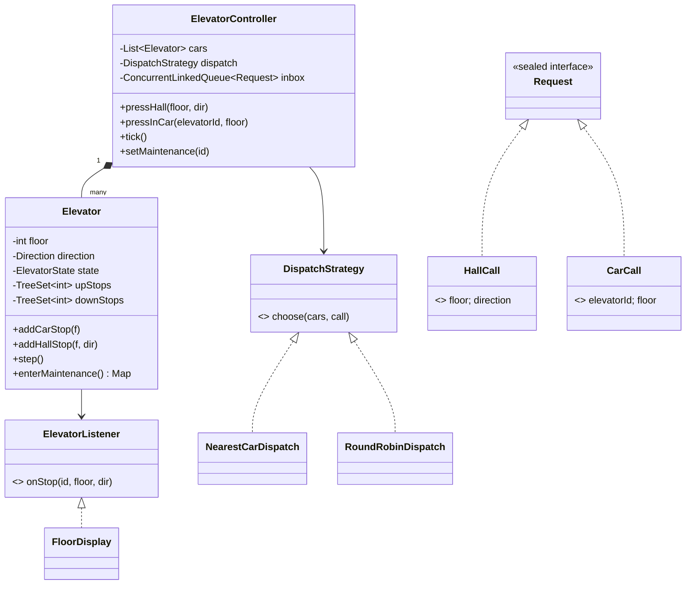
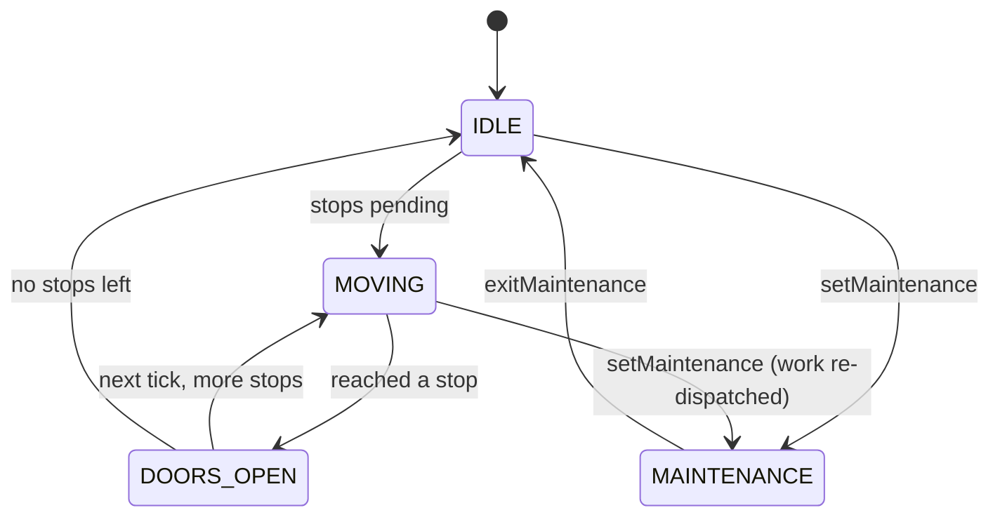

# LLD 02 · Elevator System

> Tier 1. It tests a **state machine**, a **scheduling algorithm** (SCAN/LOOK), **Strategy** for dispatch, and a clean **concurrency model**.
> Code: [`ElevatorSystem.java`](ElevatorSystem.java). Run with `java ElevatorSystem.java` (12 checks, including a 4,000-request concurrency stress test).

---

## 1. Clarifying questions

| Question | Assumption |
|---|---|
| How many elevators and floors? | N cars, floors `min..max` (configurable) |
| Which buttons exist? | **Hall buttons** (UP/DOWN on each floor) and **car buttons** (a destination inside) |
| Is a destination-dispatch kiosk (you type your floor in the lobby) in scope? | No; mentioned as an extension |
| Capacity / weight limits? | Out of scope for code; discussed |
| What should we optimise? | Average wait time and travel. Starvation must not happen |
| Maintenance / emergency mode? | Maintenance yes (a car leaves service, its work moves elsewhere) |
| Real-time hardware or a simulation? | A simulation with discrete **ticks** (1 tick = move one floor or open doors) |

## 2. Requirements
**Functional:** accept hall calls and car calls; pick a car for each hall call; serve stops in an efficient order; notify floor displays; take cars in and out of maintenance.
**Non-functional:** requests arrive concurrently from every floor; no request is lost; no starvation; the dispatch policy is pluggable.

## 3. Thinking process

**The key insight: there are two separate scheduling problems.** Say it early; it structures the whole design.

| Problem | Question | Where it lives |
|---|---|---|
| **Dispatch** | Someone on floor 7 pressed UP: *which car* goes? | `DispatchStrategy` (system-wide) |
| **Ordering** | A car has stops {3, 9, 5, 1}: *in what order*? | `Elevator.step()` using LOOK (per car) |

**Entities:** `Elevator` (an entity with state), `HallCall` and `CarCall` (immutable command objects), `ElevatorController` (the facade + the event loop), `DispatchStrategy`, `ElevatorListener` (displays).

**Why requests are objects (the Command pattern):** they can be queued, logged, replayed in tests and re-dispatched when a car goes into maintenance.

**Why hall calls carry a direction:** a person on 5 who pressed DOWN must not be picked up by a car passing 5 on its way UP. So each car keeps **two ordered sets**: `upStops` (served while moving up) and `downStops` (served while moving down). A car call goes into whichever side the target is on.

### Scheduling algorithms to compare

| Algorithm | Rule | Problem |
|---|---|---|
| FCFS | serve in arrival order | zig-zags; measured: **675 floors vs 49** for 30 random stops |
| SSTF (shortest seek first) | always the nearest stop | **starvation**: far floors wait forever under load |
| SCAN | sweep to the END of the building, then reverse | wasted trips to empty top/bottom floors |
| **LOOK** ✅ | sweep while requests remain ahead, then reverse | no starvation (every stop is reached within one round trip), little waste |

## 4. Class diagram



**State machine of one car**


## 5. Key flows

**Hall call:** `pressHall(7, UP)` (any thread) → `inbox.add(HallCall)` → on the next `tick()` → `dispatch.choose(cars, call)` → `car.addHallStop(7, UP)`.

**One tick of a car (LOOK):**
```
if shouldStopHere(): open doors, remove the stop, notify -> done
if moving UP and nothing above      -> reverse (or IDLE)
if moving DOWN and nothing below    -> reverse (or IDLE)
if IDLE                             -> go towards any work
if a call waits at this turning point -> stop
else move one floor
```

**Dispatch cost (NearestCar):** `distance` if the car is idle or already moving towards the floor in the caller's direction; otherwise `distance + 2 × building height` (it must finish its sweep first); plus `pendingStops` as a load-balancing term.

## 6. Patterns used

| Pattern | Where | Why |
|---|---|---|
| **State** (enum-based) | `ElevatorState` + `Direction` | Behaviour depends on the state (maintenance ignores steps, doors-open delays movement). An enum is enough because the transitions are few. Mention the full State pattern if they push. |
| **Strategy** | `DispatchStrategy` | Buildings differ: nearest-car, zoning (cars 0–1 serve floors 0–20), peak-hour lobby mode, energy saving. |
| **Command** | `HallCall`, `CarCall` (records) | Queueable, loggable, replayable, re-dispatchable. |
| **Observer** | `ElevatorListener` → `FloorDisplay` | Displays, analytics and audit don't couple to cars. |
| **Facade** | `ElevatorController` | Buttons only see `pressHall` / `pressInCar`. |

## 7. Concurrency: the single-writer event loop

Buttons are pressed from many threads, but **only the tick thread mutates elevator state**. Buttons call `inbox.add(request)` on a `ConcurrentLinkedQueue`, which is lock-free and thread-safe. Each `tick()` drains the inbox and steps every car.

Why this beats locking every `Elevator` method:
- No lock ordering problems (dispatch reads *all* cars, which would otherwise need many locks).
- Deterministic and testable: the same inbox order gives the same behaviour.
- It mirrors real controllers (a PLC scan loop) and the actor model (Akka): **share by communicating**.

The stress test: 8 threads press 4,000 buttons while a ticker runs. Every requested floor is visited and all cars end idle.

Alternative if asked: a `ReentrantLock` per elevator plus a lock-free dispatch snapshot; or one thread per elevator with its own `BlockingQueue` (an actor per car).

## 8. Edge cases
A car call for the current floor (doors open next tick) · a call at the turning point · a DOWN call above a car moving UP (it must not stop on the way) · all cars in maintenance (exception: no car in service) · a car call to a car in maintenance (ignored) · invalid floors (rejected) · ties in dispatch cost (the lower id wins, so tests are deterministic).

## 9. Extensions
- **Capacity**: track the load per car; dispatch skips full cars; a full car ignores hall calls but serves car calls.
- **Destination dispatch** (a lobby kiosk): the hall call *includes* the destination, so dispatch can group passengers going to similar floors.
- **Peak modes**: a morning-up-peak strategy parks idle cars at the lobby; switched by a scheduler (Strategy swap at runtime).
- **Emergency / fire mode**: a new state that overrides everything: go to the ground floor, open doors, ignore calls.
- **Priority** (VIP, hospital beds): a priority field on requests; dispatch cost subtracts priority.
- **Express zones**: a car serves only `[a, b]`; dispatch filters by zone.

## 10. Interview Q&A

**Q1. Why LOOK and not SSTF?**
SSTF minimises the next move but can starve far floors under steady load near the car. LOOK bounds the wait time: every request is reached within one sweep up and one sweep down.

**Q2. What's the difference between SCAN and LOOK?**
SCAN goes to the physical end of the shaft before reversing; LOOK reverses at the last pending request. LOOK is SCAN without the useless trips.

**Q3. How do you handle a DOWN call from floor 5 while a car is going up past 5?**
The hall call is stored in `downStops`. While moving up, the car only stops for `upStops`, so it serves 5 on the way back down. Direction is part of the request.

**Q4. How is dispatch different from scheduling?**
Dispatch assigns a hall call to a car (a global decision). Scheduling orders the stops inside one car (a local decision). Separate classes make each replaceable on its own.

**Q5. How do you make it thread-safe?**
Single-writer event loop: requests go into a concurrent queue; one thread applies them and advances the simulation. No locks on elevator state, and behaviour is deterministic.

**Q6. What happens when a car breaks down mid-route?**
`enterMaintenance()` returns its pending stops; the controller re-dispatches them as hall calls to other cars. Car calls from passengers inside are an operations issue (an emergency stop at the nearest floor).

**Q7. How would you add a zoning strategy for a 60-floor building?**
`ZoneDispatch` implements `DispatchStrategy`: it filters cars whose zone contains the floor, then applies nearest-car within those. It's injected into the controller with no other changes.

**Q8. How would you test this without real time?**
Ticks are explicit (`tick()`, `runUntilIdle()`), so tests are deterministic: push buttons, tick N times, assert the stop order from the display listener.

**Q9. Why use an enum for state instead of the State pattern classes?**
There are few states and transitions are simple, so an enum plus a switch is readable. If each state had rich, different behaviour (emergency, fire service, VIP), I'd move to State classes so that each state's logic lives in one place.

**Q10. How do you measure that your algorithm is good?**
Simulate traffic patterns (up-peak, down-peak, inter-floor) and measure the average and P95 wait time, the travel time and floors travelled. The demo compares LOOK vs FCFS travel: 49 vs 675 floors.

## 11. Common mistakes
- One giant `Elevator.move()` that also chooses which car answers.
- Ignoring hall-call direction.
- SSTF without addressing starvation.
- `synchronized` on every elevator method, plus a dispatcher that iterates cars while they change → inconsistent snapshots.
- `Thread.sleep` in logic, which makes tests slow and flaky.
