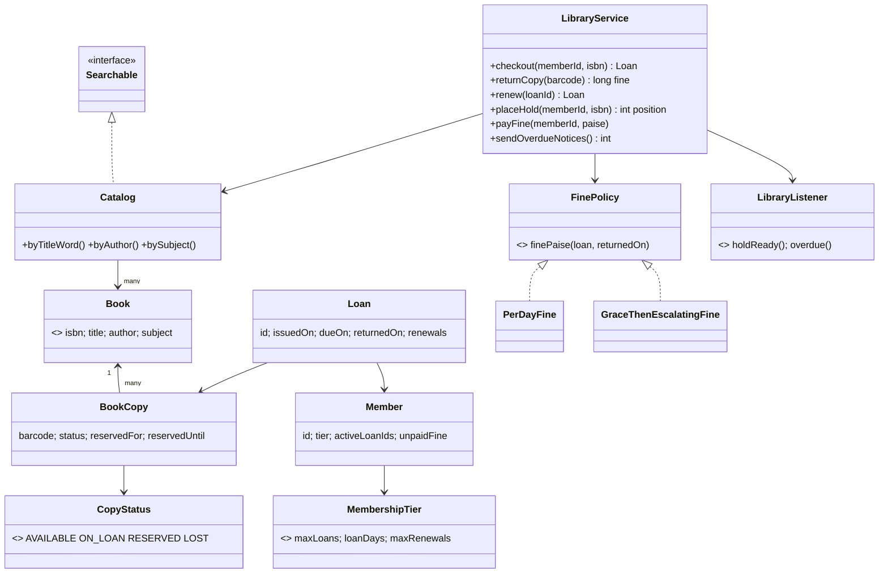
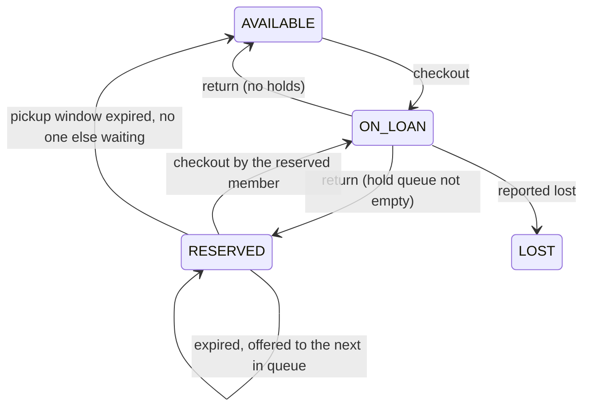

# LLD 03 · Library Management System

> Tier 1, often the warm-up round. It looks like CRUD, but interviewers watch for **domain modelling** (Book vs BookCopy), **business rules** in the right place, a **hold queue**, fines as a **Strategy**, and the "last copy" race.
> Code: [`LibraryManagementSystem.java`](LibraryManagementSystem.java). Run with `java LibraryManagementSystem.java` (24 checks).

---

## 1. Clarifying questions

| Question | Assumption |
|---|---|
| Actors? | Member (search, borrow, return, renew, hold), Librarian (add books, members), System (overdue notices, fines) |
| Several copies of one title? | **Yes**, which forces the Book vs BookCopy split |
| Borrowing limits? | Per membership tier (student 3/14 days, standard 5/21, premium 10/30) |
| Holds / reservations? | Yes: a FIFO queue **per title**; a returned copy is reserved for the first in line for 3 days |
| Renewals? | Limited per tier; not allowed if others are waiting or the loan is overdue |
| Fines? | Per late day with a cap; the rules may differ per library → Strategy. Unpaid fines over a threshold block borrowing |
| Search? | By title word, author, subject |
| Payments, e-books, inter-library loans? | Out of scope; mentioned as extensions |

## 2. Requirements
**Functional:** catalogue and search; check out / return / renew; holds with a pickup window; fines; overdue notices; member limits.
**Non-functional:** consistent under concurrent checkouts (the last copy goes to exactly one member); rules easy to change; time injectable for tests.

## 3. Thinking process

**The modelling trap: "Book".** A library has *titles* and *physical copies*.
- `Book` (ISBN, title, author, subject) is what you **search** and **place holds on** ("any copy of Clean Code").
- `BookCopy` (barcode, status, shelf) is what you **lend**, mark lost, or reserve.

With one `Book` class you can't express "3 copies" or "a hold on any copy". Interviewers explicitly look for this split.

**Other decisions**
- **Membership tiers are data, not subclasses.** `PremiumMember extends Member` adds nothing behavioural; an enum with `maxLoans`, `loanDays`, `maxRenewals` does the job.
- **Loan** is its own entity (copy + member + dates + renewals) instead of fields on the copy, so history is kept and fines are computed from it.
- **Holds attach to the title**, not to a copy: the first returned copy of any barcode goes to the head of the queue.
- **Fine rules vary between libraries** → `FinePolicy` Strategy.
- **Search** uses inverted indexes (word → ISBNs), the same idea as a search engine.
- **Reservation expiry is lazy**: checked whenever the title is touched, so no background thread is needed. (A daily job could also do it; both are valid.)

## 4. Class diagram

**Copy lifecycle**

## 5. Key flows

**Checkout(member, isbn)**, all under the **ISBN lock**:
1. Rule checks (limit, unpaid fines): fail fast before changing anything.
2. Expire stale reservations (lazy).
3. Prefer a copy RESERVED for this member; otherwise any AVAILABLE copy.
4. Copy → ON_LOAN, create the Loan (due = today + tier days), remove the member from the hold queue.

**Return(barcode)**, under the same lock: close the loan, compute the fine via `FinePolicy`, add it to the member's balance, copy → AVAILABLE, then `assignToNextHold` → RESERVED + notify.

## 6. Patterns used

| Pattern | Where | Why |
|---|---|---|
| **Strategy** | `FinePolicy` | Public vs university vs corporate libraries charge differently. |
| **Observer** | `LibraryListener` → notifications | Email/SMS/app are not the service's concern. |
| **Repository-ish maps + Facade** | `LibraryService` | One entry point; storage could move to JPA repositories behind interfaces. |
| **Interface segregation** | `Searchable` | A public kiosk needs search only, not lending. |
| *Enum with data instead of inheritance* | `MembershipTier`, `CopyStatus` | Avoids pointless subclasses. |

## 7. Concurrency
- **Contended resource:** the copies of one title. 30 members racing for 3 copies → exactly 3 loans (tested).
- **Per-ISBN `ReentrantLock`** (created via `computeIfAbsent`): popular titles don't block other titles. Every state change for a title (checkout, return, renew, hold, expiry) happens under that lock, so check-then-act is atomic.
- Member counters (`activeLoanIds` as a concurrent set, the fine as an `AtomicLong`) are touched by different titles' locks, so they're thread-safe on their own.
- Edge case worth mentioning: a member borrowing two *different* titles at the same instant could slip past the loan limit, because the two checks run under different ISBN locks. Fixes: a per-member lock acquired **before** the title lock (always in that order to avoid deadlock), or a CAS-based counter that increments only if it is below the limit. In a DB this is a conditional update on `members.active_loans < max`.

## 8. Edge cases
Unknown member/ISBN · last copy · the limit reached · unpaid fines over the threshold · a hold when copies are free (rejected) · a duplicate hold · queue jumping (rejected) · pickup window expiry → next in line · renewing with others waiting, over the limit, or overdue · the fine cap · overpayment of a fine.

## 9. Extensions
- **Lost / damaged copy**: `CopyStatus.LOST`, charge the replacement cost (another FinePolicy-like strategy), close the loan.
- **E-books with N concurrent licences**: the same model; "copies" are licences with automatic return at expiry.
- **Branches**: `BookCopy.branch`; holds specify a pickup branch; a transfer workflow.
- **Recommendations**: subscribe to loan events (Observer) to build a "who borrowed X also borrowed Y" index.
- **Persistence**: tables `book`, `book_copy`, `loan`, `hold`; checkout = transaction with `UPDATE book_copy SET status='ON_LOAN' WHERE barcode=? AND status='AVAILABLE'`.

## 10. Interview Q&A

**Q1. Why separate Book and BookCopy?**
They have different identities and lifecycles. The title is shared metadata; each copy has its own barcode and status. Holds and search target titles; loans, loss and damage target copies.

**Q2. Where do the borrowing rules live?**
In `LibraryService.checkout` (the use case), parameterised by `MembershipTier` data. If rules grew complex I'd extract a `BorrowingPolicy` chain (limit rule, fine rule, membership-expiry rule), i.e. Chain of Responsibility / Specification.

**Q3. How do holds work when there are several copies?**
The queue is per ISBN. When any copy is returned, it's reserved for the queue head with a pickup deadline. If they don't come, the reservation expires and the copy goes to the next person or back to AVAILABLE.

**Q4. How do you prevent two people getting the last copy?**
All state changes for a title run under that title's lock, so "find an available copy and mark it ON_LOAN" is atomic. In a DB: a conditional update with a row-count check.

**Q5. Why not one global lock?**
It's correct but serialises the whole library. A per-title lock means only users of the *same* title wait.

**Q6. How would you handle reservation expiry, lazily or with a scheduler?**
Lazy expiry (on the next access) is simple and exact for correctness. A daily scheduler is still useful to *notify* and free copies proactively. Mention both; the code uses lazy expiry plus a notification job.

**Q7. How would you design fines for different libraries?**
A `FinePolicy` interface: per-day with a cap, grace-then-escalating, or a flat replacement cost for lost books. It's configured per library or per tier.

**Q8. How is search implemented, and how would it scale?**
Inverted indexes (word → ISBNs) in memory. At scale: Elasticsearch, fed by catalogue change events.

**Q9. What's a "rich" vs an "anemic" domain model here?**
Anemic: entities are bags of getters/setters and all logic lives in services. Rich: entities protect their invariants (e.g. `loan.renew()` validates its own limits). This design keeps rules in the service for one readable place, but `Loan.renew` and `BookCopy.reserveFor` would be natural moves to a richer model.

**Q10. How do you test date-based rules?**
Inject a `Supplier<LocalDate>`. The demo moves the date forward to test fines, overdue notices and pickup expiry instantly.

## 11. Common mistakes
- One `Book` class with a `count` field (you lose per-copy status and history).
- `StudentMember extends Member` with no behaviour difference.
- Holds per copy instead of per title.
- Fines in `double`; `LocalDate.now()` scattered through the logic.
- No answer for "two members, last copy".
