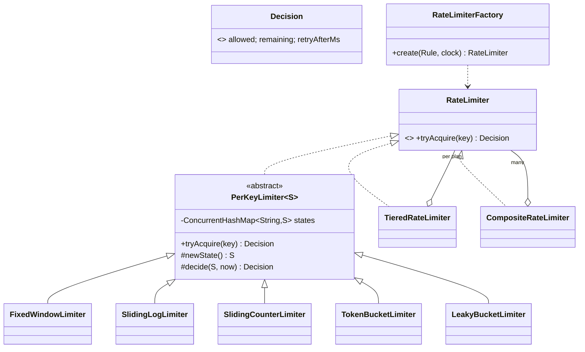

# LLD 04 · Rate Limiter

> Tier 1, and very relevant for API-gateway / gRPC backgrounds. It tests algorithm knowledge (5 algorithms and their trade-offs), clean **Strategy + Factory** design, per-key state, **lazy computation**, and thread safety. It is often followed by "now make it distributed".
> Code: [`RateLimiterSystem.java`](RateLimiterSystem.java). Run with `java RateLimiterSystem.java` (22 checks; every algorithm admits exactly 100 of 16,000 concurrent calls).

---

## 1. Clarifying questions

| Question | Assumption |
|---|---|
| Limit by what key? | User id / API key / IP (any string). Possibly several limits at once (per user + global) |
| Hard limit or soft? | Hard: reject with HTTP 429, `Retry-After` and `X-RateLimit-Remaining` |
| Are bursts allowed? | Depends on the product → the algorithm must be pluggable |
| Different limits per customer plan? | Yes (FREE / PRO / ENTERPRISE) |
| Single node or distributed? | Single node in code; distributed design discussed (Redis + Lua) |
| Accuracy vs memory? | Discuss per algorithm |
| Where does it run? | As a filter/middleware in the API gateway, before business logic |

## 2. Requirements
**Functional:** `tryAcquire(key)` → allowed / denied + remaining + retry-after; multiple algorithms; per-plan rules; layered limits.
**Non-functional:** O(1) or near-O(1) per call; thread-safe under heavy contention on hot keys; users don't block each other; memory proportional to active keys; deterministic tests.

## 3. Thinking process
1. **The interface is tiny**: `Decision tryAcquire(String key)`. Everything else is an implementation detail → **Strategy**.
2. **State is per key** → `ConcurrentHashMap<String, State>`, created lazily with `computeIfAbsent`.
3. **Locking granularity**: synchronise on the **per-key state object**, not the limiter. Users never contend with each other; only requests for the *same* key serialise, and those must anyway, because they share one counter.
4. **No timers**: a naive token bucket adds tokens with a scheduled thread per key, which is impossible with millions of keys. Instead, **refill lazily**: `tokens += (now - last) × rate` on each call.
5. **Configuration → objects** via a **Factory** (`Rule(algorithm, limit, window)`), so ops can change the algorithm without a code change.
6. **Composition**: per-user AND global limits → a **Composite** limiter.

## 4. The algorithms (the core of the interview)

| Algorithm | State per key | Accuracy | Bursts | Memory | Notes |
|---|---|---|---|---|---|
| **Fixed window** | count + window start | ✗ allows **2× at boundaries** (demo: 10 requests in 2 ms with limit 5/s) | yes, at edges | O(1) | simplest; fine for coarse quotas (per day) |
| **Sliding window log** | deque of timestamps | exact | no | O(limit) | expensive for big limits |
| **Sliding window counter** | current + previous count | ≈ exact (assumes uniform spread) | no | O(1) | Cloudflare's choice; great default |
| **Token bucket** | tokens + last refill time | exact average | **yes, up to capacity** | O(1) | AWS API Gateway, Stripe; good when short bursts are OK |
| **Leaky bucket** | water level + last leak | exact | no, a **smooth** output rate | O(1) | protects fragile downstreams; the queue version adds latency |

**Sliding window counter formula:** `estimate = current + previous × (1 − elapsedInCurrent / window)`. Demo: 10 requests in the previous window, halfway through the current one → 5 still count → 5 more allowed.

**Token bucket formula:** `tokens = min(capacity, tokens + elapsed × rate)`; allow if `tokens ≥ 1`; `retryAfter = (1 − tokens) / rate`.

## 5. Class diagram

## 6. Patterns used

| Pattern | Where | Why |
|---|---|---|
| **Strategy** | `RateLimiter` + 5 algorithms | Swap algorithms per API/plan without touching callers |
| **Template Method** | `PerKeyLimiter.tryAcquire` (final) → `newState` / `decide` | Per-key storage + locking written once; each algorithm only writes its decision logic |
| **Factory** | `RateLimiterFactory.create(Rule)` | Config-driven creation |
| **Composite** | `CompositeRateLimiter` | Treat "user AND global" as one limiter |
| **Decorator-like delegation** | `TieredRateLimiter` | Routes to a per-plan limiter |

## 7. Concurrency
- `computeIfAbsent` creates each key's state exactly once, even under races.
- `synchronized (state)` makes read-modify-write atomic per key. Critical sections are tiny (a few arithmetic ops).
- The test: 16 threads × 1,000 calls on **one hot key** → exactly 100 allowed, for all 5 algorithms.
- Lock-free alternative for fixed windows / token buckets: pack the state into an `AtomicLong` and use a CAS loop. Mention it as an optimisation for extremely hot keys.
- **Memory hygiene:** idle keys accumulate. Evict states unused for > window (a scheduled sweep, or a cache like Caffeine with `expireAfterAccess`).

## 8. Going distributed (the usual follow-up)
- Counters live in **Redis**, keyed `rl:{key}:{window}`. Each check runs as **one Lua script** (atomic on the Redis server): `INCR` + `EXPIRE` for fixed windows; for a token bucket, read tokens + timestamp, refill, decrement and write back in one script.
- Sliding log in Redis: a `ZSET` of timestamps: `ZREMRANGEBYSCORE`, `ZCARD`, `ZADD` in one script.
- **Trade-off**: a network hop per request. Mitigations: local token buckets with a periodic sync ("approximate global limits"); or sticky routing so one gateway node owns a key.
- **Fail-open vs fail-closed** if Redis is down: usually fail-open (allow) for user-facing APIs, fail-closed for abuse protection (login attempts).
- Clock skew between nodes: use the Redis server time (`TIME`) inside the script.

## 9. Edge cases
The fixed-window boundary burst (demonstrated) · a long idle period (the token bucket is capped at capacity) · a gap of 2+ windows (the sliding counter resets `previous` to 0) · a brand-new key (starts full / empty) · retry-after never 0 · a composite where an early layer counts a request that a later layer rejects (documented trade-off).

## 10. Extensions
- **Weighted requests** (an expensive endpoint costs 5 tokens): `tryAcquire(key, cost)`.
- **Rules per endpoint**: key = `userId + ":" + route`; rules are looked up by route pattern.
- **Dynamic config**: a rules store with hot reload; the factory rebuilds limiters on change.
- **Queue instead of reject** (leaky-bucket queue): a `DelayQueue` / scheduler releases requests at the drain rate.
- **Observability**: emit metrics for allowed/denied counts per key and plan.

## 11. Interview Q&A

**Q1. Token bucket vs leaky bucket?**
The token bucket allows bursts up to capacity while enforcing the average rate. The leaky bucket enforces a *smooth* output rate: no bursts reach the backend. Use a token bucket for user-facing APIs and a leaky bucket in front of fragile downstreams.

**Q2. What's wrong with the fixed window?**
At a window boundary a client can send `limit` requests at the end of one window and `limit` at the start of the next: 2× the limit in a very short span. The demo shows 10 requests in 2 ms with limit 5/s.

**Q3. Why doesn't your token bucket need a background thread?**
Lazy refill: tokens are recomputed from the elapsed time when a request arrives. Idle keys cost nothing, and there's no timer per key.

**Q4. How do you make it thread-safe without a global bottleneck?**
Per-key state in a `ConcurrentHashMap`, and synchronisation on that one state object. Only requests for the same key serialise.

**Q5. How do you rate-limit across 20 gateway instances?**
Shared state in Redis with atomic Lua scripts per algorithm, or local buckets with a share of the limit (limit / N) plus periodic rebalancing. Discuss latency, failure mode (fail-open/closed) and clock source.

**Q6. What do you return to the client?**
HTTP 429 with `Retry-After`, `X-RateLimit-Limit`, `X-RateLimit-Remaining` and `X-RateLimit-Reset`. The `Decision` record carries what's needed.

**Q7. How would you give different customers different limits?**
A plan lookup (API key → plan) and a limiter per plan built from config (`TieredRateLimiter`). For per-customer custom limits, the key includes the customer and the rule comes from a config store.

**Q8. How do you protect the whole service even when every user is under their own limit?**
Layer a global limiter on top (a composite). Mention load shedding / adaptive concurrency limits for overload protection beyond fixed numbers.

**Q9. Sliding window counter: how accurate is it?**
It assumes the previous window's requests were spread uniformly. The error is bounded and small in practice: Cloudflare measured ~0.003% wrongly allowed. It's O(1) memory vs O(limit) for the exact log.

**Q10. Where should a rate limiter sit in the architecture?**
As early as possible: an edge/API gateway, or a servlet filter / gRPC interceptor before any expensive work. Per-service limiters protect individual dependencies.

## 12. Common mistakes
- A single `synchronized tryAcquire` on the whole limiter.
- A timer thread per key for refills.
- `System.currentTimeMillis()` hard-coded, so behaviour can't be tested.
- Not knowing the fixed-window boundary problem.
- Forgetting to evict idle keys (a memory leak).
