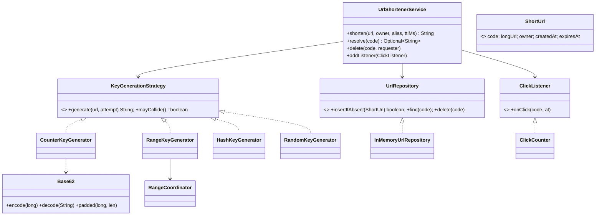

# LLD 05 · URL Shortener (bit.ly / TinyURL)

> Tier 1. It's asked as an HLD question too; in the LLD round the focus is **key generation** (base62, counters vs hashing vs random), **collision handling**, **atomic uniqueness**, custom aliases, expiry, and a clean split between service, generator and repository.
> Code: [`UrlShortenerSystem.java`](UrlShortenerSystem.java). Run with `java UrlShortenerSystem.java` (27 checks).

---

## 1. Clarifying questions

| Question | Assumption |
|---|---|
| Code length / charset? | 7 chars of `[0-9a-zA-Z]` = 62⁷ ≈ **3.5 trillion** codes |
| Custom aliases? | Yes: validated, unique, with reserved words blocked |
| Expiry? | Optional TTL per link |
| The same URL shortened twice? | The same owner gets the same code back (idempotent); different owners get different codes (separate analytics/ownership) |
| Delete / edit? | The owner can delete; editing the target is out of scope (it causes cache headaches) |
| Analytics? | Click counts per code (detailed analytics is HLD) |
| Read/write ratio? | ~100:1, so the **redirect path must be cheap** |
| Should codes be guessable? | Prefer not (sequential codes let people enumerate private links) |

## 2. Requirements
**Functional:** `shorten(url, owner, alias?, ttl?) → code`; `resolve(code) → url` (redirect); delete by owner; click counting.
**Non-functional:** codes are globally unique; generation doesn't bottleneck across many servers; resolve is O(1); safe under concurrency (two users, one alias).

## 3. Thinking process

**A short code is just a number in base 62.** That reframes the problem as **"how do we choose a unique number?"**

| Strategy | How | + | − |
|---|---|---|---|
| **Counter** | global `AtomicLong` / DB sequence → base62 | unique by construction, no retries | a single contention point; **predictable** codes |
| **Range allocation** (ticket server) | each server leases a block of 1,000 ids from ZooKeeper/DB, then counts locally | unique, almost no coordination (6 leases for 5,000 links in the demo) | gaps when a server dies (harmless); still sequential within a block |
| **Hash** (SHA-256 → 42 bits → base62) | `hash(url)` | same URL → same code (natural dedupe); stateless | **collisions** → must check and re-hash with a salt |
| **Random** | 7 random base62 chars | unguessable | collision check + retry; it gets worse as the space fills |

In every case the **final guarantee** is an *atomic insert-if-absent* in storage (`ConcurrentHashMap.putIfAbsent` here; a primary key / conditional put in a DB). Generators produce *candidates*; storage decides.

**Hiding sequential ids:** encrypt the counter with a format-preserving cipher or a Feistel network before base62 encoding. That keeps uniqueness (it's a bijection) and makes codes look random.

## 4. Class diagram



## 5. Key flows

**Shorten**
```
validate url (scheme http/https, length)
alias given?  -> validate (charset, reserved words) -> insertIfAbsent or "taken"
dedupe: (owner, url) seen and not expired? -> return the existing code
for attempt in 0..7:
    code = keygen.generate(url, attempt)     // hash/random vary per attempt (salt)
    if repo.insertIfAbsent(code): remember dedupe, return code
    collision++   (impossible for counter/range -> treat as a bug)
fail: "could not allocate"
```
**Resolve**: look up → if expired, delete lazily and return 404 → publish a click event → `302` to the long URL.

## 6. Patterns used

| Pattern | Where | Why |
|---|---|---|
| **Strategy** | `KeyGenerationStrategy` | Choose counter/range/hash/random per deployment without touching the service |
| **Repository** | `UrlRepository` | Swap in-memory for DynamoDB/Cassandra/MySQL |
| **Observer** | `ClickListener` → `ClickCounter` | Analytics is decoupled; in production it's an async Kafka event |
| **Value object** | `ShortUrl` record | Immutable; expiry logic lives on it |
| *Template thinking* | the retry loop | Same for every collision-prone generator |

## 7. Concurrency
- **Alias race** (10 users want "promo"): `putIfAbsent` → exactly one winner (tested).
- **Counter**: `AtomicLong.getAndIncrement` (lock-free). **Range generator**: `synchronized` on the generator, but it only coordinates once per block.
- **Clicks**: `LongAdder` per code, built for many writers on one hot counter (striped cells, summed on read). Better than `AtomicLong` for a viral link.
- 16 threads × 1,250 links with each generator → 20,000 unique codes (tested).

## 8. Redirect semantics (a frequent question)
- **301 Moved Permanently**: browsers cache it, so later clicks never reach you. Less load, but **you lose analytics**, and you can't change or expire the target.
- **302 / 307 Temporary**: every click hits your service, so analytics and expiry work. **The usual choice.**

## 9. Edge cases
Invalid/unsafe URLs (`javascript:`), very long URLs · reserved aliases (`admin`, `api`) · an alias already taken · TTL boundaries (expires exactly at `expiresAt`) · dedupe pointing to an expired link (a new code is issued) · a hash collision (salted retry, demonstrated with a deliberately weak 4-value hash) · the space exhausted (a clear error, not an infinite loop) · delete by a non-owner.

## 10. Extensions
- **Malicious URL check**: call a safe-browsing service before saving (behind an interface).
- **Per-user quotas**: put the Rate Limiter (LLD 04) in front of `shorten`.
- **Link editing**: allowed only with 302 redirects; invalidate caches on change.
- **Custom domains**: the key becomes `(domain, code)`.
- **QR codes, UTM tags, A/B targets**: extra fields on `ShortUrl` + a target-selection strategy.

## 11. Scaling to HLD (one paragraph)
Writes go to a key-value store sharded by code (DynamoDB/Cassandra). Reads are served by a **cache** (Redis/CDN edge) because there are ~100 reads per write and a power-law popularity. Codes come from range allocation per instance, so there's no hot sequence. Clicks go to Kafka, then a stream aggregator, then an analytics DB. Expired links are cleaned by a TTL index or a background sweeper.

## 12. Interview Q&A

**Q1. How many URLs can 7 base62 characters represent?**
62⁷ ≈ 3.52 × 10¹². At 1,000 new links per second that lasts over 100 years.

**Q2. Counter vs hash: which would you choose?**
Counter (via range allocation) for guaranteed uniqueness with no retries, plus obfuscation if guessability matters. Hash if you want natural dedupe and stateless generation, accepting collision checks.

**Q3. How do you handle hash collisions?**
Insert-if-absent; on conflict, re-hash with a salt (`url#1`, `url#2`, …) up to N attempts. Never trust that a 42-bit prefix is unique.

**Q4. How do you avoid a single counter becoming a bottleneck across servers?**
Range leasing: each server takes a block (e.g. 1,000 ids) from ZooKeeper/a DB row in one call and hands them out locally. One coordination per thousand links.

**Q5. How do you make sequential codes unguessable?**
Apply a bijective scramble (a Feistel cipher on the 42-bit id, or a modular multiplicative inverse) before base62 encoding. It's still unique, but no longer looks sequential.

**Q6. 301 or 302?**
302/307 if you need analytics, expiry or editability; 301 only for permanent links where offloading traffic matters more.

**Q7. How do you guarantee custom aliases are unique under concurrency?**
An atomic conditional insert, with the database's primary-key constraint as the real guarantee. Two requests for the same alias: one insert succeeds, the other gets a conflict.

**Q8. Same URL submitted twice: same code?**
It depends on the product. Here it's the same code per owner (idempotent, saves space), but different per owner so ownership and analytics stay separate. With the hash strategy, dedupe comes for free.

**Q9. How do you implement expiry?**
Store `expiresAt`. Check lazily on resolve (delete and 404), plus a background cleanup or a TTL index (DynamoDB TTL, Redis EXPIRE) to reclaim space.

**Q10. How do you count clicks for a link that goes viral?**
`LongAdder` in memory (striped counters). At scale, emit click events to Kafka and aggregate asynchronously, so the redirect path never waits on analytics.

## 13. Common mistakes
- Checking `exists(code)` and then inserting in two steps (a race).
- A hash prefix assumed to be unique.
- Ignoring custom-alias conflicts and reserved words.
- One global synchronized counter across all servers.
- Analytics written synchronously on the redirect path.
