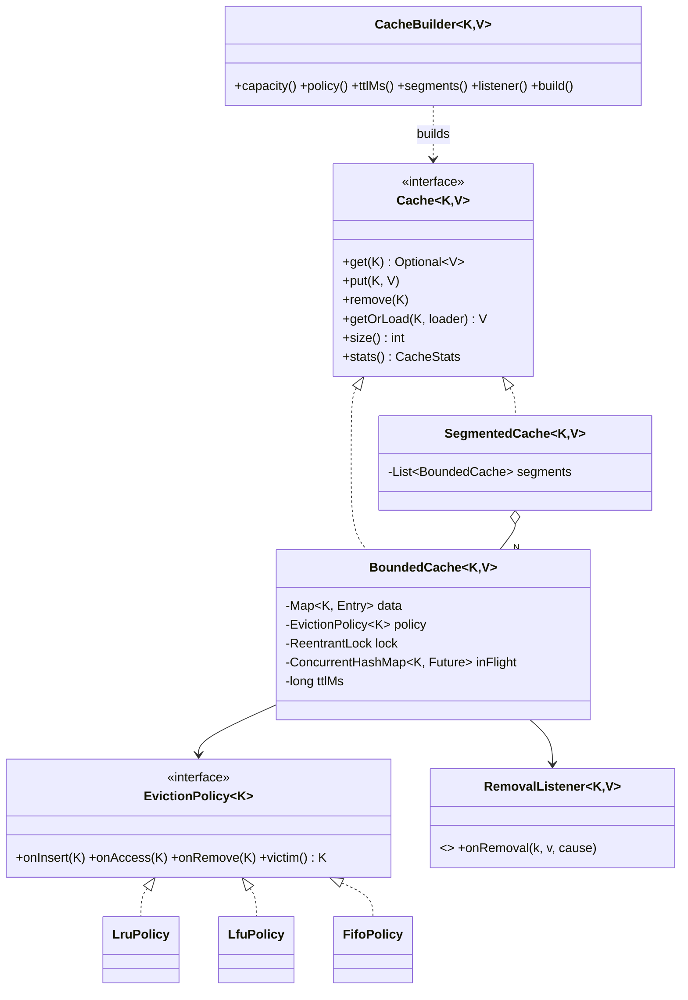

# LLD 06 · Cache with Eviction (LRU / LFU / FIFO)

> Tier 1, often asked standalone. Juniors write LeetCode 146. Seniors design a **generic cache**: a pluggable eviction **Strategy**, TTL, read-through loading **without a stampede**, removal listeners, stats, and a concurrency story (why a read-write lock is wrong for LRU, and segments).
> Code: [`CacheSystem.java`](CacheSystem.java). Run with `java CacheSystem.java` (13 checks).
> The raw data structures (O(1) LRU and LFU) are in [DSA/12-Advanced](../../DSA/12-Advanced/) (`M01_LRUCache`, `H01_LFUCache`).

---

## 1. Clarifying questions

| Question | Assumption |
|---|---|
| Generic keys/values? | Yes, `Cache<K, V>` |
| Capacity by count or by bytes? | Count (byte-weighted capacity as an extension) |
| Which eviction policies? | LRU, LFU, FIFO, **pluggable** |
| Expiry? | Optional TTL per cache (expire-after-write) |
| Load on miss? | Yes, read-through `getOrLoad(key, loader)` |
| Thread-safe? | Yes, with high concurrency |
| Distributed? | No (in-process). Distributed caching (Redis) is discussed as HLD |
| Notifications on removal? | Yes, with a cause (evicted / expired / explicit / replaced) |

## 2. Requirements
**Functional:** get / put / remove / getOrLoad; eviction at capacity; TTL; removal listener; hit/miss stats.
**Non-functional:** O(1) operations; thread-safe; no duplicate loads under concurrent misses; the policy is swappable without touching storage.

## 3. Thinking process
1. **Separate *what is stored* from *what to evict*.** The cache owns `key → value (+ expiry)`. The `EvictionPolicy` tracks only **keys** and answers `victim()`. That's a Strategy, and each policy is testable on its own.
2. **Policy contract:** `onInsert`, `onAccess`, `onRemove`, `victim`, all O(1):
   - LRU = hash map + doubly linked list (`LinkedHashMap` in access order).
   - LFU = key → freq, plus freq → keys in insertion order, plus `minFreq`.
   - FIFO = an insertion-ordered set.
3. **Evict before insert.** Inserting first and then evicting looks harmless, but under LFU the brand-new key (frequency 1) becomes the victim, so the cache never admits new keys. This design hit exactly that bug; the test "LFU protects the hot key" caught it.
4. **Concurrency:** in LRU/LFU a **get changes the policy state**, so a `ReadWriteLock` doesn't help (every get needs the write lock). Use lock **striping**: N segments by key hash, each with its own lock and policy. The trade-off is approximately-global LRU.
5. **Stampede protection:** concurrent misses for one key must trigger **one** load (single-flight), using a map of in-flight futures.
6. **Callbacks outside the lock:** listeners might be slow or call back into the cache. Collect notifications under the lock, run them after unlocking.

## 4. Class diagram

## 5. Key flows

**put(k, v)**: lock → existing key? replace + `onAccess` + REPLACED notice : (evict victims while `size ≥ capacity`) → insert + `onInsert` → unlock → run notifications.
**get(k)**: lock → entry expired? remove (EXPIRED) → miss : `onAccess` + hit → unlock → notify.
**getOrLoad(k)**: `get` → miss → `inFlight.putIfAbsent(k, myFuture)`. If someone else is loading, wait on their future. Otherwise re-check, load, `put`, complete the future, and remove it from `inFlight` (also on failure, so waiters see the exception and later calls retry).

## 6. Patterns used

| Pattern | Where | Why |
|---|---|---|
| **Strategy** | `EvictionPolicy` | LRU vs LFU vs FIFO (vs W-TinyLFU later) without changing storage |
| **Builder** | `CacheBuilder` | Many optional knobs (capacity, TTL, segments, listener, clock), like Guava/Caffeine |
| **Factory** | `CacheBuilder.newPolicy()` | Enum → strategy instance |
| **Observer** | `RemovalListener` | Metrics, write-behind, resource cleanup on eviction |
| **Decorator / Composite-ish** | `SegmentedCache` | Same `Cache` interface over N caches |

## 7. Policy comparison (what to say)

| Policy | Evicts | Good for | Weakness |
|---|---|---|---|
| LRU | least recently used | recency-heavy workloads (sessions) | **a scan pollutes it**: one pass over cold keys flushes hot ones (demo: "LRU evicts the hot key after a scan") |
| LFU | least frequently used (LRU among ties) | stable popularity (product catalogues) | **old popularity sticks** (needs ageing/decay); new items struggle |
| FIFO | oldest inserted | simple, cheap reads (no bookkeeping on get) | ignores usage |
| W-TinyLFU (Caffeine) | admission by a frequency sketch + windowed LRU | real-world mixes | more complex; mention as the state of the art |

## 8. Concurrency
- **Per-segment `ReentrantLock`**: 8 segments mean up to 8 threads in parallel. The test: 16 threads × 12,500 random ops; the size never exceeds capacity and no value is corrupted.
- **Why not `ReadWriteLock`?** LRU/LFU `get` mutates the order/frequency, so it would need the write lock anyway. RW locks also cost more than plain locks.
- **Why not `ConcurrentHashMap` + `synchronized` policy?** The map and the policy must change **together** atomically (insert + `onInsert`, evict + remove), or they drift apart.
- **Stats** use `LongAdder` (cheap concurrent increments).
- **Single-flight:** 64 threads miss "config" at once → the loader runs **once** (tested).
- Advanced (Caffeine): reads append to a lock-free ring buffer; a single thread drains it and applies policy updates in batches, so reads almost never take a lock.

## 9. Edge cases
Capacity ≤ 0 (rejected) · null keys/values (rejected) · put on an existing key (replace, no eviction) · TTL boundary (expired *at* `expiresAt`) · explicit remove then LFU `victim()` (the `minFreq` bucket may be empty, so advance) · a loader exception (propagated to all waiters, then the in-flight entry is cleared) · a listener throwing (it runs outside the lock, so the cache stays consistent).

## 10. Extensions
- **Weighted capacity** (bytes): `Weigher<K,V>`; evict while `totalWeight > maxWeight`.
- **expireAfterAccess**: refresh `expiresAt` on get.
- **refreshAfterWrite**: serve the stale value while reloading asynchronously.
- **Write-through / write-behind**: on put, write to the DB synchronously, or queue it (a removal listener + batcher).
- **Distributed**: consistent hashing across nodes, or Redis with `maxmemory-policy allkeys-lru`; invalidation via pub/sub.
- **Negative caching**: cache "not found" briefly to protect the DB from repeated misses.

## 11. Interview Q&A

**Q1. How do you get O(1) LRU?**
A hash map from key to a node in a doubly linked list. A get moves the node to the head; eviction removes the tail. `LinkedHashMap(accessOrder=true)` is exactly this.

**Q2. How do you get O(1) LFU?**
Key → frequency, frequency → an insertion-ordered set of keys, and a `minFreq` pointer. An access moves the key to bucket f+1 (bumping `minFreq` if bucket f empties). Evict the first key in `minFreq`'s bucket. New keys reset `minFreq` to 1, **after** eviction.

**Q3. Why is your eviction a separate strategy?**
Different workloads need different policies, and the storage/TTL/locking code shouldn't change when the policy does (Open/Closed). Each policy is unit-testable on its own.

**Q4. How do you make an LRU cache thread-safe and fast?**
A single lock is correct but contended. Stripe it into segments by key hash (approximate global LRU), or use Caffeine's approach of buffering reads and applying them asynchronously. A read-write lock doesn't help, because reads mutate the order.

**Q5. What is a cache stampede and how do you prevent it?**
Many concurrent misses for the same key all hit the database. Prevent it with single-flight (one loader per key; the others wait on its future), plus jittered TTLs so hot keys don't expire together, and/or refresh-ahead.

**Q6. Lazy vs active expiry?**
Lazy: check on access; simple and exact for reads, but expired entries waste memory. Active: a periodic sweep (Redis samples random keys). Use both: lazy for correctness, periodic for memory.

**Q7. Why call listeners outside the lock?**
A listener may be slow (I/O) or call the cache again, which would deadlock or stall all threads. Collect the events under the lock and dispatch them after unlocking.

**Q8. When is LFU worse than LRU?**
When popularity shifts: yesterday's hit keeps a high count and blocks new items. Fix with ageing (halve all counts periodically) or windowed LFU.

**Q9. Write-through vs write-behind vs cache-aside?**
- Cache-aside: the app reads the cache, and on a miss loads from the DB and puts the value. The app also invalidates on writes.
- Write-through: writes go to the cache and the DB synchronously. Consistent, but slower writes.
- Write-behind: writes go to the cache and are flushed to the DB asynchronously. Fast, but there's a risk of data loss.

**Q10. How would you size the cache?**
Measure the working set and the hit rate versus capacity (from stats), plus memory per entry. Target a hit rate where the marginal gain flattens. Weight by bytes if values vary in size.

## 12. Common mistakes
- **Insert-then-evict** (it breaks LFU: the new key evicts itself). This file had the bug, and a test caught it.
- Using `ReadWriteLock` for LRU "because gets are reads".
- Map and policy updated non-atomically.
- Calling listeners or loaders while holding the lock.
- No stampede protection on `getOrLoad`.
