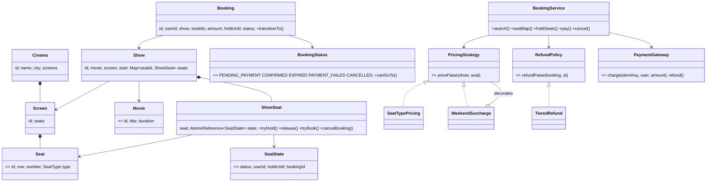
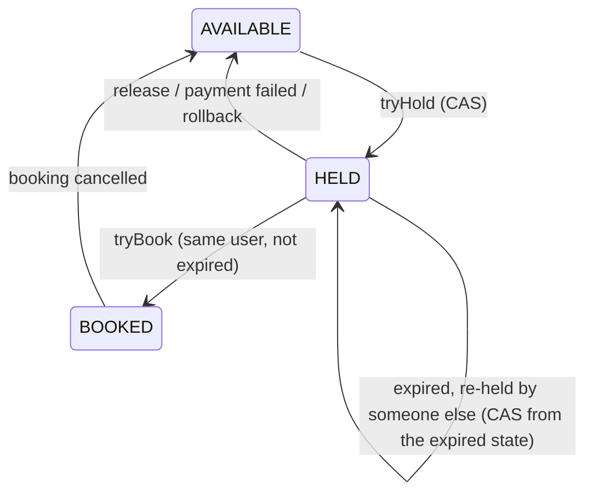

# LLD 07 · Movie Ticket Booking (BookMyShow), plus the Hotel and Airline variants

> Tier 2, heavy on **concurrency (seat locking)**, **state transitions** and **Strategy/Observer**. This is *the* booking template: hotel and airline reservations reuse the same hold → pay → confirm skeleton (section 10).
> Code: [`MovieBookingSystem.java`](MovieBookingSystem.java). Run with `java MovieBookingSystem.java` (25 checks, including a 200-user race on 20 seats).

---

## 1. Clarifying questions

| Question | Assumption |
|---|---|
| Scope of the catalogue? | City → cinemas → screens → shows of movies |
| Do users pick exact seats? | Yes (a seat map) |
| Max seats per booking? | 10 |
| How long can a user hold seats while paying? | **5 minutes**, then auto-release |
| Partial success when selecting several seats? | **No: all-or-nothing** |
| Pricing? | By seat type, with weekend/prime-time surcharges (rules change → Strategy/Decorator) |
| Cancellation? | Allowed, with a time-based refund policy |
| Payment? | An external gateway; may fail or be slow; must be idempotent |
| Food add-ons, offers, loyalty? | Out of scope (extensions) |

## 2. Requirements
**Functional:** search shows; view the seat map; hold seats; pay; confirm; cancel with a refund; notify on confirmation.
**Non-functional:** **no double booking, ever**; abandoned holds free themselves; a payment retry never charges twice; high contention on popular shows (opening night).

## 3. Thinking process
1. **Separate the catalogue from the inventory.** `Seat` is a physical seat in a screen (static). `ShowSeat` is that seat *for one show* (dynamic status). Mixing them is the classic modelling error: you can't sell seat F7 for both the 6 pm and 9 pm shows.
2. **The critical section is "seat → mine"**, and it must be:
   - **atomic**, so two users never both get F7
   - **all-or-nothing** across several seats
   - **temporary** (a hold with expiry), because payment takes minutes, and holding a DB lock for minutes is unacceptable
3. **Two-phase booking:** `HOLD (soft lock, TTL)` → `PAY` → `CONFIRM (only if the hold is still mine and unexpired)`.
4. **Booking is a state machine**: `PENDING_PAYMENT → CONFIRMED | EXPIRED | PAYMENT_FAILED`, `CONFIRMED → CANCELLED`. Transitions are validated in one place (`canGoTo`).
5. **What varies?** Pricing (seat type, weekend, dynamic), refund rules, the payment provider, notification channels → Strategy / Decorator / interface / Observer.

## 4. Class diagram



**Seat lifecycle (per show)**


## 5. Key flows

**holdSeats(user, show, seats)**
```
validate count, show not started
sort + dedupe seat ids                      // consistent order (and avoids self-conflict)
for seat in sorted:
    CAS  AVAILABLE-or-EXPIRED-HOLD  ->  HELD(user, now + 5 min)
    on failure: release the seats taken so far (only OUR holds), fail
price via PricingStrategy, create Booking(PENDING_PAYMENT, holdUntil)
```
**pay(booking)**
```
must be PENDING_PAYMENT and not past holdUntil (else EXPIRED + release)
gateway.charge(idempotencyKey = bookingId)  // a retried request can't double-charge
declined -> PAYMENT_FAILED + release seats
for each seat: CAS HELD(me, unexpired) -> BOOKED(bookingId)
    if any fails (the hold expired during a slow payment and was taken):
        undo, REFUND, mark EXPIRED          // compensation
CONFIRMED -> notify observers (e-ticket, SMS)
```

## 6. Patterns used

| Pattern | Where | Why |
|---|---|---|
| **State (enum transition table)** | `BookingStatus.canGoTo` | All legal transitions in one place; illegal ones throw (tested: CANCELLED → CONFIRMED) |
| **Strategy** | `PricingStrategy`, `RefundPolicy` | Cinemas and seasons differ |
| **Decorator** | `WeekendSurcharge(inner)` | Stack surcharges/discounts without class explosion: `Festival(Weekend(SeatType))` |
| **Observer** | `onConfirmed` listeners | E-ticket, SMS, loyalty points, analytics |
| **Adapter (interface)** | `PaymentGateway` | Razorpay/Stripe adapters plugged in; the fake in tests |
| **Immutable value + CAS** | `SeatState` record in an `AtomicReference` | Lock-free, consistent snapshots |

## 7. Concurrency (the heart of this problem)
- **Per-seat CAS on an immutable state object**: `compareAndSet(current, HELD(me, until))`. Only one thread can move a given snapshot forward.
- **All-or-nothing without locks**: acquire in **sorted** order; on any failure **roll back** only our own holds. There are no locks, so there's no deadlock. Sorted order also makes two overlapping requests fail fast at the same seat instead of each holding half.
- **Expiry needs no cleanup thread for correctness**: an expired hold counts as free, and the next `tryHold` CASes over it. A periodic sweeper is still nice for accurate seat maps and metrics.
- **The confirm step re-validates** ownership and expiry with a CAS, so a payment completing after expiry can't steal a re-sold seat. It refunds instead.
- **The race test:** 200 users, random 1–4 seat groups, 20 seats → every seat sold at most once, no seat stuck in HELD, and every BOOKED seat maps to exactly one confirmed booking.

**In a real (distributed) system:**
- Holds go in **Redis**: `SET seat:{show}:{seat} user NX PX 300000` per seat (a Lua script makes multi-seat holds all-or-nothing), or in a DB row `UPDATE show_seat SET status='HELD', user=?, hold_until=? WHERE show_id=? AND seat_id IN (...) AND (status='AVAILABLE' OR hold_until < now())`, checking the row count = number of seats.
- Confirmation: `UPDATE … SET status='BOOKED' WHERE … AND user=? AND hold_until > now()` in the same transaction as inserting the booking.
- The **unique constraint** `(show_id, seat_id)` on confirmed tickets is the last line of defence.

## 8. Edge cases
Duplicate seat ids in one request · an unknown seat · 0 or > 10 seats · a show already started · paying after hold expiry · a payment declined · a hold expiring *during* payment (refund + EXPIRED) · paying twice (idempotent gateway + state check) · cancelling twice · cancelling someone else's booking · refunds by time window.

## 9. Extensions
- **Waitlist** for sold-out shows: a FIFO per show; on cancellation, notify the first in line (Observer).
- **Dynamic pricing**: `DemandPricing` decorator using occupancy %.
- **Seat-gap rule** (no single empty seat left between bookings): a validation strategy on the selection.
- **Coupons / offers**: a `DiscountStrategy` chain applied to the amount.
- **Group booking across shows** or **food add-ons**: line items on `Booking`.
- **Virtual waiting room** on opening night: admission control (a token queue) before the seat map.

## 10. The same design for Hotel and Airline booking (asked often)

| Concern | Movie | Hotel | Airline |
|---|---|---|---|
| Inventory unit | a specific seat in a show | **room-type count per night** (usually not a specific room until check-in) | a seat class count per flight (+ optional seat selection) |
| Hold | per seat, 5 min | per (roomType, night) for each night of the stay, all-or-nothing **across the date range** | per (flight, class) count, then a seat assignment |
| Atomic op | CAS a seat state | `available[roomType][night] -= 1` for **every** night, or roll back | decrement a fare-bucket count; overbooking allowed by policy |
| Pricing | seat type + weekend | **per-night** rates, seasons, length-of-stay discounts | fare classes (buckets), dynamic |
| Cancellation | tiered refund | free until X days before | fare rules |
| Extra | | overbooking + walk policy, check-in assigns a room | PNR, multi-leg itineraries (all legs or none = a saga) |

The skeleton is identical: **search → hold (TTL, atomic, all-or-nothing) → pay (idempotent) → confirm (re-validate) → notify**, with booking as a state machine. Say this explicitly; it shows you recognise the pattern.

## 11. Interview Q&A

**Q1. How do you prevent two users booking the same seat?**
Per-seat atomic state transitions (CAS here; a conditional UPDATE or Redis `SET NX` in production), with a unique constraint on `(show_id, seat_id)` as the final guarantee.

**Q2. Why not just lock the seat row during payment?**
Payment can take minutes. Holding DB locks that long kills throughput and risks lock leaks. A soft hold with an expiry decouples the user's think-time from database locks.

**Q3. What happens if the user closes the browser after holding seats?**
The hold expires after 5 minutes. Expired holds are treated as available, and the next user's CAS reclaims them; a sweeper can also clean them up proactively.

**Q4. The payment succeeded but the hold had expired and the seat was resold. Now what?**
Confirmation re-checks ownership, so it fails. Compensate: refund automatically and mark the booking EXPIRED. Alternatively, extend the hold when payment starts (a "payment in progress" state) to shrink that window.

**Q5. How do you make multi-seat selection all-or-nothing?**
Acquire seats in sorted order; on the first failure, release the ones acquired. In a DB, use a single conditional UPDATE over all seats and compare the affected row count; in Redis, a Lua script.

**Q6. Why sort the seat ids?**
Consistent ordering prevents deadlock in lock-based implementations, and with CAS it makes conflicting requests collide at the same first seat (fail fast) rather than each grabbing half.

**Q7. How do you avoid double charging?**
The idempotency key = booking id at the gateway; the booking state check (`PENDING_PAYMENT` only) blocks a second pay; and the gateway's charge is deduplicated by key.

**Q8. How would you scale opening-night traffic?**
Shard inventory by show; cache the seat maps with short TTLs; put holds in Redis; use a virtual queue/waiting room to meter users into the seat selection page; rate-limit per user.

**Q9. How do pricing rules stay maintainable?**
A base strategy plus decorators (weekend, prime time, festival), configured per cinema. New rules are new classes, and existing ones don't change.

**Q10. How is this different for hotels?**
The inventory is counts per room type per night, and a stay spans several nights, so the hold must atomically decrement every night in the range (all-or-nothing across dates). The rest of the flow is the same.

## 12. Common mistakes
- No distinction between `Seat` and `ShowSeat`.
- Check-then-set without atomicity ("if available, then book").
- Holding seats forever (no TTL) or holding DB locks during payment.
- No re-validation at confirm time.
- Partial seat allocation on conflict.
- Status as free-form strings changed anywhere.
