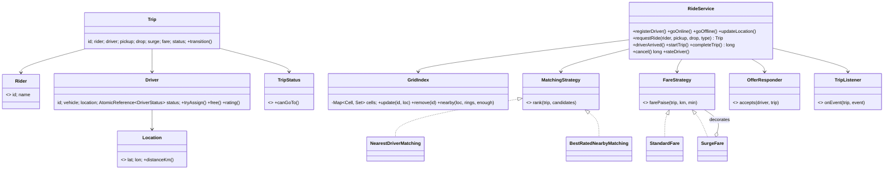
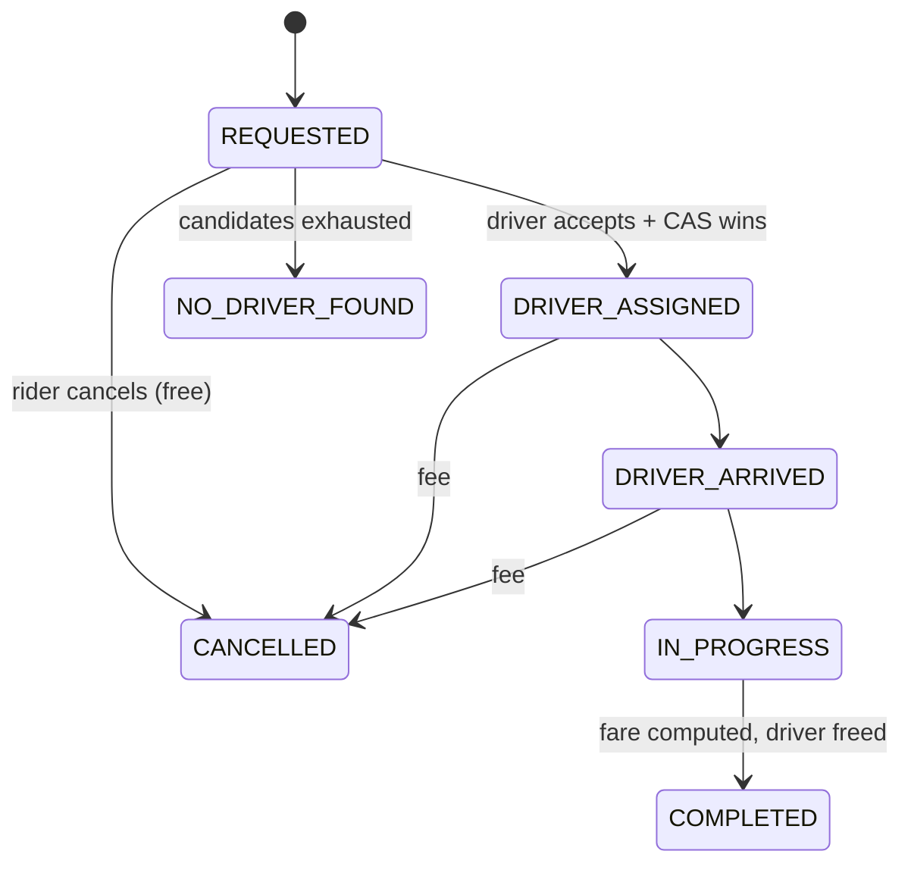

# LLD 08 · Ride-Sharing System (Uber / Ola)

> Tier 2. It tests a **matching algorithm** with a **spatial index**, a real-time **state machine** (trip and driver), **Strategy** for matching and pricing (with surge as a **Decorator**), and the race "two riders, one driver".
> Code: [`RideSharingSystem.java`](RideSharingSystem.java). Run with `java RideSharingSystem.java` (18 checks, including 100 riders vs 30 drivers concurrently).

---

## 1. Clarifying questions

| Question | Assumption |
|---|---|
| Actors? | Rider, Driver, System (matching, pricing) |
| Vehicle categories? | Bike, Auto, Mini, Sedan, SUV: a rider requests one category |
| How is a driver chosen? | Nearby candidates are ranked by a strategy (nearest / best-rated); an **offer** goes to one driver at a time, and the driver may decline |
| Pool / shared rides? | Out of scope (extension) |
| Fare? | Base + per km + per minute, × **surge** from demand/supply |
| Cancellation? | Free before assignment, a fee after |
| Ratings? | The rider rates the driver after completion |
| Scale signals? | Thousands of drivers sending location every few seconds: the location update path must be cheap |
| Payments, ETAs from road maps? | Out of scope (haversine distance as a proxy; a routing service behind an interface in production) |

## 2. Requirements
**Functional:** drivers go online/offline and stream locations; a rider requests a ride → match → driver arrives → start → complete → fare → rating; cancellation with a fee; surge pricing.
**Non-functional:** a driver is never assigned two trips; matching is fast (no full scan of drivers); location updates are concurrent and cheap; algorithms are pluggable.

## 3. Thinking process
1. **Separate "find" from "choose" from "commit":**
   - *find* candidates nearby → a **spatial index** (grid / geohash)
   - *choose* an order → `MatchingStrategy` (nearest, best-rated, ETA-based, fairness to idle drivers)
   - *commit* → atomic `driver.tryAssign()` (CAS `AVAILABLE → ON_TRIP`). If it fails, someone else got the driver: move on.
2. **Why a spatial index:** scanning 100k drivers per request is too slow. Bucket drivers into ~1 km cells; a query checks the rider's cell and a few rings around it. A location update just moves an id between two concurrent sets. In production use geohash, S2 or Uber's **H3** hexagons; the idea is the same.
3. **Two state machines:** `Trip` (REQUESTED → DRIVER_ASSIGNED → DRIVER_ARRIVED → IN_PROGRESS → COMPLETED, with CANCELLED / NO_DRIVER_FOUND) and `Driver` (OFFLINE ↔ AVAILABLE ↔ ON_TRIP).
4. **Surge:** demand (open requests in the cell) / supply (available matching drivers nearby), clamped to [1.0, 3.0]. It's captured **at request time** so the rider sees the price before confirming.
5. **Ratings:** `DoubleAdder` + `LongAdder` give a concurrent average without locks.

## 4. Class diagram



**Trip lifecycle**


## 5. Key flow: requestRide
```
demand(cell)++                                   // for surge
candidates = grid.nearby(pickup, rings ≤ 3)      // a handful of cells, not every driver
           .filter(type matches, AVAILABLE)
surge = demand / candidates (clamped)
for d in matching.rank(trip, candidates):
    if !d accepts the offer: continue            // in reality: a push + a 10-15 s timeout
    if !d.tryAssign():  continue                 // CAS lost: another rider got them
    grid.remove(d); trip -> DRIVER_ASSIGNED; notify; return
trip -> NO_DRIVER_FOUND
finally demand(cell)--
```

## 6. Patterns used

| Pattern | Where | Why |
|---|---|---|
| **Strategy** | `MatchingStrategy`, `FareStrategy` | Cities and products differ (nearest vs rating vs ETA; Auto vs Premier pricing) |
| **Decorator** | `SurgeFare(StandardFare)` | Surge, tolls, promos stack on any base fare |
| **State (enum table)** | `TripStatus.canGoTo` | One place for legal transitions; illegal ones throw |
| **Observer** | `TripListener` | Rider app, driver app, ETA service, analytics |
| **Dependency injection** | `OfferResponder`, clock | Tests simulate declines and time |

## 7. Concurrency
- **Driver assignment is a CAS**: `AVAILABLE → ON_TRIP`. 100 concurrent riders and 30 drivers → exactly 30 matches, and no driver gets two trips (tested). A losing rider just tries the next candidate.
- **Location updates**: `volatile Location` on the driver + concurrent cell sets. Thousands of updates per second need no global lock.
- **Trip transitions** are `synchronized` per trip (low contention: one rider, one driver).
- **Stale candidates** (a driver went offline after the search) are handled because the CAS fails or the status filter excludes them. Searches are always optimistic.
- In production, driver state lives in Redis (`SET driver:{id}:trip tripId NX`), and the dispatch service shards by city/cell so each cell's matching is single-threaded (an actor per region).

## 8. Edge cases
Nearest driver has the wrong vehicle type · driver declines → next candidate · nobody within range → NO_DRIVER_FOUND · cancel before vs after assignment (fee) · cancel twice · rating before completion or outside 1–5 · surge when supply is 0 (capped at 3.0) · a driver moving between cells mid-search.

## 9. Extensions
- **ETA-based matching**: replace distance with a routing-service ETA (`EtaMatching` strategy).
- **Batched matching**: collect requests for 2 s and solve a global assignment (Hungarian algorithm / min-cost flow), which beats greedy per-request matching at peak.
- **Pool rides**: a trip has several riders; the matcher checks detour constraints.
- **Driver fairness**: boost drivers idle longest (a strategy weight).
- **Scheduled rides**: a job scheduler (LLD 13) triggers matching 15 minutes before pickup.
- **Payments**: on COMPLETED, charge via the payment service (LLD 18) with idempotency key = trip id.

## 10. Interview Q&A

**Q1. How do you find nearby drivers efficiently?**
A spatial index: bucket by grid/geohash cell and search the rider's cell plus neighbouring rings. Geohash prefixes give "nearby" as string-prefix lookups; H3 hexagons give uniform neighbour distances.

**Q2. How do you stop two riders getting the same driver?**
An atomic transition on driver status (CAS in memory; `SET NX` / a conditional update in a store). Losers retry with the next candidate.

**Q3. What if the driver doesn't respond to the offer?**
The offer has a timeout. On expiry it counts as a decline and the next candidate gets the offer. Offering to one driver at a time avoids double acceptance; offering to several in parallel is faster but needs the CAS to pick one winner.

**Q4. How is surge computed?**
The demand/supply ratio per cell over a short window, clamped and smoothed, recomputed every minute or so. It's shown to the rider and locked into the trip at request time.

**Q5. How do you handle millions of location updates?**
Drivers send updates to a location service that writes only the latest position (in-memory/Redis geo) and moves cell membership. No database write per update; persist traces asynchronously for fare disputes.

**Q6. How would you calculate the fare fairly?**
From the GPS trace distance and duration at completion (not straight-line distance), using the pricing strategy for the product and the surge locked at request time, plus tolls. Upfront pricing is a different strategy: quote from the planned route.

**Q7. How do the Trip and Driver states stay consistent?**
Assignment updates both: CAS the driver first, then transition the trip. Completion and cancellation free the driver. In a distributed system this is a small saga with compensations (if the trip update fails, release the driver).

**Q8. How would you test matching?**
Inject the responder (to simulate declines), the clock and the strategies; place drivers at known offsets. The grid is verified against a brute-force scan on random data (tested: every driver within 1 km is found).

**Q9. Greedy nearest-driver: what's the downside?**
It's locally optimal and globally poor: it can take a driver who is the only option for another rider. Batch matching solves an assignment problem over many riders and drivers at once.

**Q10. How do ratings avoid contention?**
`DoubleAdder` / `LongAdder` for the sum and count give lock-free updates; reading the average is approximate under concurrent writes, which is acceptable.

## 11. Common mistakes
- Scanning all drivers per request.
- No atomic assignment (double dispatch).
- Trip status as free-form updates.
- Surge recomputed after the rider has accepted a price.
- Location updates writing to a relational DB synchronously.
