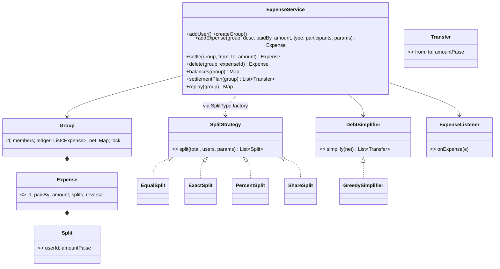

# LLD 09 · Splitwise (Expense Sharing + Debt Simplification)

> Tier 2, a favourite because it combines **OOP** (split types as Strategy + Factory), **money correctness** (no lost paise), **ledger design** (append-only, derived balances), and an **algorithm** (minimising transfers, greedy vs NP-hard optimal).
> Code: [`SplitwiseSystem.java`](SplitwiseSystem.java). Run with `java SplitwiseSystem.java` (23 checks).

---

## 1. Clarifying questions

| Question | Assumption |
|---|---|
| Groups or one-to-one? | Groups (one-to-one = a group of two) |
| Split types? | Equal, Exact amounts, Percent, Shares (weights). More may come |
| One payer or several per expense? | One payer (multi-payer is an extension: model it as several expenses or payer splits) |
| Currency? | One currency, integer paise (multi-currency is an extension) |
| Edit/delete expenses? | Yes, but **history must stay auditable** |
| "Simplify debts"? | Yes: produce a small set of transfers that settles everyone |
| Settle up? | Record payments between members |
| Notifications? | On every expense (Observer) |

## 2. Requirements
**Functional:** users, groups, add an expense with a split type, see balances ("who owes whom"), a simplified settlement plan, settle up, delete an expense.
**Non-functional:** **exact money** (no paise appear or vanish); concurrent additions to a group stay consistent; easy to add split types; auditable history.

## 3. Thinking process
1. **The invariant first:** in a group, Σ net balances = 0, always. Every design choice protects it.
2. **Splits must be exact.** ₹100 ÷ 3 isn't representable. Use integer paise and **distribute the remainder** (largest-remainder method): 3334, 3333, 3333. One `proportional()` helper powers Equal, Percent and Share; Exact only validates.
3. **Strategy + Factory for split types:** `SplitType → SplitStrategy`. Adding "split by item" is a new class plus one map entry.
4. **Ledger vs balances:** store **expenses** (immutable, append-only) as the source of truth, and keep **net balances** as a derived cache updated in the same critical section. Deleting appends a **reversal** (negated expense), never rewriting history. This is the accounting principle, and it's how money systems stay auditable. The `replay()` check proves the cache equals a full recomputation.
5. **Settle-up is just an expense** (payer = debtor, single participant = creditor), so it reuses the same path and invariant.
6. **Simplification is a separate algorithm** behind `DebtSimplifier`.

## 4. Class diagram



## 5. Key flows
**addExpense:** validate (amount > 0, payer and participants in the group) → `strategy.split()` (exact paise) → under the group lock: append to the ledger, `net[payer] += amount`, `net[p] -= share` for each participant → notify listeners after unlocking.

**Simplify (greedy):**
```
creditors = max-heap of positive balances, debtors = max-heap of |negative| balances
while both non-empty:
    c = biggest creditor, d = biggest debtor
    amt = min(c, |d|);  emit d -> c : amt
    push back whichever still has a remainder
```
Each step zeroes at least one person, so at most n − 1 transfers.

## 6. The algorithm discussion (interviewers love this)
- **Without simplification**, pairwise debts can be O(n²) transfers.
- **Net balances first** (who is +/−) already removes cycles (A→B→C→A).
- **Greedy (largest creditor vs largest debtor):** ≤ n − 1 transfers, O(n log n). Not always minimal. The demo shows `{A:+5, B:+4, C:−4, D:−3, E:−2}`: greedy uses **4**, optimal **3** (it keeps the perfect pair B/C).
- **Optimal minimum** = n − (maximum number of disjoint zero-sum subsets). It's **NP-hard** (subset-sum style). Backtracking (LeetCode 465) is fine for small groups. 300 random cases check that optimal ≤ greedy and that greedy always settles everyone.
- **What to say:** "I'd ship greedy (fast, bounded, good enough) and optionally run exact search for small groups."

## 7. Patterns used

| Pattern | Where | Why |
|---|---|---|
| **Strategy** | `SplitStrategy`, `DebtSimplifier` | Split types and simplification algorithms vary independently |
| **Factory** | `STRATEGIES` map (SplitType → strategy) | Callers pass a type, not a class |
| **Observer** | `ExpenseListener` | Push notifications, activity feed |
| **Event sourcing (light)** | append-only ledger + replay | Audit, undo by reversal, a rebuildable cache |
| **Value objects** | `Expense`, `Split`, `Transfer` records | Immutable facts |

## 8. Concurrency
- **One lock per group**: the ledger append and the balance updates must be atomic together. Groups are independent, so no global lock.
- 16 threads × 250 expenses on one group: Σ balances stays exactly 0, and the cached balances equal a full ledger replay (tested).
- Listeners are called **after** releasing the lock.
- Production: an `expenses` table + `expense_splits`; balances via an aggregate query or a materialised table updated **in the same transaction**; optimistic `version` on the group row, or row locks per (group, user) balance.

## 9. Edge cases
Rounding (₹100 / 3, odd percentages) · exact amounts not adding up · percents ≠ 100 · zero/negative weights · a participant or payer outside the group · deleting twice · settling more than owed (creates a reverse balance, which is allowed) · zero balances omitted from views · an empty plan when everyone is even.

## 10. Extensions
- **Multi-payer expenses**: a `payers: List<Split>` mirroring the participants; net = paid − owed.
- **Multi-currency**: store the original currency + amount; convert at the expense's FX rate into the group currency; balances per currency or normalised.
- **Recurring expenses** (rent): a scheduler creates expenses monthly.
- **Itemised bills**: an `ItemizedSplit` strategy where each item has its own participant subset.
- **Reminders**: a job that nudges debtors above a threshold.
- **Cross-group simplification**: simplify across all groups between the same users (careful: users may want groups separate).

## 11. Interview Q&A

**Q1. How do you split ₹100 among 3 without losing a paisa?**
Work in integer paise. Give everyone `floor(total × w / W)`, then hand the leftover paise to the participants with the largest fractional remainders (ties → a stable order). The parts always sum to the total.

**Q2. Why store expenses and not just balances?**
Balances alone can't explain *why* someone owes money, can't support edits or audits, and can't be recomputed if a bug corrupts them. The expense ledger is the source of truth; balances are a cache.

**Q3. How do you delete or edit an expense?**
Append a reversal (the negated expense). An edit = a reversal + a new expense. History stays complete and balances stay consistent.

**Q4. How do you minimise the number of transactions?**
Compute net balances, then greedily match the largest creditor with the largest debtor (≤ n−1 transfers). The true minimum is NP-hard; for small n, backtrack over zero-sum subsets.

**Q5. Why is the optimal problem NP-hard?**
Minimum transfers = n − max number of disjoint zero-sum subsets, which needs subset-sum-like partitioning, a known NP-complete family.

**Q6. Where do you put the validation "percent must add to 100"?**
Inside the `PercentSplit` strategy. Each strategy owns its own parameter rules, so the service stays generic.

**Q7. How do you keep balances correct under concurrent expense additions?**
Ledger append and balance update happen in one critical section per group (or one DB transaction). Invariant checks: Σ = 0, and replay equals the cache.

**Q8. Two people settle the same debt at the same time?**
Both settlements are recorded (they're real payments). The balance just flips sign and the plan shows a refund. To prevent it, use an idempotency key on settle requests from the client.

**Q9. How would you model "A paid for B only"?**
An Exact split with B's share = the full amount (or a Percent split of 100% to B). The payer isn't automatically a participant.

**Q10. How do you show "who owes whom" to a user?**
Either the simplified plan filtered to transfers involving that user, or pairwise balances (keep a pairwise matrix if the product needs "you owe X specifically" without simplification).

## 12. Common mistakes
- `double` amounts (0.1 + 0.2 bugs) or rounding each share independently (the total drifts by a paisa).
- `if (type == EQUAL) … else if (type == PERCENT)` in the service.
- Mutating or deleting ledger rows.
- Claiming greedy is optimal.
- Balances updated outside the lock that appends to the ledger.
