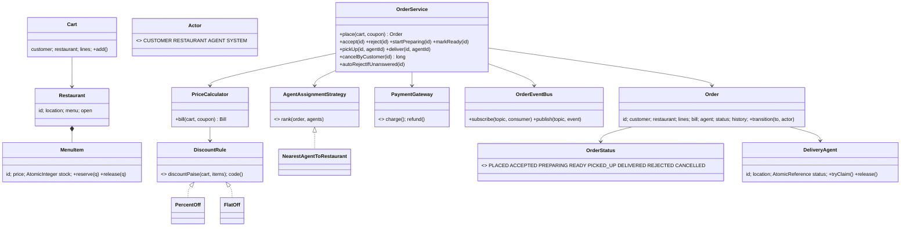
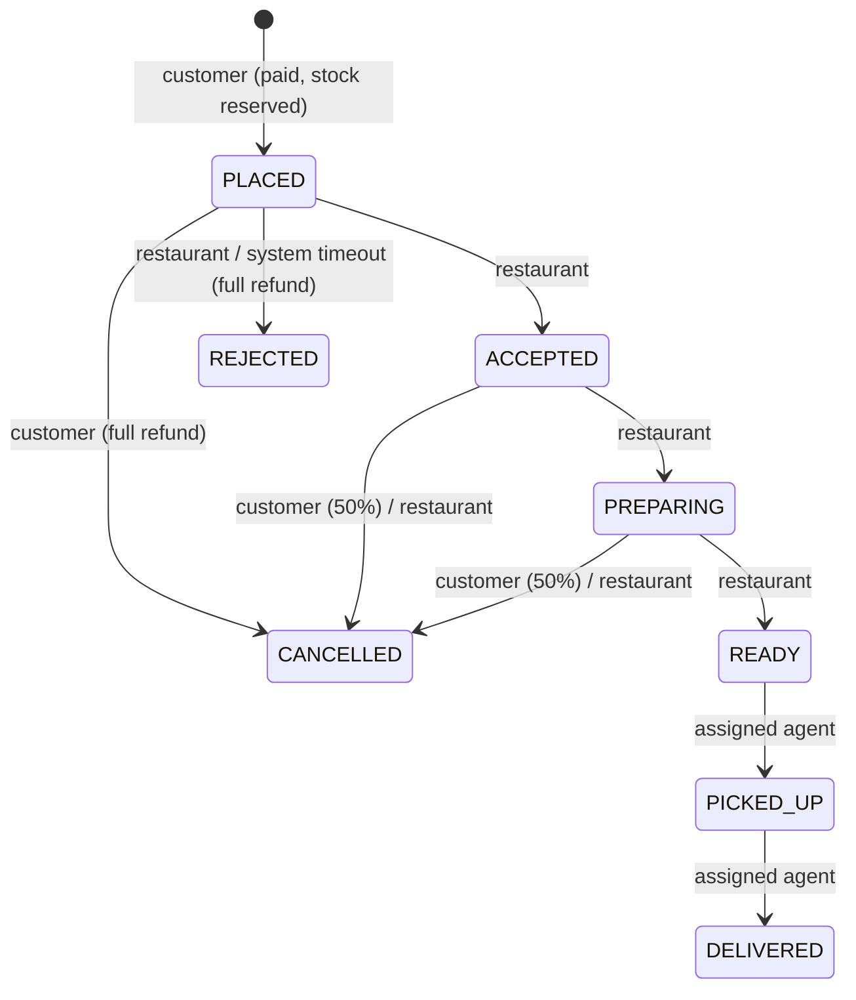

# LLD 10 · Food Delivery System (Swiggy / Zomato)

> Tier 2. A **multi-actor state machine**: the customer, restaurant, delivery agent and system all move one order through its lifecycle, and each may only perform *its* transitions. It also covers carts, coupons, limited stock, agent dispatch, events, refunds, and the race "customer cancels while the restaurant accepts".
> Code: [`FoodDeliverySystem.java`](FoodDeliverySystem.java). Run with `java FoodDeliverySystem.java` (18 checks, including 500 rounds of a cancel/accept race).

---

## 1. Clarifying questions

| Question | Assumption |
|---|---|
| Actors? | Customer, Restaurant, Delivery agent, System (timeouts, auto-reject) |
| Order from several restaurants at once? | **No**: one restaurant per cart/order |
| Limited items (today's special)? | Yes: per-item stock, reserved at order placement |
| Payment timing? | Prepaid at placement; refunds on reject/cancel |
| Cancellation policy? | Free before the restaurant accepts, 50% after, impossible once ready/picked up |
| Coupons? | Percent (with a cap) and flat, each with a minimum order |
| When is an agent assigned? | When the restaurant accepts (the nearest available agent) |
| Live tracking, ratings, ETAs? | Out of scope / extensions |

## 2. Requirements
**Functional:** browse menu → cart → bill with coupon → place (pay + reserve stock) → restaurant accepts/rejects → prepare → ready → agent picks up → delivered; cancellations and refunds; notifications to all parties.
**Non-functional:** each actor can only do its own steps; no overselling of limited items; no double-assigned agents; concurrent actions on one order resolve to a legal outcome.

## 3. Thinking process
1. **Find the central entity: `Order`.** Everything else (cart, bill, agent, events) feeds or reacts to its lifecycle.
2. **The state machine includes the actor.** A plain `from → to` table isn't enough: "PLACED → ACCEPTED" must be impossible for the customer. Model `(from, to) → allowed actors` in one map (`RULES`). It's reviewable, testable, and it doubles as authorization.
3. **Policies around transitions:** refunds depend on the state at the moment of cancellation (`transition` returns the previous state, so the refund decision uses exactly the state that was replaced, not a stale read).
4. **Inventory:** limited stock is a counter with a CAS decrement (never below 0). Reservation is all-or-nothing across cart lines.
5. **Dispatch:** a Strategy ranks agents; a CAS claims one.
6. **Notifications:** an event bus with topics per customer, restaurant and agent (Observer / pub-sub).

## 4. Class diagram



**Lifecycle, with who may do each step**


## 5. Key flows
- **place:** validate the cart and that the restaurant is open → reserve stock for each line (roll back on any failure) → bill (coupon validated) → charge → create Order(PLACED) → publish.
- **accept:** `transition(ACCEPTED, RESTAURANT)` → publish → assign an agent (rank → CAS claim → attach under the order lock *if still active*).
- **cancelByCustomer:** under the order lock: `transition(CANCELLED, CUSTOMER)` and read the agent → refund based on the **returned previous state** → release stock (only if nothing was cooked) and the agent → publish.

## 6. Patterns used

| Pattern | Where | Why |
|---|---|---|
| **State machine (table-driven) + authorization** | `RULES: from → to → actors` | One source of truth for lifecycle and permissions |
| **Strategy** | `AgentAssignmentStrategy`, `DiscountRule` | Dispatch and promotions evolve constantly |
| **Observer / pub-sub** | `OrderEventBus` topics | Customer app, restaurant tablet, agent app, analytics, all decoupled |
| **Adapter interface** | `PaymentGateway` | Swap providers, fake in tests |
| **Value objects** | `Bill`, `Location`, `OrderEvent` records | Immutable snapshots |

## 7. Concurrency, including the bug the tests found
- **Order transitions** are `synchronized` per order: concurrent actions serialise into one legal sequence.
- **Limited stock:** a CAS loop on `AtomicInteger`. 10 customers race for 2 portions → exactly 2 orders, and stock ends at 0, never negative (tested).
- **Agent claim:** CAS `AVAILABLE → BUSY`.
- **The race the test caught.** The first version had this interleaving:
  ```
  restaurant: transition PLACED -> ACCEPTED
  customer:   transition ACCEPTED -> CANCELLED, reads agent == null, releases nobody
  restaurant: claims agent X for the now-cancelled order  ->  X is BUSY forever
  ```
  **Fix:** after the CAS claim, attach the agent **under the order's lock only if the order is still ACCEPTED/PREPARING**, otherwise release the agent. The cancel side reads the agent under the same lock as its transition. Lesson to say in interviews: *every compound action touching two entities needs a re-check under a lock (or a transaction), even when each entity is individually thread-safe.*
- **The refund is decided from the state actually replaced** (`transition` returns `from`), so it's consistent with the race outcome: cancel-first → full refund, accept-first → 50% (verified over 500 rounds).

## 8. Edge cases
An empty cart · the restaurant closed · an item from a second restaurant · a sold-out item mid-checkout (stock rolled back) · an invalid or inapplicable coupon · the wrong agent picking up · cancelling after pickup · the restaurant never responding (system auto-reject) · no free agent (retry later).

## 9. Extensions
- **Agent assignment timing**: assign when `prepTime − agentETA ≈ 0` to reduce agent waiting time (a strategy using ETAs).
- **Batching**: one agent carries two orders from the same restaurant or route (the order → agent relation becomes many-to-one).
- **Live tracking**: an agent location stream → a customer topic (same bus).
- **Ratings & tips** after DELIVERED.
- **Restaurant capacity**: auto-pause accepting when the queue is long (backpressure).
- **Distributed:** an order service + a dispatch service + a payment service communicating by events; the order state machine persists with a `version` column (optimistic locking); refunds via an outbox → payment service.

## 10. Interview Q&A

**Q1. How do you stop the customer from marking an order as delivered?**
Every transition is checked against the `(from, to) → actors` table. The customer can only place and cancel; delivery is only allowed for the assigned agent (the agent id is checked too).

**Q2. Why return the previous state from `transition`?**
Decisions that depend on "what state was the order in?" (the refund amount) must use the state that was **atomically replaced**, not a separate read that may be stale by the time you act.

**Q3. How do you avoid overselling a limited dish?**
An atomic conditional decrement (CAS loop / `UPDATE item SET stock = stock - q WHERE id = ? AND stock >= q`). Reserve at placement; release on cancel-before-cooking or reject.

**Q4. When should an agent be assigned?**
Simplest: on acceptance. Better: when the remaining prep time ≈ the agent's travel time, so the agent doesn't wait and the food doesn't sit. It's a strategy decision.

**Q5. What happens if no agent is available?**
The order stays ACCEPTED/PREPARING without an agent; a dispatcher retries periodically or when an agent frees up (event). Escalate (surge pay for agents) if it takes too long.

**Q6. How do the four apps stay updated?**
Pub-sub topics per participant; in production, Kafka for events plus WebSocket/push gateways to the apps.

**Q7. Customer cancels exactly when the restaurant accepts: what happens?**
Order transitions are serialised. Either cancel wins (accept fails: "order cancelled") with a full refund, or accept wins and the cancellation incurs the 50% fee. The agent claimed by a losing accept is released. Tested over 500 concurrent rounds.

**Q8. How do you handle the restaurant not responding?**
A timer (scheduler) fires `autoRejectIfUnanswered` after N minutes; if the order is still PLACED, the SYSTEM actor rejects it and refunds.

**Q9. How would you persist this state machine safely across services?**
An order row with `status` and `version`; transitions do `UPDATE … SET status=?, version=version+1 WHERE id=? AND status=? AND version=?`. Side effects (refunds, notifications) go through an outbox table in the same transaction.

**Q10. Why one restaurant per order?**
Different restaurants have different prep times, locations and acceptance decisions; one order would need several agents and partial cancellations. Product-wise it's a common constraint; technically it keeps the aggregate simple.

## 11. Common mistakes
- Free-form `setStatus()` callable by anyone.
- Refund computed from a status read *after* the transition.
- Assigning an agent without re-checking that the order is still active (the leak shown above).
- Stock checked and decremented in two separate steps.
- Notifications sent synchronously inside locks.
