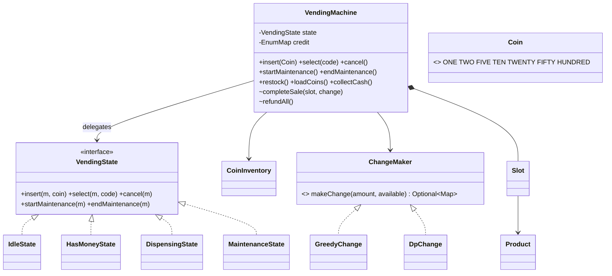
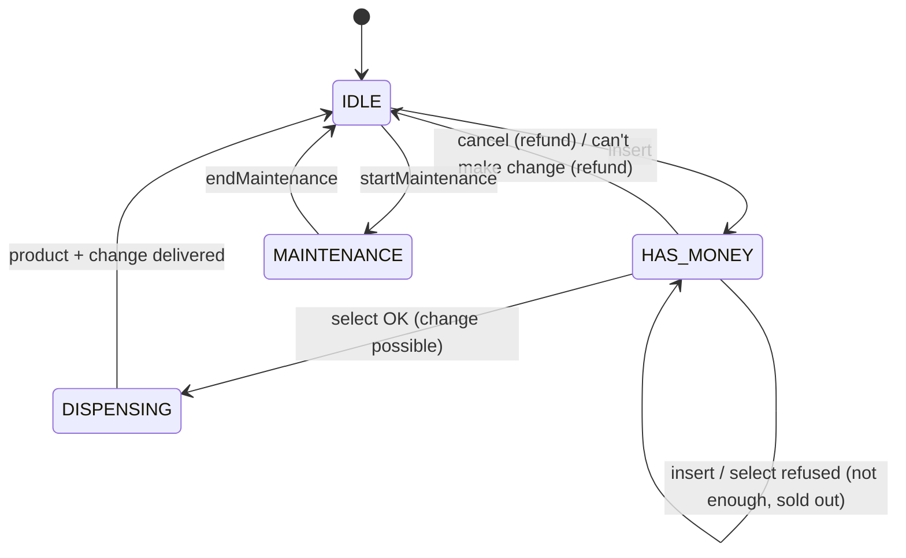

# LLD 11 · Vending Machine

> Tier 2, the **State pattern** textbook example. Interviewers then push on what the textbook skips: **making change with a limited coin box** (greedy fails), **refusing a sale atomically** when change can't be made, refunds, maintenance mode, and money conservation.
> Code: [`VendingMachineSystem.java`](VendingMachineSystem.java). Run with `java VendingMachineSystem.java` (26 checks).
> A minimal enum-based version is in [OOP P9_State](../../OOP/06-Design-Patterns/P9_State.java).

---

## 1. Clarifying questions

| Question | Assumption |
|---|---|
| Payment methods? | Coins/notes (₹1–₹100). Card/UPI is an extension (a Strategy) |
| Products? | Slots with a code (A1, B1…), a product, a price, a quantity |
| One item per transaction? | Yes; the customer may then insert more for another |
| Change? | Yes, from the machine's **limited** coin box, plus the customer's inserted coins |
| Can't make change? | Refuse the sale and return the customer's coins ("exact change only") |
| Admin? | Maintenance mode: restock, load coins, collect cash; no sales then |
| Concurrent users? | Physically one at a time; the code still guards against concurrent events (several buttons) |

## 2. Requirements
**Functional:** insert money, select a product, dispense + change, cancel/refund, sold-out handling, maintenance operations.
**Non-functional:** **money is conserved** (inserted = sales + returned); a sale is all-or-nothing; adding a state doesn't touch existing states.

## 3. Thinking process
1. **List the states:** IDLE (no money), HAS_MONEY, DISPENSING (motor running), MAINTENANCE. *Sold out* is a property of a slot, not a machine state. Don't over-model.
2. **List the events:** `insert`, `select`, `cancel`, `startMaintenance`, `endMaintenance`.
3. **Make the state × event table**, then implement each **row** as a class (the State pattern). Each class answers every event for its state, so all of IDLE's rules live together.
4. **Separate the money logic:** `CoinInventory` (the box) and `ChangeMaker` (the algorithm, a Strategy).
5. **Check everything, then commit.** Selecting a product checks the slot, the stock, the balance, and *whether change can be made*. Only then does `completeSale()` move coins, change, product and stock together.
6. **Refunds return the customer's own coins** (tracked separately as `credit`), not "any coins worth X".

| State \ Event | insert | select | cancel | maintenance |
|---|---|---|---|---|
| IDLE | add credit → HAS_MONEY | "insert money first" | "nothing to refund" | → MAINTENANCE |
| HAS_MONEY | add credit | checks → sell → IDLE (or refuse + refund) | refund → IDLE | refused |
| DISPENSING | busy, return the coin | busy | busy | refused |
| MAINTENANCE | return the coin | out of service | out of service | end → IDLE |

## 4. Class diagram

## 5. Change-making: the interesting algorithm
- **Greedy** (largest coin first) is optimal for canonical coin systems **with unlimited coins**.
- With a **limited box** greedy can fail even when change exists. To return ₹6 from `{5×1, 2×3}`: greedy takes 5 and is stuck needing 1; DP finds 2+2+2 (tested).
- **DP (bounded coin change):** treat each physical coin as a 0/1 item; `dp[a] = min coins for a`, looping amounts backwards; reconstruct by comparing table snapshots. Fine for vending amounts. Binary splitting of counts would scale it.
- The customer's inserted coins **count as available change** (insert ₹50 for a ₹35 item: the ₹10 and ₹5 may come from the box, or the customer's own coins may be reused).
- 500 random boxes check that DP succeeds whenever greedy does, and that its change is exact and within the box's counts.

## 6. Patterns used

| Pattern | Where | Why |
|---|---|---|
| **State** | `VendingState` + 4 classes | Each state's rules together; a new state (e.g. CARD_AUTHORIZING) = one class |
| **Strategy** | `ChangeMaker` (greedy vs DP) | Swap the algorithm without touching states |
| **Singleton-per-context states** | state instances inside the machine | States are stateless; no need for `new` on every transition |
| *Command (implicit)* | events as method calls | Could be queued/logged for audit |

**State vs Strategy:** they look identical structurally. A Strategy is chosen *from outside* and rarely changes; State objects *switch themselves* in response to events and know their successors.

## 7. Concurrency and correctness
- A physical machine serves one person, but several buttons and the coin acceptor fire events from different hardware threads → every event method is `synchronized` on the machine. State changes and money movements happen under one lock.
- **Money conservation invariant** (tested with 8 threads × 2,000 random events): `inserted = salesTotal + returned`, and the box grows by exactly `salesTotal`.
- **All-or-nothing sale:** every check (stock, balance, change) happens before any mutation; `completeSale` performs all effects together.

## 8. Edge cases
Selecting before paying · an unknown slot · sold out · insufficient balance (tells you how much more) · change impossible (refuse + full refund, stock untouched) · an exact amount with an empty box (works) · cancel with no money · coins inserted during maintenance or dispensing (returned) · admin operations outside maintenance (rejected) · entering maintenance mid-transaction (refused).

## 9. Extensions
- **Card/UPI**: a `PaymentMethod` strategy; a new `AUTHORIZING` state while waiting for the bank (timeouts → refund/void).
- **Multiple items per transaction**: a cart inside HAS_MONEY.
- **Telemetry**: an Observer on sales/stock → the operator's dashboard and restock routing.
- **Dynamic pricing / promotions**: a pricing strategy per slot.
- **Hardware faults** (product stuck): a `FAULT` state; refund and alert.

## 10. Interview Q&A

**Q1. Why the State pattern instead of a switch?**
With switches, each method has a `switch(state)` and a new state touches every method. With State classes, each state is one cohesive class, transitions are explicit, and adding a state is one class (Open/Closed).

**Q2. Is "SOLD_OUT" a state?**
Not of the machine: other slots may still sell. It's a slot condition checked in HAS_MONEY. A machine-level "EMPTY" state only makes sense if *every* slot is empty.

**Q3. How do you make change optimally?**
Greedy works for canonical denominations with unlimited coins. With a limited box, use a bounded coin-change DP (min coins) and reconstruct the coins used. If no solution exists, refuse the sale.

**Q4. What if change can't be made?**
Refuse the sale before dispensing and return the customer's own inserted coins. Never take money you can't settle.

**Q5. How do you guarantee money is never lost?**
Track the customer's credit separately from the box, commit a sale in one step after all checks, and keep the invariant `inserted = sales + returned` (tested under concurrency).

**Q6. How do states access machine data?**
They receive the context (`VendingMachine`) as a parameter and call package-private helpers (`credit`, `refundAll`, `completeSale`). States hold no data of their own, so one instance each is shared.

**Q7. How would you add card payments?**
Add `insertCard()` to the state interface (default: reject), and a CARD_AUTHORIZING state that waits for the gateway's callback, then moves to DISPENSING or back to IDLE with a void.

**Q8. Thread safety in an embedded machine?**
Hardware interrupts from the coin acceptor and keypad can interleave, so serialise event handling (one lock, or an event queue processed by one thread, like the elevator controller).

**Q9. How does the maintenance mode protect inventory changes?**
Admin methods require the MAINTENANCE state, and entering it is refused mid-transaction, so restocking can't race with a sale.

**Q10. How would you test it?**
Script event sequences and assert the states, outputs (dispensed, returned coins) and messages; property tests for change-making (random boxes); a concurrency test for money conservation.

## 11. Common mistakes
- Giant switches duplicated across methods.
- Dispensing first and only then discovering there's no change.
- Refunding "₹X worth" from the box instead of the customer's own coins (it can drain the change supply).
- Greedy change with a limited box.
- Treating sold-out as a machine state.
