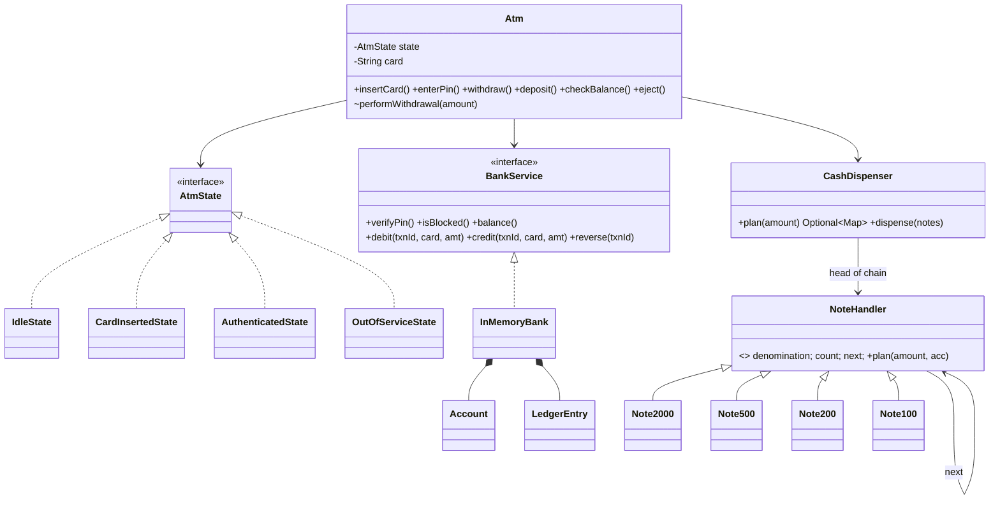
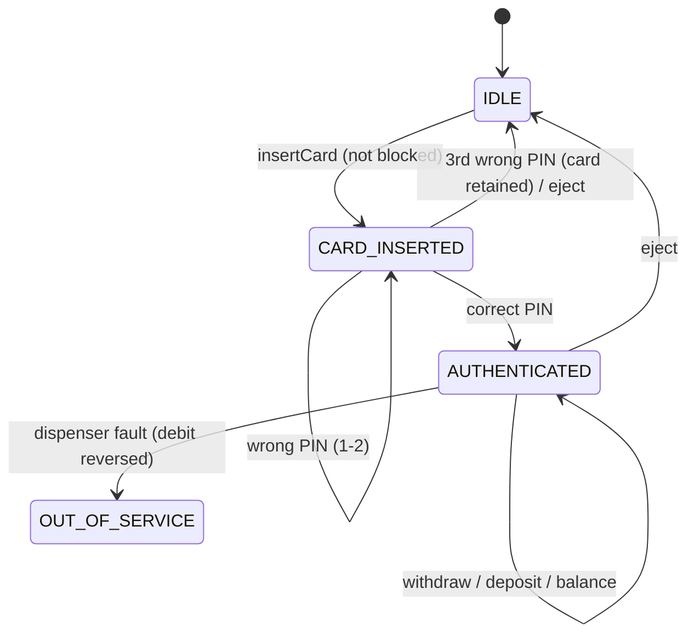

# LLD 12 · ATM System

> Tier 2. It tests the **State pattern** (the session lifecycle), **Chain of Responsibility** (the cash dispenser), and above all **transaction consistency** across two systems: the bank ledger and the physical cash. The key ideas are plan-before-debit, idempotent debits and compensating reversals.
> Code: [`AtmSystem.java`](AtmSystem.java). Run with `java AtmSystem.java` (24 checks, including 2 ATMs racing on one account).

---

## 1. Clarifying questions

| Question | Assumption |
|---|---|
| Operations? | Withdraw, deposit, balance inquiry (transfer and PIN change are extensions) |
| Who owns balances? | The **bank**. The ATM is a client of a `BankService` and never stores balances |
| PIN policy? | 3 wrong attempts → card blocked and retained |
| Limits? | Multiples of ₹100; a daily withdrawal limit of ₹40,000 |
| Notes? | ₹2000 / 500 / 200 / 100 with finite counts per cassette |
| Failure cases? | A dispenser jam after the debit, network retries, an ATM short of certain notes |
| Concurrency? | Several ATMs (and online banking) can hit the same account at once |

## 2. Requirements
**Functional:** card session (insert → PIN → operations → eject), withdraw with a note breakdown, deposit, balance, lockout, out-of-service mode.
**Non-functional:** **the customer is never charged without receiving cash**; retries never double-debit; concurrent withdrawals never overdraw or exceed the daily limit.

## 3. Thinking process
1. **Two state machines, two owners.** The *ATM session* (IDLE → CARD_INSERTED → AUTHENTICATED, plus OUT_OF_SERVICE) lives in the ATM. The *account* (balance, limit, PIN failures) lives in the bank. Keep them apart: the ATM calls `bank.debit(...)`.
2. **The order of operations is the design** (it's a saga):
   1. **Plan** the notes (no side effects). Can this ATM pay exactly this amount?
   2. **Debit** the bank with a unique `txnId`. This is idempotent: a retry after a timeout is a no-op.
   3. **Dispense.**
   4. On a dispenser failure, **reverse** the debit (a compensating transaction) and take the ATM out of service.
3. **The dispenser is a Chain of Responsibility**: each handler takes its notes and passes the rest on. It must **back off** when greedy fails (₹600 with one ₹500 and three ₹200 → 200×3).
4. **PINs are never stored raw.** The demo hashes them; real systems use an HSM and PIN blocks.

## 4. Class diagram





## 5. Key flow: withdraw(amount)
```
validate: > 0, multiple of 100
plan = dispenser.plan(amount)            // pure; fails -> "try another amount", NOTHING debited
txn  = new unique id
bank.debit(txn, card, amount)            // per-account lock; checks balance + daily limit; idempotent
try   dispenser.dispense(plan)
catch fault -> bank.reverse(txn); ATM -> OUT_OF_SERVICE; tell the customer they weren't charged
```

## 6. Patterns used

| Pattern | Where | Why |
|---|---|---|
| **State** | `AtmState` + 4 states | Each state's allowed operations together; defaults reject everything else |
| **Chain of Responsibility** | `NoteHandler` chain | Each denomination handles what it can; new denominations slot in |
| **Template Method (as a fixed sequence)** | `performWithdrawal` | The order validate → plan → debit → dispense → compensate is the invariant |
| **Saga / compensation** | `bank.reverse(txnId)` | Two systems, no shared transaction |
| **Idempotency key** | `txnId` in the bank ledger | Network retries are safe |
| **Facade / interface** | `BankService` | The ATM is decoupled from the core banking system |

## 7. Concurrency and consistency
- **Per-account lock in the bank**: balance and daily-limit checks plus the debit are atomic. 16 threads on 2 ATMs drain one account: it is never overdrawn, cash out = money debited, and the limit is respected (tested).
- **Idempotent debit and reversal** keyed by transaction id (tested by repeating both).
- **ATM methods are `synchronized`**: one session per machine; hardware events are serialised.
- **The dispenser re-validates counts** at dispense time ("notes changed since planning") in case of concurrent use or a reload.
- **Production:** the ATM talks to the bank over ISO 8583 messages; timeouts trigger an automatic **reversal advice**; end-of-day reconciliation compares ATM cassette counts with the ledger. Mention reconciliation: it's how real banks catch everything else.

## 8. Edge cases
Operations without a card · wrong PIN ×3 (card retained, then refused) · amounts not a multiple of 100 · insufficient funds · the daily limit · an ATM lacking the right notes (refused *before* debit) · greedy note selection failing (the handler backs off) · a jam after the debit (reversal + out of service) · a retried debit or reversal (idempotent).

## 9. Extensions
- **Transfer between accounts**: in the bank, lock both accounts in **id order** (avoids deadlock; see the [toolkit](../00-LLD-Playbook/ConcurrencyToolkit.java)).
- **Deposits with cash counting**: an escrow state ("counting…"), then confirm or return the notes.
- **Cardless (UPI/OTP) withdrawal**: a new authentication strategy feeding the same AUTHENTICATED state.
- **Preferred denominations**: the customer chooses the note mix; the chain respects the preferences first.
- **Monitoring**: low-cash and fault events → an operations dashboard (Observer).

## 10. Interview Q&A

**Q1. Debit first or dispense first?**
Plan first (no side effects), then debit, then dispense, and reverse if dispensing fails. Dispensing first risks giving free cash if the debit then fails; debiting without a plan risks charging for cash the ATM can't give.

**Q2. The network times out after the debit request. What now?**
You don't know if the debit happened. Retry with the **same txnId**: the bank applies it at most once. If it's still unknown, send a reversal for that txnId; reversals are idempotent too.

**Q3. How does the dispenser decide which notes?**
A chain of handlers from the largest denomination down, each taking as many notes as possible but backing off if the remainder can't be paid by the rest of the chain. It's essentially a bounded change-making search.

**Q4. Why is the ATM not allowed to hold balances?**
Balances belong to the bank's ledger, shared by all channels (other ATMs, the app, branches). A local copy goes stale and causes overdrafts.

**Q5. How do you stop two ATMs overdrawing a joint account?**
The bank checks and debits under a per-account lock (or a conditional `UPDATE … WHERE balance >= ?`). The ATMs just send requests.

**Q6. Why State classes here?**
Each operation's meaning depends on the session state, and default methods reject everything that isn't allowed, so adding a state (e.g. CARDLESS_AUTH) is one class.

**Q7. What happens to a jammed ATM?**
It reverses the in-flight debit, moves to OUT_OF_SERVICE, refuses new cards, and should raise an alert for the operator.

**Q8. How are PINs handled securely?**
They're never stored or logged in plain text. They're encrypted at the PIN pad, verified by the bank's HSM, and failures are counted server-side so attempts across ATMs add up.

**Q9. How do you guarantee the daily limit across channels?**
Track it in the bank account (per day) and check it inside the same atomic debit. The ATM can't enforce it alone.

**Q10. What is reconciliation and why mention it?**
A periodic comparison of the physical cash dispensed (cassette counters, journals) with the bank's ledger. It catches anything the online flow missed: lost reversals, partial dispenses.

## 11. Common mistakes
- Dispensing before or without a successful debit; debiting without checking the ATM can pay.
- No idempotency on debit (a timeout retry charges twice).
- Balance kept in the ATM object.
- Greedy notes without back-off.
- `if (state == …)` chains in every method.
