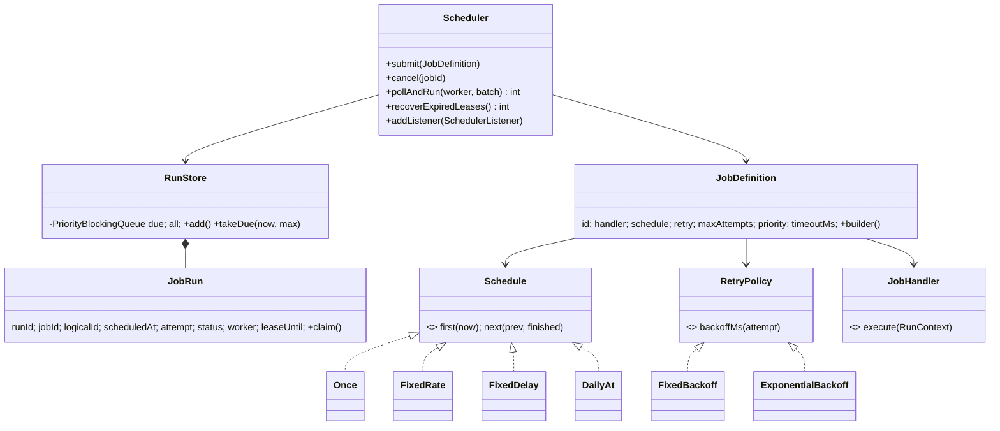
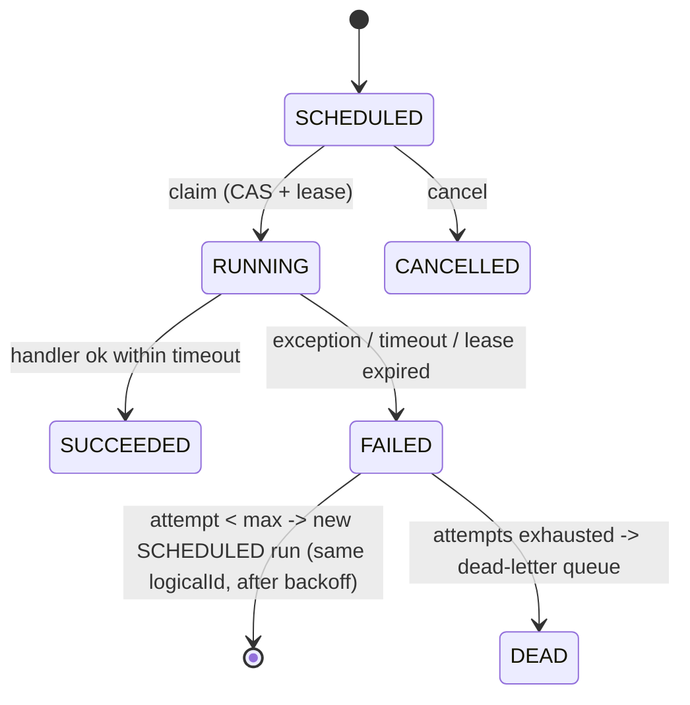

# LLD 13 · Distributed Job Scheduler

> Tier 3, a senior/staff differentiator. It tests **delivery semantics** (at-least-once vs exactly-once), **idempotency**, **retries with backoff and jitter**, **leases for crash recovery**, schedules (rate vs delay vs cron, misfires), a dead-letter queue, and "many workers, each job once".
> Code: [`JobSchedulerSystem.java`](JobSchedulerSystem.java). Run with `java JobSchedulerSystem.java` (17 checks; all deterministic thanks to an injected clock).

---

## 1. Clarifying questions

| Question | Assumption |
|---|---|
| Job types? | One-time (at T), recurring: fixed rate, fixed delay, daily-at (a mini cron) |
| Who runs jobs? | A pool of workers, possibly on many machines, polling a shared store |
| What if a job fails? | Retry with a policy (fixed / exponential + jitter) up to max attempts, then the **dead-letter queue** |
| Timeouts? | Per job; a timeout counts as a failure |
| Worker crashes mid-job? | The job must eventually run again (**lease** expiry) |
| Exactly-once? | Not promised; **at-least-once + idempotent handlers** (explain why) |
| Priorities? | Yes: among jobs due at the same time, lower number first |
| Dependencies (DAG), sharding, UI? | Extensions |

## 2. Requirements
**Functional:** submit / cancel jobs; run at the right times; retry with backoff; DLQ; timeouts; recover from worker crashes; listeners for success/retry/dead.
**Non-functional:** no run is executed by two workers at once; no run is lost; recurring jobs don't stampede after downtime; horizontally scalable workers; testable without real time.

## 3. Thinking process
1. **Separate *definition* from *execution*.** A `JobDefinition` (what, when, how to retry) is long-lived; a `JobRun` is one attempt of one occurrence (status, worker, lease, error). Retries create new runs **with the same logical id** (`job@occurrenceTime`).
2. **What varies → Strategy:** `Schedule` (when next) and `RetryPolicy` (how long to wait).
3. **Many options → Builder** for `JobDefinition`, with validated defaults.
4. **The claim is the critical section:** `SCHEDULED → RUNNING` by CAS (in a DB: `UPDATE … WHERE status='SCHEDULED'`, or `SELECT … FOR UPDATE SKIP LOCKED`). Only one worker wins.
5. **Workers die.** The claim comes with a **lease** (`leaseUntil`). A sweeper turns expired RUNNING runs into failures and retries them. This *creates* the at-least-once guarantee, which is why handlers must be idempotent.
6. **Time is a dependency:** inject the clock, and the tests become deterministic.

## 4. Class diagram

## 5. Key flows
**pollAndRun(worker):** `takeDue(now)` (pop due runs by time then priority) → `claim()` CAS → execute → on success, SUCCEEDED and the next occurrence → on failure, FAILED, then retry or DEAD.
**recoverExpiredLeases():** for each RUNNING run with `leaseUntil ≤ now`: CAS to FAILED and handle it like any failure.

## 6. Schedules and misfires

| Schedule | Next run | Use |
|---|---|---|
| FixedRate(p) | previous **scheduled** + p | steady cadence (metrics every minute) |
| FixedDelay(d) | previous **finish** + d | never overlap, drifts (cleanup jobs) |
| DailyAt(h, m) | next h:m after now | reports, billing |
| Once(t) | none | reminders, delayed tasks |

**Misfire:** the scheduler was down for 3.5 periods. Firing 3 catch-up runs at once is a stampede. The policy here skips to the next future slot (tested: `next(0, 3500) = 4000`). Quartz calls these misfire instructions: "fire once now" vs "skip"; make it configurable.

## 7. Retries: backoff and jitter
- **Exponential**: `base × 2^(n−1)`, capped (1 s, 2 s, 4 s, … ≤ 60 s).
- **Full jitter**: a random value in `[1, cap]`. When a DB blinks, 10,000 jobs fail together, and without jitter they all retry in the same millisecond and knock it over again (thundering herd).
- **Retry only transient errors**: a validation error will fail forever. Classify exceptions (retryable vs not) and send non-retryable ones straight to the DLQ (an extension).
- **DLQ**: dead runs are kept with their error for inspection and **replay** after a fix.

## 8. Concurrency and delivery guarantees
- **Claim by CAS** (`SCHEDULED → RUNNING`): 8 workers over 2,000 due runs → 2,000 executions, each job exactly once (tested).
- `takeDue` is atomic (peek + poll under one lock) so two pollers can't pop the same element.
- **At-least-once**: a worker can do the work and die before recording success. The lease expires, and the run executes again (tested: the handler ran twice). The fix is the **idempotent handler**: key side effects by `logicalId` (tested: the side effect happened once).
- **Why not exactly-once?** Marking a run done and performing an external side effect can't be atomic across two systems. You can only get *effectively once* with idempotency keys or a transactional outbox when the side effect is in the same DB.
- **Production store:** a `job_runs` table; workers poll with `SELECT … WHERE status='SCHEDULED' AND scheduled_at <= now() ORDER BY scheduled_at, priority FOR UPDATE SKIP LOCKED LIMIT 50`. Leases are a `lease_until` column; heartbeats extend leases for long jobs.

## 9. Edge cases
Cancel while scheduled (stops) vs while running (the attempt finishes, no more runs) · a duplicate job id · `maxAttempts < 1` · a timeout (detected after return; a real system interrupts the thread or kills the container) · a lease that expires while the worker is still alive but slow (its late success is ignored by the CAS) · a recurring job whose occurrence died (cadence continues) · priority ties.

## 10. Extensions
- **DAG / workflows**: a job runs when its parents succeed (topological order; see Graph topo-sort in DSA).
- **Sharding**: partition jobs by hash(jobId) across scheduler nodes; a leader per partition (ZooKeeper/etcd).
- **Rate-limited queues**: per-tenant concurrency limits (the Rate Limiter from LLD 04).
- **Heartbeats** for long jobs, and **cancellation tokens** checked by handlers.
- **Cron expressions**: a `CronSchedule` strategy parsing `0 9 * * MON-FRI`.
- **Exactly-once-ish via outbox**: the handler writes its effect and "done" in one DB transaction.

## 11. Interview Q&A

**Q1. How do you ensure a job runs on only one worker?**
An atomic claim: CAS / a conditional update / `SKIP LOCKED` row locks. Whoever changes the status from SCHEDULED wins; the others skip the run.

**Q2. A worker crashes mid-job. What happens?**
Its lease expires; the sweeper marks the run failed and schedules a retry; another worker runs it. That's at-least-once, so handlers must be idempotent.

**Q3. Can you guarantee exactly-once execution?**
Not for external side effects. You guarantee at-least-once and make the effect idempotent (idempotency key = logical run id), or keep effect and completion in one transaction.

**Q4. Fixed rate vs fixed delay?**
Rate schedules from the planned start (a steady cadence, runs can bunch up if late); delay schedules from completion (no overlap, the period drifts by the execution time).

**Q5. Why add jitter to exponential backoff?**
To desynchronise retries of jobs that failed together, avoiding retry storms that keep the dependency down.

**Q6. The scheduler was down for an hour. Do you run all the missed occurrences?**
Usually not: use a misfire policy (run once now, or skip to the next slot). For billing-style jobs you might need every occurrence; then catch up with rate limiting.

**Q7. How do you scale to millions of jobs?**
Partition the job store (by time bucket or hash), let workers pull with `SKIP LOCKED`, use a time-wheel / bucketed queue for near-term jobs, and keep the far future in the DB.

**Q8. How do you handle a job that runs longer than its lease?**
Heartbeat: the worker extends `lease_until` periodically. If it stops heartbeating, it's presumed dead. Set the lease well above the heartbeat interval.

**Q9. What's in the DLQ, and what do you do with it?**
Runs that exhausted their retries, with the error and the payload. Alert on growth; after fixing the root cause, replay them (new runs, same logical id, so idempotency still holds).

**Q10. How would you test this?**
An injected clock and synchronous execution make it deterministic: advance time, poll, assert the statuses. A thread-pool test verifies claim uniqueness. Fault injection (throwing handlers, simulated crashes) covers retries and leases.

## 12. Common mistakes
- Claiming "exactly once".
- No lease, so a crashed worker's jobs are stuck RUNNING forever.
- Retrying immediately and without a limit, with no jitter.
- Computing a recurring job's next time from *now* after a retry (the cadence drifts). Use the occurrence time.
- `Thread.sleep` in scheduling logic and tests.
