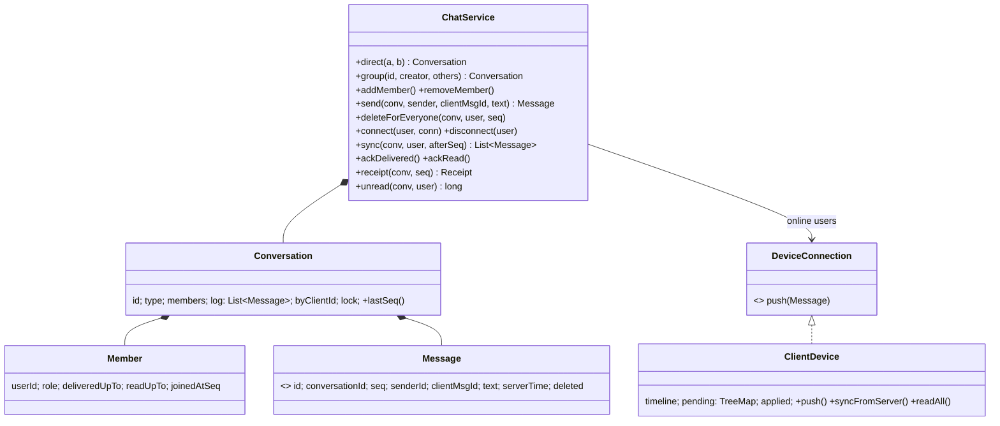

# LLD 14 · Chat Application (WhatsApp-like)

> Tier 3. It tests **message ordering** without trusting clocks, **reliable delivery** to devices that keep disconnecting, **idempotent sends**, **receipts** (✓ / ✓✓ / blue), **group fan-out** and permissions, and concurrent senders in one group.
> Code: [`ChatSystem.java`](ChatSystem.java). Run with `java ChatSystem.java` (26 checks, including 16 concurrent senders and out-of-order, lossy delivery).

---

## 1. Clarifying questions

| Question | Assumption |
|---|---|
| One-to-one and groups? | Both; groups have admins who add/remove members |
| Ordering guarantee? | A **single total order per conversation** that every member sees identically |
| Offline users? | Messages are stored; the device syncs on reconnect |
| Receipts? | SENT (server stored) → DELIVERED (all recipients' devices) → READ (all read) |
| New group members see old history? | No, only messages from when they joined |
| Delete for everyone? | Yes (a tombstone; the slot stays) |
| Media, E2E encryption, multi-device, typing indicators? | Discussed as extensions |
| Transport? | Abstracted as a `DeviceConnection.push()` (a WebSocket in reality) |

## 2. Requirements
**Functional:** direct and group chats, send, receive in real time when online, sync when back online, receipts, unread counts, member management, delete.
**Non-functional:** a consistent order; no loss; no duplicates shown after retries; concurrent senders don't corrupt the order; cheap per-member state.

## 3. Thinking process
1. **Never order by client timestamps.** Phone clocks are wrong and the network reorders packets. The **server assigns `seq = 1, 2, 3…` per conversation** under the conversation's lock. That one decision solves ordering for every member.
2. **Retries cause duplicates** (the send succeeded but the ack was lost). The client attaches a `clientMsgId`; the server dedupes on `(sender, clientMsgId)` and returns the *same* message and seq.
3. **Don't track delivery per message per user**, which is O(messages × members). Track **two cursors per (member, conversation)**: `deliveredUpTo`, `readUpTo`. Sync is "give me seq > cursor"; receipts compare cursors with a seq; unread = lastSeq − readUpTo.
4. **Online and offline are the same pipeline:** push if connected (best effort), and always store. A reconnecting device pulls from its cursor. Pushes can therefore be lost, duplicated or reordered without breaking correctness.
5. **The client needs a hold-back buffer:** apply seq N only after N−1; if a gap doesn't fill, sync.
6. **Groups:** store **one** copy of the message per conversation, and fan out *notifications* to online members (fan-out on write for delivery, single storage).

## 4. Class diagram

## 5. Key flows
**send(conv, sender, clientMsgId, text)**, under the conversation lock:
1. Membership check.
2. Dedupe: `(sender, clientMsgId)` seen → return the stored message.
3. `seq = lastSeq + 1`, append to the log, set the sender's cursors.
4. Push to the online members' connections (in seq order).

**reconnect:** `device.syncFromServer()` → `sync(conv, user, applied)` → push each message through the same hold-back buffer → `ackDelivered(applied)`.

**receipt(seq)** = READ if every other member's `readUpTo ≥ seq`; DELIVERED if every `deliveredUpTo ≥ seq`; otherwise SENT. Members who joined after that seq are ignored.

## 6. Patterns used

| Pattern | Where | Why |
|---|---|---|
| **Observer** | `DeviceConnection.push` | The server notifies whoever is connected; devices come and go |
| **Idempotency key** | `clientMsgId` | Safe retries |
| **Cursor / watermark** | `deliveredUpTo`, `readUpTo`, `applied` | O(1) state per member per chat; sync and receipts fall out of it |
| **Hold-back queue** (from distributed systems) | `ClientDevice.pending` | In-order application over an unordered network |
| **Tombstone** | `Message.tombstone()` | Delete without renumbering |

## 7. Concurrency
- **A per-conversation lock** serialises seq assignment: 16 senders × 200 messages → seq 1..3,200 with no gaps or duplicates, each sender's own order preserved, and the online watcher received all of them in order (tested).
- Different conversations never contend.
- Cursors are `AtomicLong` with `accumulateAndGet(max)`, so acks can arrive late or out of order without moving a cursor backwards.
- **Production:** seq from the conversation's partition leader (Kafka partition by conversationId, or a DB sequence per conversation / Cassandra with a lightweight transaction). Push I/O happens on per-connection ordered queues, not under the lock.

## 8. Edge cases
A lost ack → retry → the same message · duplicate and shuffled pushes (ignored and reordered) · a lost push (gap → sync fills it) · offline then reconnect · a member who joins later (no old history, not counted in older receipts) · a removed member (can't sync or post) · a non-admin managing members · delete by a non-sender · direct chat ids that are the same from both sides.

## 9. Extensions
- **Multi-device**: cursors per *device*; DELIVERED when every user has at least one device past the seq (or all devices, per product).
- **E2E encryption** (Signal protocol): the server stores ciphertext; group messages are encrypted per member (sender keys). Ordering and cursors are unchanged.
- **Large groups / channels** (100k members): don't push to everyone; members pull. Receipts become counts, not ticks.
- **Media**: upload to object storage first, then send a message with a URL + hash.
- **Typing / presence**: ephemeral events, never stored, sent with best effort.
- **Search**: index messages asynchronously (server-side only without E2E).

## 10. Scaling to HLD
WebSocket gateways keep connections (a user → gateway map lives in Redis). A chat service assigns seq per conversation (partitioned by conversationId), persists to Cassandra (partition key = conversationId, clustering key = seq, so sync is a range scan), then publishes to the gateways holding the recipients. Offline users get a push notification (APNs/FCM). Receipts are cursor updates, batched.

## 11. Interview Q&A

**Q1. How do you guarantee every member sees messages in the same order?**
A server-assigned, per-conversation monotonically increasing sequence, assigned in one serialised place (a lock, partition leader or DB sequence). Clients display by seq, never by timestamp.

**Q2. Why not order by timestamp?**
Device clocks drift and can be wrong by minutes; two messages can share a millisecond; network delays reorder them. Only a single sequencer gives a consistent total order.

**Q3. The client sends, the server stores it, but the ack is lost. What happens?**
The client retries with the same `clientMsgId`; the server finds it and returns the existing message (same id and seq). No duplicate.

**Q4. How do offline users get messages?**
Messages are always stored. On reconnect the device sends its last applied seq and the server returns everything after it. A push to offline users just goes through the mobile notification service.

**Q5. How do you implement double and blue ticks efficiently?**
Per-member cursors, not per-message flags. DELIVERED = every recipient's `deliveredUpTo ≥ seq`, READ = every recipient's `readUpTo ≥ seq`. Acks only ever raise cursors (`max`).

**Q6. Messages arrive at the phone out of order. What does the client do?**
It buffers by seq (hold-back queue) and applies contiguously. If a gap persists (a lost push), it syncs from the last applied seq. Duplicates (seq ≤ applied) are ignored.

**Q7. Fan-out on write or on read for groups?**
Store one copy per conversation (no write amplification) and fan out *notifications* to online members. For huge groups, skip push fan-out and let members pull.

**Q8. Should a new member see old history?**
Usually not, so store `joinedAtSeq` and clamp sync and receipts to it. Privacy-wise this also matters for E2E groups (new members don't have old keys).

**Q9. How do you delete a message for everyone?**
Replace the content with a tombstone, keeping the seq slot, and propagate it as an event so devices update. Removing the slot would break cursors and ordering.

**Q10. How would you scale sequencing for very active groups?**
The sequencer is per conversation, so it scales horizontally across conversations. One hot conversation is bounded by one partition, which is fine because a human group can't produce more than a few thousand messages per second.

## 12. Common mistakes
- Ordering by client time; one global sequence for all chats (a bottleneck).
- A per-message, per-user delivered table.
- Treating push as reliable (no sync path).
- No dedupe on retries.
- Network I/O while holding the conversation lock (fine in a demo, called out in the code).
