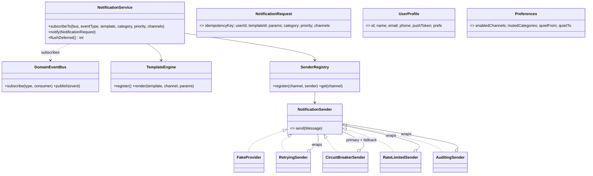
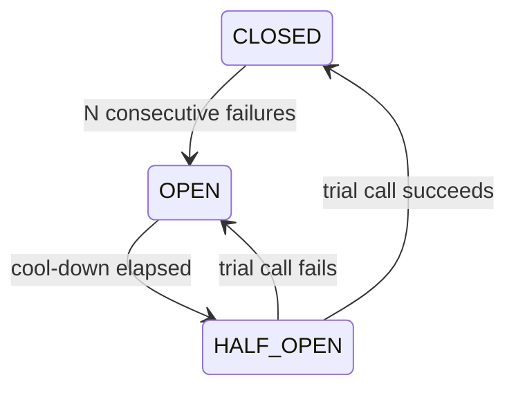

# LLD 15 · Notification System (email / SMS / push)

> Tier 3. It's the canonical **Observer + Strategy + Decorator** design: domain events trigger notifications, each channel is a strategy, and reliability features (retry, circuit breaker, rate limit, audit) are stackable decorators. It also covers user preferences, quiet hours, templates, channel fallback and dedupe.
> Code: [`NotificationSystem.java`](NotificationSystem.java). Run with `java NotificationSystem.java` (19 checks).

---

## 1. Clarifying questions

| Question | Assumption |
|---|---|
| Who triggers notifications? | Other services, via **domain events** (OrderShipped, OtpRequested), not direct calls |
| Channels? | Push, SMS, Email, possibly several providers per channel |
| User control? | Channel opt-in, category mute (marketing), quiet hours |
| Priority? | CRITICAL (OTP, fraud) ignores quiet hours and mutes; LOW (marketing) is deferred in quiet hours |
| Content? | Templates per (template, channel) with parameters |
| Reliability? | Retries for transient errors, a provider failover when one is down, no duplicates |
| Abuse? | Per-recipient rate limits (no SMS floods) |
| Delivery receipts / analytics? | Logged per (notification, channel); provider webhooks are an extension |

## 2. Requirements
**Functional:** subscribe to events → build requests → apply preferences → render templates → send through channels in fallback order → log the outcome; defer and flush on quiet hours.
**Non-functional:** a new channel or provider doesn't change the service; one failing provider doesn't take notifications down; an event delivered twice is sent once; provider rate limits and user experience are protected.

## 3. Thinking process
1. **Decouple producers.** The order service publishes `OrderShipped`; it must not know about SMS. An event bus (Observer / pub-sub) inverts the dependency.
2. **The pipeline** is a fixed sequence of policies: **dedupe → category mute → quiet hours → per channel (permission, address, template) → render → send → log**.
3. **Channels vary** → `NotificationSender` (a Strategy) resolved by a **registry/Factory**.
4. **Cross-cutting reliability** (retry, breaker, rate limit, audit, metrics) → **Decorators** around any sender. They're composable and each is testable alone, unlike a subclass explosion.
5. **Idempotency**: events are delivered at-least-once (Kafka, retries), so dedupe by the event id.
6. **Fail loudly in templates**: a missing parameter throws. Never send "Hi {{name}}".

## 4. Class diagram



**The SMS stack in the demo** (read outside-in):
```
Auditing( RateLimited( CircuitBreaker( primary = Retrying(twilio), fallback = msg91 ) ) )
```

## 5. Patterns used

| Pattern | Where | Why |
|---|---|---|
| **Observer / pub-sub** | `DomainEventBus` | Producers don't depend on notification code |
| **Strategy** | `NotificationSender` per channel/provider | Swap providers (SES ↔ SendGrid) |
| **Factory / registry** | `SenderRegistry` | Channel → configured sender |
| **Decorator** | Retry, CircuitBreaker, RateLimit, Audit | Composable cross-cutting behaviour |
| **Template Method (as a pipeline)** | `notify()` | A fixed order of policy checks |
| **Circuit Breaker** (resilience) | `CircuitBreakerSender` | Fail fast and fail over when a provider is down |

## 6. Circuit breaker states

While OPEN, the dead provider **is not called at all** (tested: its call count doesn't change), and traffic goes to the fallback provider (all 6 OTPs delivered via the backup).

## 7. Concurrency and reliability
- **Dedupe** with `ConcurrentHashMap.newKeySet().add(key)`, which is atomic: 8 threads sending 4,000 requests with repeated keys deliver each key exactly once (tested). In production: a dedupe table/Redis `SET NX` with a TTL.
- **Rate limiter** state per recipient, synchronised on that recipient's counter only.
- **Breaker state** guarded by its own monitor. The provider call happens outside the lock.
- **Production shape:** events → Kafka → notification workers (partitioned by user for per-user ordering) → per-channel queues (priority queues: CRITICAL drains first) → provider adapters. Delivery status comes back by provider webhooks.

## 8. Edge cases
An unknown user · a category muted vs SECURITY (can't be muted) · a channel disabled · no push token (fallback) · no template for a channel (skipped) · a missing template parameter (exception) · quiet hours wrapping midnight (22 → 7) · deferred requests passing dedupe when flushed · transient vs permanent provider failures · the rate limit window rolling over.

## 9. Extensions
- **Digests/batching**: combine LOW notifications into one daily email.
- **Localization**: templates keyed by (template, channel, locale); fall back to the default locale.
- **Delivery tracking**: provider webhooks → DELIVERED/BOUNCED; auto-disable bouncing emails.
- **A/B testing** of templates: a strategy choosing the variant.
- **Scheduling**: "send at 9 am user local time" via the Job Scheduler (LLD 13).
- **Per-provider cost routing**: cheapest healthy SMS provider per country (a strategy inside the breaker).

## 10. Interview Q&A

**Q1. Why an event bus instead of services calling the notification service directly?**
Loose coupling: producers just emit facts; new notifications (or other consumers like analytics) subscribe without touching producers. It also buffers spikes.

**Q2. How do you add WhatsApp as a channel?**
Add `Channel.WHATSAPP`, implement a `WhatsAppSender`, register it (optionally wrapped in decorators), and add templates. The service pipeline doesn't change.

**Q3. Why decorators for retry/rate-limit/circuit-breaker?**
Each concern is independent and needed in different combinations per channel. Decorators compose at wiring time; inheritance would need a subclass for every combination.

**Q4. How does the circuit breaker help?**
When a provider is down, retries pile up latency and load. The breaker fails fast after N failures, routes to a fallback, and probes periodically (half-open) to recover automatically.

**Q5. How do you avoid sending the same notification twice?**
Idempotency key = the source event id, recorded atomically before sending (or a unique constraint in a delivery table). Duplicates from at-least-once event delivery are dropped.

**Q6. How do you handle quiet hours?**
Compute the user's local time; LOW priority requests are deferred (stored) and flushed by a scheduler when quiet hours end; CRITICAL bypasses them.

**Q7. How do user preferences interact with security messages?**
SECURITY (OTP, password reset, fraud) can't be muted or disabled by channel preferences; it's a product and compliance rule encoded in the pipeline.

**Q8. Channel fallback: when do you stop?**
At the first successful channel in the request's ordered list (push → SMS → email). For some notifications you'd send on *all* channels instead; make that a per-template policy.

**Q9. How do you prioritise OTPs over marketing at scale?**
Separate queues / topics per priority with dedicated workers, so a marketing blast can't delay OTPs. Rate limiting for marketing, none for OTPs (but abuse limits per number).

**Q10. What would you monitor?**
Send success rate per provider, latency, breaker state changes, queue lag per priority, bounce/complaint rates, and dedupe hits.

## 11. Common mistakes
- Services calling SMS APIs directly.
- `if (channel == EMAIL) … else if (SMS)` inside one big method.
- Retries without backoff, or retrying permanent errors.
- No dedupe, so duplicate OTPs/emails.
- Letting a missing template parameter render as literal braces.
- One queue for everything (marketing delays OTPs).
