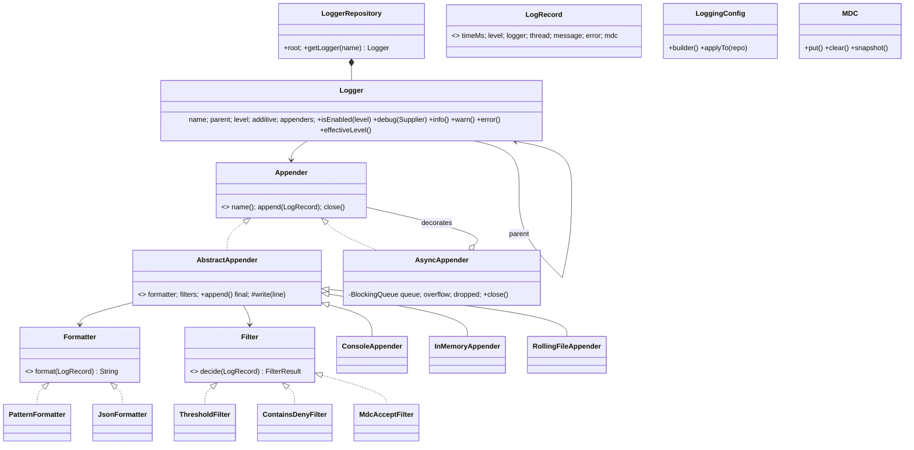

# LLD 16 · Logging Framework (Log4j / Logback style)

> Tier 3. It tests **extensibility** (appenders, formatters, filters as plug-ins), **Builder** configuration, a **hierarchical** logger tree with inheritance and additivity, a **Chain of Responsibility** for filters, a **Decorator** for async logging, and performance thinking (the disabled-log fast path, lazy messages, bounded queues).
> Code: [`LoggingFramework.java`](LoggingFramework.java). Run with `java LoggingFramework.java` (20 checks).

---

## 1. Clarifying questions

| Question | Assumption |
|---|---|
| Levels? | TRACE < DEBUG < INFO < WARN < ERROR < FATAL (+ OFF) |
| Per-package levels? | Yes: dotted names inherit from the nearest configured ancestor ("com.app.db" ← "com.app" ← ROOT) |
| Destinations? | Console, file (rolling by size + retention), in-memory (tests); more via a plug-in interface |
| Formats? | A pattern layout (`%d [%t] %p %c - %m`) and JSON (for ELK/Datadog) |
| Context? | Per-request context (requestId, userId) attached automatically: MDC |
| Performance? | Disabled logs must be ~free; slow I/O must not block request threads (async) |
| Thread safety? | Many threads log at once; lines never interleave |
| Config reload, remote shipping? | Extensions |

## 2. Requirements
**Functional:** `getLogger(name)`, level checks, log with/without throwable, multiple appenders per logger, additivity, filters, formatters, MDC, rolling files, async appender, fluent configuration.
**Non-functional:** a near-zero cost when disabled; thread-safe appends; bounded memory under bursts; no lost logs on shutdown (drain).

## 3. Thinking process
1. **Separate the four concerns:** *should we log?* (level + filters), *what is it?* (`LogRecord`), *how does it look?* (`Formatter`), *where does it go?* (`Appender`). Each is an interface, which is the core of Log4j's design.
2. **Hierarchy:** loggers form a tree by dotted names. The effective level is found by walking up; records propagate **up** to ancestors' appenders unless a logger is **non-additive**.
3. **The fast path:** `isEnabled` is one volatile read and compare. Messages are `Supplier<String>`, so a disabled call never builds the string (tested: 100,000 disabled calls, 0 suppliers evaluated).
4. **Filters** return ACCEPT / DENY / NEUTRAL; the first non-neutral decides (Chain of Responsibility). That allows "drop health checks, *but* keep everything for user=vip".
5. **I/O is slow** → an `AsyncAppender` decorator with a bounded queue and an explicit overflow policy (block vs drop), plus drain-on-close.
6. **The record is immutable**, with an MDC snapshot taken at the call site, so async appenders see the right context even on another thread.

## 4. Class diagram



## 5. Key flow: `logger.info("x")`
```
if !isEnabled(INFO): return                       // effective level from the nearest configured ancestor
record = LogRecord(now, INFO, name, thread, msg, err, MDC.snapshot())
for l = this; l != null; l = l.parent:
    for appender in l.appenders: appender.append(record)
        -> filters (first ACCEPT/DENY wins) -> format (outside the lock) -> synchronized write
    if !l.additive: break
```

## 6. Patterns used

| Pattern | Where | Why |
|---|---|---|
| **Strategy** | `Formatter`, `Appender`, `Filter` | Plug in new formats/destinations/rules |
| **Chain of Responsibility** | the filter list | Ordered, short-circuiting decisions |
| **Decorator** | `AsyncAppender(inner)` | Make any appender async without changing it |
| **Template Method** | `AbstractAppender.append` (final) → `write` | Filtering, formatting and locking written once |
| **Builder** | `LoggingConfig.builder()` | Readable, validated configuration applied in one go |
| **Factory + cache (Flyweight-like)** | `LoggerRepository.getLogger` | One instance per name, created lazily with parents |
| **Observer** | appenders receiving records | Many destinations per event |

## 7. Concurrency and performance
- **No locks on the hot path**: level reads are `volatile`; appender lists are `CopyOnWriteArrayList` (read on every call, written rarely).
- **Per-appender lock** only around the actual write, with formatting done before it, so lines never interleave (tested: 8 threads × 1,000 lines, all well-formed, and per-thread MDC never leaked).
- **The MDC is a `ThreadLocal`**: always clear it in `finally`, because pooled threads otherwise carry another request's id into unrelated logs.
- **Async:** BLOCK keeps every line (back-pressure); DROP protects latency and **counts** the losses (tested: a full queue with the caller never blocked). `close()` drains the queue: all 5,000 records were written in order.
- Real frameworks use a lock-free ring buffer (Log4j2 + LMAX Disruptor) for async logging.

## 8. Edge cases
A disabled level with an expensive message · a missing MDC key (`-`) · quotes/newlines in JSON (escaped, otherwise log parsers break) · a throwable attached · non-additive loggers · a rolling file at its size limit (roll + retention) · async queue overflow · shutdown with a pending queue · two threads calling `getLogger` for a new name at the same time (`computeIfAbsent` makes one instance).

## 9. Extensions
- **Hot reload** of config (watch a file, apply a new `LoggingConfig` atomically).
- **Time-based rolling** (daily) and compression of old files.
- **Remote appenders** (Kafka, HTTP) behind the async decorator, with batching.
- **Sampling** (log 1% of DEBUG in production) as a filter.
- **Markers** (SECURITY, AUDIT) routed to dedicated appenders.
- **Structured args**: `log.info("user {} paid {}", id, amount)` with deferred formatting.

## 10. Interview Q&A

**Q1. How do you make disabled log statements cheap?**
Check the level first (a volatile read + compare) and pass the message as a `Supplier` or parameterised template, so no string concatenation happens unless enabled.

**Q2. How does level inheritance work?**
Loggers form a tree by dotted names. A logger without its own level walks up to the nearest ancestor that has one; ROOT always has one.

**Q3. What is additivity?**
By default a record also goes to every ancestor's appenders. Setting `additive=false` stops propagation, useful when a subsystem writes to its own file and shouldn't duplicate into the root log.

**Q4. Why Chain of Responsibility for filters?**
Rules have priorities and need to short-circuit ("always keep this user", "drop health checks"). ACCEPT/DENY/NEUTRAL with first-decisive-wins expresses that cleanly and extensibly.

**Q5. Sync vs async appenders: trade-offs?**
Sync is simple and lossless but adds I/O latency to request threads. Async adds a queue (memory), possible loss on crash, and a policy for when the queue is full; it must drain on shutdown.

**Q6. What happens when the async queue is full?**
Choose: block the caller (no loss, latency spikes), drop new records (count and expose the drops), or drop lower levels first. Never grow without bound.

**Q7. How is MDC implemented, and what's the classic bug?**
A `ThreadLocal<Map>`. The bug: not clearing it in thread pools, so the next task on that thread logs the previous request's id. Also, async appenders need a **snapshot** of the MDC at log time.

**Q8. How do you keep lines from interleaving across threads?**
Build the whole line first, then write it under the appender's lock (or hand it to a single writer thread).

**Q9. Why JSON logs in production?**
Machine-parseable fields (level, requestId, userId) for search and aggregation in ELK/Datadog, without fragile regex parsing. Correct escaping is essential.

**Q10. Is the logger a Singleton?**
The *repository* is effectively one per application (often static for convenience); each logger is cached per name. Tests should be able to create isolated repositories, as this design does.

## 11. Common mistakes
- Building log strings before checking the level.
- One global `synchronized log()` method (all threads serialise).
- Unbounded async queues (OOM under bursts).
- Not draining async logs on shutdown.
- Forgetting MDC cleanup.
- Hand-written JSON without escaping.
