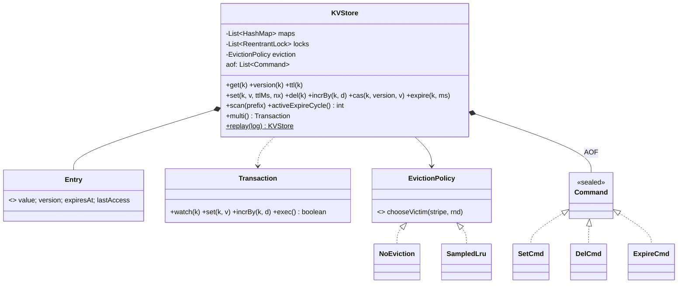

# LLD 17 · In-Memory Key-Value Store (a mini Redis)

> Tier 3. It tests **thread safety at scale** (lock striping vs Redis's single thread), **expiry** (lazy + active sampling), **pluggable eviction**, **atomic operations** (INCR, SET NX, CAS), **transactions** (WATCH/MULTI/EXEC, deadlock-free multi-key locking) and **persistence** (append-only log replay).
> Code: [`KeyValueStore.java`](KeyValueStore.java). Run with `java KeyValueStore.java` (26 checks).

---

## 1. Clarifying questions

| Question | Assumption |
|---|---|
| Value types? | Strings (counters are strings holding integers, like Redis) |
| Operations? | GET, SET (TTL, NX), DEL, INCRBY, CAS by version, EXPIRE, TTL, SCAN by prefix |
| Expiry precision? | Exact for reads (a key is gone *at* its deadline); memory reclaimed in the background |
| Memory limit? | Max keys; policy: reject writes (noeviction) or evict (sampled LRU) |
| Multi-key atomicity? | Transactions with optimistic WATCH |
| Persistence? | An append-only file of write commands; replay on restart |
| Concurrency? | Many client threads at once |
| Replication, clustering, pub/sub, data types (lists, sets)? | Extensions |

## 2. Requirements
**Functional:** the operations above plus transactions and AOF replay.
**Non-functional:** O(1) average per operation; no lost updates under concurrency; multi-key operations never deadlock; bounded memory; expired keys don't accumulate.

## 3. Thinking process
1. **The concurrency model is the first decision.**
   - *Redis:* one thread executes all commands sequentially (an event loop, like Node.js). No locks, every command is atomic, and it's very fast because operations are tiny and in memory. Scaling is by sharding across processes.
   - *Java (this design):* many threads, so partition the keyspace into **stripes**, each a `HashMap` with its own lock. Different stripes run in parallel; one key is always serialised by its stripe.
   - Why not just `ConcurrentHashMap`? Single-key ops would be fine (`compute`), but **multi-key transactions**, eviction (pick a victim, then remove) and AOF ordering need an explicit lock you can hold across several steps.
2. **Entries are immutable** (value, version, expiresAt, lastAccess). Every write creates a new entry with a new **version**, which enables CAS and WATCH.
3. **Expiry has two halves:**
   - *lazy*: check on access, giving exact semantics
   - *active*: sample keys with TTLs and delete the expired ones, which reclaims memory from keys nobody reads (Redis's algorithm: sample 20, repeat while > 25% were expired)
4. **Eviction is a Strategy**, chosen when a new key would exceed capacity. Sampled LRU (Redis's approach) avoids a per-key linked list: sample N keys and evict the oldest-accessed of them.
5. **Transactions**: record WATCHed versions; at EXEC, lock all involved stripes **in ascending order** (a global lock order means no deadlock), verify the versions, then apply all operations or none.
6. **Persistence by Command pattern:** every successful write appends a command record; replaying the log rebuilds state.

## 4. Class diagram

## 5. Key flows
- **set(k, v, ttl, nx):** lock the stripe → lazily expire k → NX and present? fail → new key and the stripe full? evict a victim (or reject) → put `Entry(v, ++version, expiry)` → append to the AOF.
- **incrBy:** the same lock; parse, add with overflow check, write a new version, **keep the TTL**.
- **cas(k, expectedVersion, v):** succeeds only if the current version matches (optimistic concurrency, like an HTTP ETag / `If-Match`).
- **exec():** sort the involved stripe ids → lock all → check watched versions → apply ops → append all commands to the AOF → unlock in reverse.

## 6. Patterns used

| Pattern | Where | Why |
|---|---|---|
| **Strategy** | `EvictionPolicy` | noeviction / allkeys-lru / volatile-ttl… configurable |
| **Command** | `SetCmd`, `DelCmd`, `ExpireCmd` (AOF) | Log, replay, replicate |
| **Lock striping** | stripes + locks | Parallelism with multi-key control |
| **Optimistic concurrency** | versions, CAS, WATCH | No locks held while the client thinks |
| **Immutable value object** | `Entry` record | Safe snapshots, version per write |

## 7. Concurrency
- 16 threads × 1,000 INCR → exactly 16,000 (no lost updates).
- 8 threads doing CAS retry loops → exactly 4,000.
- ~8,000 concurrent **multi-key transfer transactions** across random stripes: the total is conserved and nothing deadlocks, thanks to the ascending stripe lock order.
- **SET NX + TTL is a distributed-lock primitive** (`SET lock:job worker-1 NX PX 30000`). Discuss its limits: release must check ownership (compare the value, delete atomically), and clock or GC pauses can break mutual exclusion (Redlock debate; use fencing tokens).

## 8. Expiry and eviction details
- Lazy expiry makes reads exact; active expiry reclaimed all 5,000 dead keys without anyone reading them (tested).
- Sampled LRU (10 samples) kept 48/50 hot keys while evicting 40 (tested). True LRU would keep 50/50 but costs two pointers per key; the approximation is the classic memory/accuracy trade-off.
- Redis policies to mention: `noeviction`, `allkeys-lru`, `volatile-lru`, `allkeys-lfu`, `volatile-ttl`, `allkeys-random`.

## 9. Persistence options
| Option | How | Trade-off |
|---|---|---|
| **AOF** (implemented) | log every write; replay on start | durable (fsync policy: always / every second / OS), larger files → needs **rewrite/compaction** |
| **Snapshot (RDB)** | periodic full dump (fork + copy-on-write) | compact and fast restarts, loses the writes since the last snapshot |
| Both | snapshot + AOF tail | what production Redis often runs |

## 10. Extensions
- **Data types**: lists, sets, sorted sets (skip list, see DSA 12), hashes; a type tag in `Entry`.
- **Replication**: stream the AOF commands to replicas (async), with offsets for resync.
- **Cluster**: 16,384 hash slots across nodes; clients route by slot.
- **Pub/Sub, keyspace notifications** (e.g. on expiry).
- **Memory accounting** in bytes instead of a key count.

## 11. Interview Q&A

**Q1. Why is Redis single-threaded, and how does it stay fast?**
Operations are in-memory and tiny, so CPU isn't the bottleneck; network I/O and syscalls are. One thread avoids locks and context switches, and gives every command atomicity for free. Newer versions offload I/O to threads but still execute commands on one thread.

**Q2. How would you make it thread-safe in Java?**
Partition into lock stripes (or use `ConcurrentHashMap.compute` for single-key ops). Hold the stripe lock for read-modify-write operations (INCR, SET NX); for multi-key operations, lock stripes in a global order.

**Q3. How do you implement TTL expiry?**
Store an absolute `expiresAt`. Lazy: treat it as missing and delete it on access. Active: periodically sample keys with TTLs and delete the expired ones, repeating while the expired ratio is high. Both are needed.

**Q4. How do you implement INCR atomically?**
Read, parse, add and write under the key's lock (or in Redis's single thread). Never `get` then `set` from the client side.

**Q5. What is WATCH/MULTI/EXEC?**
Optimistic transactions: WATCH records versions; EXEC applies the queued commands atomically only if no watched key changed, otherwise it aborts and the client retries.

**Q6. How do you avoid deadlocks with multi-key operations?**
Acquire locks in one global order (ascending stripe index) and release them in reverse. Two transactions can never wait on each other in a cycle.

**Q7. Why sampled LRU instead of exact LRU?**
Exact LRU needs a linked list (two pointers per key) updated on every read, which is heavy and contended. Sampling 5–10 keys gets close to LRU behaviour with no extra per-key structure.

**Q8. AOF vs RDB?**
AOF: better durability, larger files, needs compaction. RDB: compact, fast restarts, but you lose recent writes on a crash. Combine them.

**Q9. Can SET NX implement a distributed lock?**
Yes, for many cases: `SET k owner NX PX ttl`; release with an atomic check-and-delete (a Lua script). For strict safety, add fencing tokens, because pauses and clock drift can let two holders overlap.

**Q10. How does this compare to an LRU cache (LLD 06)?**
The cache is a size-bounded, read-through helper. The KV store is a primary datastore: explicit writes, TTLs, atomic operations, transactions, persistence. Eviction is optional there (`noeviction` is a valid production setting).

## 12. Common mistakes
- Plain `HashMap` with `synchronized` on every method (correct, zero parallelism).
- Client-side read-modify-write for counters.
- Only lazy expiry (a memory leak of unread keys) or only active expiry (stale reads).
- Locking multiple keys in arbitrary order (deadlocks).
- Losing the TTL on INCR/overwrite without intending to.
