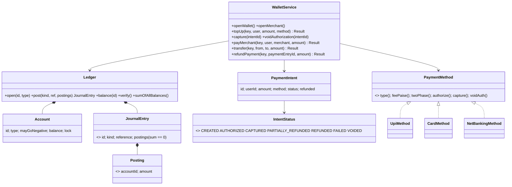
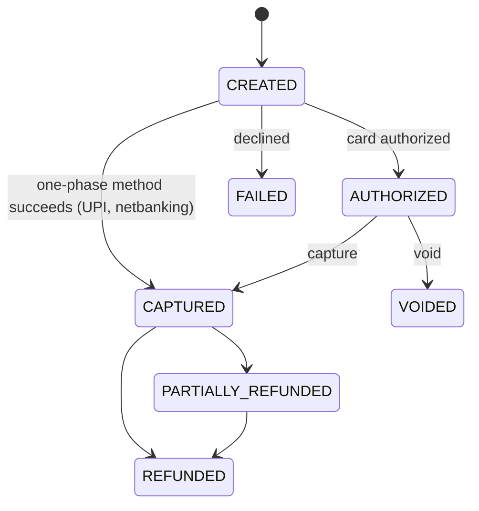

# LLD 18 · Payment Gateway + Wallet

> Tier 3, and very relevant to fintech backgrounds (FIS-style domains). It tests **money correctness**: integer amounts, a **double-entry ledger** whose entries always sum to zero, **idempotency** for retries, payment methods as a **Strategy** (UPI / card auth+capture / netbanking), a **payment intent state machine**, refunds as reversing entries, and deadlock-free concurrent transfers.
> Code: [`PaymentWalletSystem.java`](PaymentWalletSystem.java). Run with `java PaymentWalletSystem.java` (29 checks, including 16,000 concurrent requests with duplicate retries).

---

## 1. Clarifying questions

| Question | Assumption |
|---|---|
| Wallet or pure gateway? | A wallet (stored balance) funded through external methods, used for merchant payments and P2P |
| Payment methods? | UPI (instant, no fee), Card (authorize then capture, 2% fee), Netbanking (flat fee). More will come |
| Fees? | Method fees on top-ups; a platform fee (bps) on merchant payments |
| Refunds? | Full or partial; never more than paid |
| Retries? | Clients **will** retry (timeouts, double clicks): every mutating call takes an idempotency key |
| Currency? | One currency (INR) in paise; multi-currency is an extension |
| Negative balances? | Never for users/merchants; only system accounts (the external world) |
| Chargebacks, settlement files, KYC limits? | Discussed as extensions |

## 2. Requirements
**Functional:** open wallets/merchants; top up via a method; capture/void card authorizations; pay merchants; P2P transfer; refunds; balances.
**Non-functional:** **money is never created or destroyed** (provable); retries are safe; concurrent transfers never deadlock or overdraw; full audit trail; new methods are plug-ins.

## 3. Thinking process
1. **Money representation:** `long` paise. `double` can't represent 0.1, and rounding errors accumulate into real money.
2. **Double-entry bookkeeping:** instead of `a -= x; b += x`, record a **journal entry** with postings that **sum to zero**. Consequences:
   - `Σ all balances = 0` at all times (the outside world is a SYSTEM account that goes negative as money enters).
   - Balances are a cache; they can always be recomputed from the immutable journal (`verify()`).
   - Fees, splits and refunds are just more postings in the same entry: atomic by construction.
3. **Refunds never edit history.** They're new entries that reference the original payment, with checks against over-refunding and a proportional split of the merchant and fee shares.
4. **Payment methods vary** in rails, fees and phases → `PaymentMethod` Strategy + a registry by type.
5. **Cards are two-phase:** *authorize* reserves funds at the bank, *capture* moves them. *Void* releases an authorization. Model it with `PaymentIntent` and a validated state machine.
6. **Idempotency:** store `key → result future`. Duplicates (even concurrent ones) get the first result, including failures.

## 4. Class diagram

## 5. The journal entries (what to draw on the whiteboard)

| Operation | Postings (sum = 0) |
|---|---|
| Top-up ₹200 by card (2% fee) | external −20000, wallet +19600, fees +400 |
| Pay merchant ₹500 (2% platform fee) | wallet −50000, merchant +49000, fees +1000 |
| P2P ₹90 | sender −9000, receiver +9000 |
| Refund ₹200 of that payment | wallet +20000, merchant −19600, fees −400 |

## 6. Patterns used

| Pattern | Where | Why |
|---|---|---|
| **Strategy + registry (Factory)** | `PaymentMethod` by `MethodType` | New rails without touching the wallet logic |
| **State machine** | `IntentStatus.canGoTo` | Capture after void, or refund before capture, are impossible |
| **Idempotency key** | `idempotent(key, op)` | Safe retries, including concurrent duplicates |
| **Event sourcing / ledger** | append-only `journal` + derived balances | Audit, recomputation, reconciliation |
| **Value objects** | `Posting`, `JournalEntry`, `Result` records | Immutable facts; validation in the constructor |
| *Template-like flow* | top-up: authorize → (capture) → post | Each method fills in the steps |

## 7. Concurrency
- `Ledger.post` locks **every involved account in sorted id order** (a global order, so no deadlock), checks the balances of non-system accounts, applies all postings, and appends to the journal, all inside the critical section.
- Tested: 16 threads × 500 random transfers among 10 wallets, **each sent twice** → no deadlock, no negative wallet, total conserved, exactly one journal entry per successful transfer, and the ledger verifies.
- Idempotency uses `putIfAbsent` of a future, so the second concurrent duplicate waits for the first instead of executing.
- **In a database:** one transaction inserts the journal entry and postings and updates the balances with `UPDATE accounts SET balance = balance + ? WHERE id = ? AND (balance + ? >= 0 OR may_go_negative)` (check the row counts), locking rows in id order. Idempotency keys go in a table with a unique constraint, holding the response.

## 8. Edge cases
Non-positive amounts · a transfer to self · an unsupported method · a declined authorization · capture twice / capture after void · insufficient funds (and that *failure* is idempotent too) · over-refund · partial refund rounding (merchant share rounded, fee share = remainder, so the entry still sums to zero) · an unbalanced entry (impossible to construct).

## 9. Extensions
- **Gateway webhooks & reconciliation**: daily settlement files from banks are matched with `providerRef`s; mismatches go to a review queue.
- **Pending/holds**: an `available` vs `ledger` balance (authorizations reduce available).
- **Chargebacks**: an entry merchant → wallet with a dispute workflow (a state machine).
- **Multi-currency**: per-currency accounts; FX conversion as an entry through an FX system account.
- **Limits & KYC**: per-user daily/monthly limits as a validation chain before posting.
- **Outbox**: emit `PaymentSucceeded` events in the same DB transaction as the journal entry.
- **Saga for multi-service flows** (order → payment → inventory): compensations = refunds.

## 10. Interview Q&A

**Q1. Why double-entry instead of updating two balances?**
Each entry is self-balancing and atomic, so money can't be created or lost by partial updates. Σ balances = 0 is a checkable invariant, and balances are re-derivable from an immutable journal for audit.

**Q2. How do you guarantee a retried payment isn't charged twice?**
An idempotency key per client request; the server stores key → result (unique constraint) and returns the stored result for duplicates, even concurrent ones. The gateway call uses the intent id as its own idempotency key.

**Q3. Authorization vs capture?**
Authorization reserves funds on the card without moving money; capture moves it (possibly a different, lower amount); void cancels the reservation. Hotels, ride-hailing and e-commerce (capture on shipping) use this.

**Q4. How do you implement refunds?**
As a new entry reversing (part of) the original, referencing it. Check the cumulative refunds ≤ the original amount and split the reversal between the merchant and the fee proportionally. History is never mutated.

**Q5. How do you avoid deadlocks in transfers?**
Always lock the accounts in a global order (sorted by id), regardless of the transfer direction. In SQL, order the `SELECT … FOR UPDATE` by id.

**Q6. Why must money be `long` minor units?**
Binary floating point can't represent decimal fractions exactly; errors accumulate (0.1 + 0.2 ≠ 0.3). Integers in the smallest unit (or `BigDecimal` with an explicit scale) are exact.

**Q7. How do you prove the system is consistent?**
Invariants: every entry sums to 0; Σ all balances = 0; cached balances equal those recomputed from the journal. Run them continuously as reconciliation jobs, and also against external bank statements.

**Q8. What happens if the bank charged the user but our service crashed before crediting the wallet?**
The intent stays CREATED or AUTHORIZED with a providerRef. A reconciliation job (or the bank's webhook) finds charged-but-not-credited intents and completes them idempotently (same intent id → same entry).

**Q9. How do you add a new payment method (e.g. BNPL)?**
Implement `PaymentMethod` (authorize/capture/fee/phases), register it, done. The ledger and the wallet logic don't change.

**Q10. Can wallet balances go negative?**
Not user or merchant wallets: the ledger rejects such an entry atomically. System accounts represent external counterparties and are allowed to.

## 11. Common mistakes
- `double` money; independent balance updates.
- Mutating or deleting ledger rows for refunds.
- No idempotency, or idempotency that only covers successes.
- Locking accounts in request order (deadlocks under opposite transfers).
- Crediting the wallet at card authorization instead of capture.
