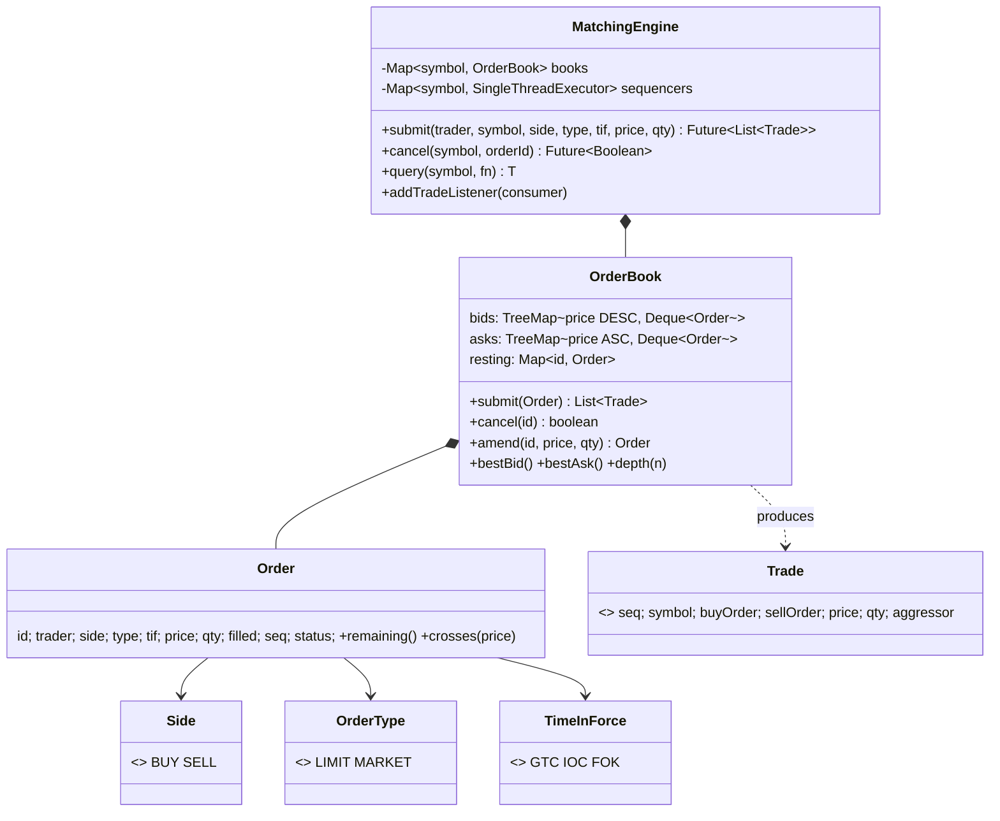

# LLD 19 · Stock Exchange Order Matching Engine

> Tier 3, a heavier problem, common at trading-adjacent companies. It tests the right **data structures** (sorted price levels + FIFO queues), the **price-time priority** algorithm, order types and **time-in-force** semantics, cancel/amend rules, and the **single-threaded sequencer** concurrency model used by real exchanges (LMAX).
> Code: [`OrderMatchingEngine.java`](OrderMatchingEngine.java). Run with `java OrderMatchingEngine.java` (20 checks, including 300 random sessions cross-checked against a naive reference matcher).

---

## 1. Clarifying questions

| Question | Assumption |
|---|---|
| Instruments? | Many symbols, each with an independent order book |
| Order types? | LIMIT and MARKET |
| Time in force? | GTC (rest until cancelled), IOC (fill what you can, cancel the rest), FOK (fill completely now or nothing) |
| Matching rule? | **Price-time priority**; trades execute at the **resting (maker) order's price** |
| Partial fills? | Yes |
| Cancel / modify? | Cancel; amend where *reducing quantity keeps priority*, but a price change or quantity increase loses it |
| Output? | A trade feed (Observer) plus market data (best bid/ask, depth) |
| Stop orders, auctions, self-trade prevention, fees, risk checks? | Extensions |

## 2. Requirements
**Functional:** submit/cancel/amend; match per the rules; publish trades; report the top of book and depth.
**Non-functional:** deterministic (the same input sequence gives the same trades); low latency (O(log P) to find the best price, O(1) to dequeue at a level); the book is never crossed; no overfills; many clients submit concurrently.

## 3. Thinking process
1. **The data structure *is* the design.** An order book side is a map **price → FIFO queue of orders**, sorted best-first:
   - bids: `TreeMap` with a **descending** comparator (highest buyer first)
   - asks: `TreeMap` ascending (lowest seller first)
   - `firstEntry()` = best price in O(log P); `peekFirst()` on the level = earliest order (time priority).
2. **The matching loop:** while the incoming order has quantity and the best opposite price *crosses* (buy price ≥ ask, sell price ≤ bid, or MARKET): trade `min(remaining, makerRemaining)` at the maker's price, pop filled makers, drop empty levels.
3. **After the loop the time-in-force decides:** GTC limit → rest the remainder at its price; IOC/MARKET → cancel the remainder; **FOK** → check available crossing liquidity *before* touching the book (all or nothing).
4. **Cancel/amend** need an `id → order` index. Amend rules mirror exchanges: reducing quantity is harmless to others, so priority is kept; anything else is cancel + new.
5. **Concurrency:** don't lock the book. Put **one sequencer thread per symbol** in front of it. Commands are queued and applied strictly in order, which gives determinism, no locks and replayability. Symbols scale in parallel.
6. **Prices are integers** (ticks/paise), never `double`: exact comparisons and map keys.

## 4. Class diagram

## 5. Worked example (section 1 of the demo)

Asks resting: `A 50@100`, `B 50@100`, `C 100@101`, then `D 10@99` (better price, arrived last).
Incoming **BUY 80 @ 100** → `10@99 (D)`, `50@100 (A)`, `20@100 (B)`. Then 100 no longer has a seller with quantity left for the buyer, and 101 doesn't cross. B keeps 30 at the front of the 100 level.

## 6. Patterns and techniques

| Technique | Where | Why |
|---|---|---|
| **Sorted map of FIFO queues** | `bids` / `asks` | Price priority (map order) + time priority (queue order) |
| **Single-writer sequencer** (actor / LMAX) | one `SingleThreadExecutor` per symbol | Determinism, no locks, replayable from the input log |
| **Observer** | trade listeners | Market data, clearing, risk, audit consume trades |
| **Command queue** | submit/cancel as tasks | Ordered processing; easy to journal |
| **Reference implementation testing** | `naive()` | A slow, obviously-correct matcher validates the fast one on random inputs |

## 7. Concurrency and correctness
- Many client threads submit; each symbol's commands run on **its own single thread**, in arrival order. Order validation happens on the caller thread (it's cheap to reject bad input before the sequencer).
- Reads (`query`) also run on the sequencer, so they see a consistent book.
- **Invariants checked:**
  - the trades are identical to the reference matcher over 300 random sessions with mixed order types and TIFs
  - the book is never crossed (best bid < best ask after every order)
  - Σ buyer fills = Σ seller fills = Σ trade quantity, and no order is overfilled
  - with 8 concurrent clients on 2 symbols, every book is consistent and the trade feed matches each book
- Real exchanges: input commands are journaled before matching; the matching thread is pinned to a core; ring buffers replace queues (LMAX Disruptor); hot standbys replay the journal for failover.

## 8. Complexity
| Operation | Cost |
|---|---|
| best price | O(log P) (`firstEntry`), or O(1) with a cached best |
| match one fill | O(1) dequeue + O(log P) when a level empties |
| add resting order | O(log P) + O(1) |
| cancel | O(log P) + O(level size) with `ArrayDeque.remove`; **O(1)** with an intrusive doubly-linked list per level plus id → node (production) |

## 9. Edge cases
A market order on an empty book (fully cancelled) · IOC partially filled · FOK with exactly enough or not enough liquidity (nothing traded when short) · cancelling a filled or unknown order · amend down vs up · a level emptying mid-sweep · equal prices (FIFO) · non-positive price/quantity (rejected before sequencing).

## 10. Extensions
- **Stop / stop-limit orders**: a separate trigger book keyed by stop price; triggered on last-trade price.
- **Self-trade prevention**: if the maker and taker have the same trader, cancel the resting/incoming order (a policy option).
- **Auctions** (open/close): collect orders, compute the price that maximises executed volume, then match.
- **Iceberg orders**: show part of the quantity and replenish it from a hidden reserve (loses time priority on each replenish).
- **Risk checks** before sequencing: buying power, position limits, fat-finger price bands.
- **Market data levels**: L1 (top of book), L2 (depth by price), L3 (every order).

## 11. Interview Q&A

**Q1. Which data structure for the order book?**
For each side, a sorted map from price to a FIFO queue (bids descending, asks ascending), plus an id → order index for cancels. Best price is the first entry; time priority is the queue order.

**Q2. At what price does a trade execute?**
The resting (maker) order's price. An aggressive buy at 105 that meets an ask at 100 trades at 100: the price improvement goes to the aggressor.

**Q3. IOC vs FOK?**
IOC fills whatever it can immediately and cancels the rest. FOK fills the entire quantity immediately or does nothing, so you must check liquidity before executing.

**Q4. Why is the matching engine single-threaded?**
Matching is sequential by nature (each order depends on the book state the previous one left). One thread per instrument removes lock contention, gives deterministic replay, and is extremely fast with in-memory structures. Parallelism comes from many instruments.

**Q5. How do you make cancel O(1)?**
Store each order in an intrusive doubly-linked list per price level, with a hash map from id to node; unlink in O(1) and drop the level when empty.

**Q6. Why does amending quantity down keep priority but up doesn't?**
Reducing only gives up liquidity and can't disadvantage anyone behind. Increasing (or changing price) would let you jump ahead of orders that arrived earlier, so it's treated as a new order.

**Q7. How do you test a matching engine?**
Scenario tests for each rule, plus property tests: compare with a naive reference matcher on random order streams, and check invariants (never crossed, fills conserved, no overfill, determinism under replay).

**Q8. How would you recover after a crash?**
Journal every input command (sequence-numbered) before applying it; on restart, replay the journal (or load a snapshot + the tail). Determinism guarantees the same book and trades.

**Q9. How do you handle 1 million orders per second?**
Pin the sequencer thread, use pre-allocated ring buffers (no GC), primitive collections, batch I/O for journaling and market data, kernel-bypass networking. The algorithm stays the same.

**Q10. Why integer prices?**
Prices are on a tick grid; integers give exact equality and ordering (as map keys) and fast arithmetic. Floating-point keys can split one price level into two.

## 12. Common mistakes
- One sorted list of all orders re-sorted per incoming order.
- Executing at the aggressor's price.
- FOK implemented as "try, then roll back".
- Locks around a shared book with many threads matching.
- `double` prices as map keys.
